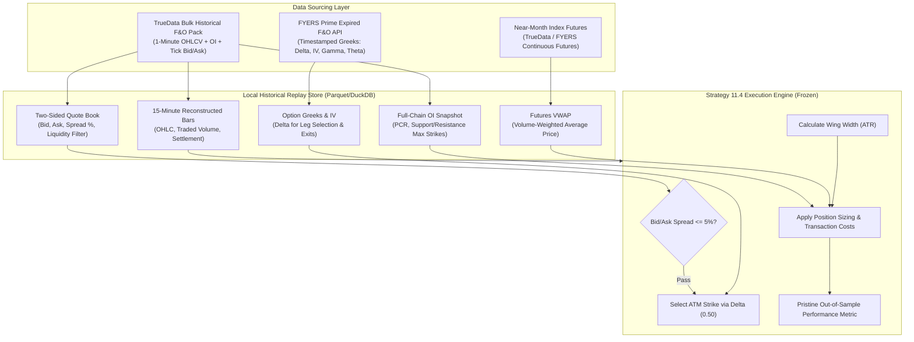

# Phase 7: Historical Data Provider Feasibility Report
## Out-of-Sample Historical Options Data for Strategy 11.4 Validation

**Date:** 2026-11-16  
**Project:** Upstox Options Analyzer  
**Phase:** Phase 7 — Historical Data Provider Feasibility  
**Status:** COMPLETE (FEASIBILITY RESEARCH ONLY — ZERO COMMITMENTS, ZERO PURCHASES)  
**Safety & Operational Constraints:**
- **Zero API Invocations:** No live Upstox API requests, token refreshes, or live market socket connections were made.
- **Zero Financial Commitments:** No subscriptions, paid licenses, or data vendor agreements were entered into.
- **Engine Frozen:** Strategy 11.4 rules, formulas, spread parameters, and the 1% account risk limit remain strictly frozen.
- **Git Tree Preserved:** All 8 landed closeout commits (`042cf0bd` through `8cc06534`) and all unstaged working-tree entries remain intact.
- **Production Status:** Strictly **HARD NO-GO** (Production Readiness Score: 11.25%).

---

## 1. Executive Summary & Problem Formulation

### 1.1 The Validation Deficit
The engineering closeout for the Upstox Options Analyzer established a stable, verified application core (Application Engineering Score: **66.50%**). However, Strategy Validation remains arrested at **28.75%** because the project lacks the historical options data required to execute a faithful, scientifically valid out-of-sample backtest of **Strategy 11.4** (Directional Index Option Debit Spreads).

The project currently holds:
1. **Upstox Intraday Equity/Index Bars:** Intraday 1-minute bars from 2022 onwards, but underlying index candles carry **zero volume** (preventing VWAP calculation).
2. **NSE Daily F&O Bhavcopy:** 603 sessions (2024-06-03 to 2026-11-05; 22.47 million rows). Contains EOD settlement prices, total volume, and EOD open interest. It completely lacks intraday timestamps, bid/ask quotes, and Greeks.
3. **Upstox Expired Options Candle Pilot:** Sampled 14-day windows ending on expiry for 52 legs (4,859 bars). Contains OHLC and contract OI, but lacks bid/ask quotes, Greeks, and full-chain snapshots.

### 1.2 Strategy 11.4 Data Requirements (Frozen Engine Specification)
Inspection of `web/src/lib/engine/strategy.ts`, `analysis.ts`, and `opportunityEngine.ts` confirms that Strategy 11.4 is not a generic price-action system; it evaluates seven specific data fields at each decision interval:

| Field Required by Engine | Code Location | Functional Purpose in Strategy 11.4 | Consequence if Missing / Approximated |
| :--- | :--- | :--- | :--- |
| **1. Historical Bid & Ask Quotes** | `strategy.ts:159-163` | Enforces two-sided quote check and strict `(ask - bid) / ltp <= 5%` spread filter; models realistic fill execution (buying ask, selling bid). | Without bid/ask, spread-filter rejections cannot be simulated, artificially inflating win rates and understating friction. |
| **2. Full-Chain Open Interest & ΔOI** | `analysis.ts:35-64` | Locates market support (strike with max Put OI) and resistance (strike with max Call OI); computes Put-Call Ratio (`pcrOi`) and net OI shift (`oiD`). | Per-contract OI cannot identify the maximum OI strikes across the chain. Partial chains corrupt the PCR and room-to-run indicators. |
| **3. Option Greeks (Specifically Delta & IV)** | `strategy.ts:24-28, 59-63` | `nearestDelta(s, type, 0.5)` selects ATM entry leg; Delta computes target exit moves: `move = |delta| * atr`. | Without Delta, ATM strike selection fails and profit targets cannot be calculated per specification. |
| **4. Option OHLCV (15-min / 1-min)** | `candles.ts:7`, `strategy.ts:60` | Evaluates premium entry price, trailing stops (`0.5 * debit`), and profit targets (`0.5 * maxProfit`). | Essential for trade lifecycle simulation. |
| **5. Underlying Index & Futures Volume (VWAP)** | `analysis.ts:97-103`, `strategy.ts:178` | Computes Futures Volume-Weighted Average Price (VWAP) trend factor. Index candles carry 0 volume. | Without near-month futures volume, VWAP factor evaluates to stale/neutral, altering signal scores. |
| **6. Contract Master & Metadata** | `strategy.ts:17-19` | Maps strike intervals, lot sizes, weekly vs. monthly expiries, and freeze limits. | Incorrect strike steps corrupt wing-width calculation (`Math.ceil(atr / strikeStep) * strikeStep`). |
| **7. Multi-Year Historical Depth** | Validation Protocol P1 | Dedicated in-sample training window (e.g. 2021–2023) and an uncompromised, sealed out-of-sample holdout (2025–2026). | Short windows (e.g. 14 days) suffer from extreme sample bias and regime overfitting. |

---

## 2. In-Depth Provider Evaluations

### 2.1 Upstox (Current Broker Platform)
* **Access Method:** REST API (`/v2/historical-candle/`, `/v2/option/chain`, `/v3/market-quote/quotes`).
* **Available Fields:**
  - Historical OHLCV and open interest on expired options (available only on the **Plus Plan**; Basic Plan returns error `UDAPI1149`).
  - Underlying index candles (OHLC) from 2022.
* **Missing / Inoperable Fields:**
  - **No historical bid/ask quotes:** Historical candle endpoints return only trade summary arrays (`[timestamp, open, high, low, close, volume, open_interest]`). Order book depth and bid/ask spreads are discarded post-session.
  - **No historical Greeks:** Greeks and IV are computed dynamically only on the live `/v2/option/chain` endpoint and carry no historical storage.
  - **No historical full-chain snapshots:** There is no endpoint to fetch the state of an entire option chain at a historical timestamp. Reconstructing a chain requires querying 40+ individual contract keys per timestamp.
  - **No contract listing dates:** The contract master response omits listing dates, preventing automated calculation of contract lifetimes.
  - **Zero index volume:** Upstox index candles have `volume: 0`, making index VWAP impossible without separate futures candles.
* **Licensing & Research Terms:** Upstox API Terms of Service govern usage. Intended strictly for personal trading, proprietary backtesting, and automated execution. Commercial redistribution or sub-licensing is prohibited.
* **Cost Structure:** Brokerage is ₹20/order (Basic) or ₹30/order (Plus). API access is free/bundled with account opening, but requires maintaining an active funded demat account.
* **Feasibility Verdict:** **INFEASIBLE ON ITS OWN**. Upstox cannot supply historical bid/ask quotes, historical Greeks, or full-chain historical snapshots.

---

### 2.2 NSE Data & Analytics Limited (Official Exchange Vendor)
* **Access Method:** Secure Automated SFTP / Encrypted Physical Hard Drive Shipments.
* **Available Fields:**
  - **EOD Historical F&O Bhavcopy:** Daily summary of contract-wise open, high, low, close, settlement price, total contracts traded, total turnover, open interest, and change in open interest.
  - **1-Minute / 5-Minute Snapshot Feed:** Periodic snapshots capturing top 5 bid/ask market depth, cumulative volume, and open interest across all listed derivatives contracts.
  - **Historical Order & Trade Data (Tick-by-Tick / Level 3):** Microsecond-precision logs of every order entered, modified, canceled, and executed across all F&O instruments from January 2008 onwards. Complete order book reconstruction allows 100% accurate bid/ask spread and slippage modeling.
  - **Futures Data:** Complete historical price and volume for all index and equity futures contracts (solving the VWAP data gap).
* **Missing / Inoperable Fields:**
  - **No historical Option Greeks:** Official NSE Technical Specification (`Snapshot 15 FAO v1.7`) documents that Option Greeks are generated solely on the real-time Analytical Feed; they are **not** present in historical order/trade logs or snapshot archives. Greeks must be computed post-hoc.
* **Coverage & Granularity:** January 2008 to present (18+ years of complete exchange archives). Granularity down to microsecond ticks or 1-minute aggregations.
* **Licensing & Restrictions:** Formal NSEIL Data Vending Agreement. Strict domestic vs. international site licensing. Users must sign intellectual property declarations and agree to exchange audit rights. Redistribution or third-party sharing is strictly forbidden.
* **Cost Structure (Official Domestic Tariff):**
  - **Historical Order & Trade Data (F&O Segment):** **₹12,50,000 per annum + 18% GST** (Total: **₹14,75,000 / year**) for a single domestic site.
  - **1-Minute Snapshot Data (F&O Segment):** **₹16,00,000 per annum + 18% GST** (Total: **₹18,88,000 / year**).
  - **5-Minute Snapshot Data (F&O Segment):** **₹4,20,000 per annum + 18% GST** (Total: **₹4,95,600 / year**).
  - **1-Minute Snapshot (15-Minute Delayed Archive):** **₹1,20,000 per annum + 18% GST** (Total: **₹1,41,600 / year**).
* **Feasibility Verdict:** **AUTHORITATIVE BUT COMMERCIALLY PROHIBITIVE**. While it provides the gold standard for institutional backtesting, the ₹14.75 Lakh+ annual license fee and multi-terabyte data processing overhead make it excessive for the current validation phase. Furthermore, Greeks are still omitted.

---

### 2.3 FYERS (Broker API v3 — Dedicated Expired F&O Endpoint)
* **Access Method:** REST API v3 (`https://api-t1.fyers.in/data`).
* **Available Fields:**
  - **Dedicated Expired Data Endpoint:** `/data/history/fno/expired/data` accepts symbol, resolution, date range, `include_oi`, and `include_greeks`.
  - **Candle Resolutions:** 5 seconds (`"5S"`), 1-minute (`"1"`), 2m, 3m, 5m, 10m, 15m, 30m, 60m, and daily (`"1D"`).
  - **Open Interest:** Included directly per candle when passing `include_oi=1`.
  - **Historical Option Greeks:** Included directly per candle when passing `include_greeks=1`. Returns timestamped:
    - Implied Volatility (`iv`)
    - Delta (`delta`)
    - Gamma (`gamma`)
    - Theta (`theta`)
    - Vega (`vega`)
  - **Helper Discovery Endpoints:** `/data/history/fno/expired/expiry-dates` and `/data/history/fno/expired/contracts` provide complete lists of all contracts that existed for any historical expiry.
  - **Futures Volume:** Full intraday and daily history for index futures contracts (providing exact volume for VWAP).
* **Missing / Inoperable Fields:**
  - **No historical Bid/Ask quotes:** Like standard candle APIs, the expired candle response only returns trade summaries (`open, high, low, close, volume, oi, iv, delta, gamma, theta, vega`). Bid and ask prices and order book depth are omitted.
  - **No atomic full-chain snapshot:** Each contract must be requested separately. Reconstructing a 40-strike chain requires 40 distinct HTTP calls per interval.
* **Coverage & Granularity:**
  - Raw exchange archives available from **October 10, 2018** (NSE F&O).
  - Accessible depth: Standard Plan provides up to 2 years daily; Prime Plan provides **7+ years** of daily and deep intraday history.
* **Rate Limits & Account Tiers:**
  - **Standard Plan (Free):** Expired F&O Intraday requests are severely restricted to **10 requests per day**. This hard cap completely prevents automated backtesting or full-chain data acquisition.
  - **Prime Plan:** Unlocks 10 requests/second, 500 requests/minute, and 500,000 requests/day. Allows systematic automated acquisition of historical chains. Exceeding limits returns HTTP 429; crossing per-minute limits >3 times triggers a daily IP block.
* **Licensing & Research Terms:** Personal trading and quantitative research permitted under FYERS API terms. Commercial redistribution prohibited.
* **Cost Structure:**
  - **Standard Account:** Free brokerage account (₹20/order).
  - **FYERS Prime Membership:** **₹499 per month + 18% GST** (₹588.82/mo) or **₹4,990 per year + 18% GST** (Total: **₹5,888.20 / year**).
* **Feasibility Verdict:** **HIGH VALUE FOR GREEKS & OHLCV+OI; PARTIALLY FEASIBLE OVERALL**. Provides an outstanding, low-cost source for historical option Greeks, OI, and 15-minute OHLCV, but cannot independently verify the 5% bid/ask spread filter.

---

### 2.4 TrueData (NSE-Authorized Market Data Vendor)
* **Access Method:** REST API, WebSocket streaming, and Bulk Historical Archives (CSV / Cloud Storage Sync).
* **Available Fields:**
  - **Historical Bar Data (REST & Bulk):** 1-minute, 5-minute, 15-minute, and EOD bars containing:
    `['Timestamp', 'Open', 'High', 'Low', 'Close', 'Volume', 'OpenInterest']`
  - **Historical Tick Data with Bid/Ask:** Setting parameter `bidask=true` on tick endpoints returns:
    `['Timestamp', 'LTP', 'TickVolume', 'OpenInterest', 'Bid', 'BidQty', 'Ask', 'AskQty']`
  - **Expired Contracts Archive:** Dedicated historical database covering expired options and futures contracts across all NSE strikes and expiries.
  - **Index Futures Volume:** Full historical futures series with tick and minute volume for exact VWAP calculation.
* **Missing / Inoperable Fields:**
  - **API Tick Window Restriction:** The programmatic REST tick API is restricted to a rolling window of recent trading days (typically 5 days) due to massive data volume.
  - **Bulk Delivery Required for Deep Tick History:** Accessing multi-year historical bid/ask quotes requires procuring their offline bulk historical database packs (delivered via CSV / cloud drive) rather than on-demand REST API queries.
  - **Option Greeks in Bulk History:** Real-time option chains include live Greeks, but bulk historical CSV archives generally provide the raw inputs (underlying price, strike, expiry, premium, OI) rather than pre-calculated Greeks.
* **Coverage & Granularity:** Tick-level, 1-minute, and EOD history going back 5 to 10+ years across all NSE F&O contracts.
* **Licensing & Restrictions:** Official NSE Data Vendor Agreement. Licensed for internal analytical, algorithmic development, and quantitative backtesting use. Commercial resale or redistribution is prohibited.
* **Cost Structure:**
  - **Base Historical API / Velocity Subscription:** ~₹2,599 to ₹3,999 per month + 18% GST (~₹31,000 to ₹48,000 / year).
  - **Specialized Historical F&O Options Pack (Bulk 1-Min / Tick Archive):** Custom commercial packaging typically priced between **₹15,000 and ₹45,000 + 18% GST** (one-time or annual dataset fee depending on requested years and contract depth).
* **Feasibility Verdict:** **HIGHEST OVERALL COMMERCIAL FEASIBILITY**. TrueData is the most accessible authorized vendor capable of providing true historical bid/ask quotes alongside 1-minute OHLCV and open interest.

---

### 2.5 Global DataFeeds (GDFL — NSE-Authorized Vendor)
* **Access Method:** NimbleData API (.NET, COM, REST, WebSocket) and charting terminal plugins (AmiBroker, Excel).
* **Available Fields:** 1-minute OHLCV with Open Interest; underlying and futures volume; contract master.
* **Limitations:**
  - Bid and ask quotes are treated as "stateless" live variables; standard historical archives store only OHLCV and OI.
  - Historical intraday options data across the full strike chain is typically restricted to a rolling 1-month window in standard subscriptions; multi-year archives require custom institutional agreements.
* **Cost:** Variable custom quote (typically ₹2,500 to ₹4,000/month for retail feeds; historical archives quoted separately).
* **Feasibility Verdict:** **PARTIALLY FEASIBLE (SECONDARY ALTERNATIVE TO TRUEDATA)**.

---

### 2.6 ICICI Direct (Breeze API)
* **Access Method:** REST API & Python SDK (`breeze-connect`).
* **Available Fields:** Historical expired option data down to 1-second candles (`get_historical_data_v2`) for up to 3 years; OHLCV and LTP.
* **Limitations:**
  - No historical bid/ask order book depth in candle archives (quotes available only via live WebSockets).
  - No native Option Greeks in historical payloads (must be computed via external Black-Scholes).
  - Rate limits require sequential, per-contract querying.
* **Cost:** Free with an active ICICI Direct trading account.
* **Feasibility Verdict:** **PARTIALLY FEASIBLE (LIMITED DEPTH, NO GREEKS, NO BID/ASK)**.

---

### 2.7 Zerodha (Kite Connect API)
* **Access Method:** REST API (`kiteconnect`).
* **Available Fields:** Live quotes and real-time WebSockets.
* **Limitations:**
  - **Expired Options Deleted:** Zerodha explicitly purges expired options contracts from its instrument master immediately upon expiry.
  - Historical queries (`/instruments/historical/`) for expired options contracts return an error or null dataset.
* **Cost:** ₹2,000/month API subscription fee.
* **Feasibility Verdict:** **COMPLETELY INFEASIBLE**.

---

## 3. Provider Comparison Matrix

| Provider | Access Architecture | Expired Options Supported? | Granularity Available | Historical Depth | Historical Bid/Ask Quotes? | Full-Chain Historical OI? | Historical Observed Greeks? | Futures Volume (VWAP)? | Estimated Cost (INR) | Feasibility Rating |
| :--- | :--- | :--- | :--- | :--- | :--- | :--- | :--- | :--- | :--- | :--- |
| **Upstox** | REST API | Yes (Plus Plan only) | 1m, 15m, 30m, 1D | ~2 years observed | **NO** (OHLCV only) | Per-contract only (no chain snapshot) | **NO** (Live chain only) | **NO** (Index vol = 0; futures unverified) | Free / bundled with trading account | **Infeasible** (Missing bid/ask, Greeks & chain) |
| **NSE Data & Analytics** | SFTP / Bulk Drive Delivery | Yes (Complete archive) | Microsecond Tick, 1m, 5m, EOD | 2008–Present (18+ years) | **YES** (Level 3 TBT order book) | **YES** (Complete exchange record) | **NO** (Analytical feed is real-time only) | **YES** (Exact exchange traded volume) | ₹14.75 Lakhs/yr (TBT) / ₹18.88 Lakhs/yr (1m) | **Authoritative / Cost Prohibitive** |
| **FYERS** | REST API v3 | Yes (`/data/history/fno/expired`) | 5s, 1m, 15m, 30m, 1D | Oct 2018–Present (7+ years) | **NO** (Trade summary candles only) | **YES** (`include_oi=1`) | **YES** (`include_greeks=1`: IV, Δ, Γ, Θ, ν) | **YES** (Full futures OHLCV) | ₹4,990/yr + 18% GST (Prime Plan) | **Partially Feasible** (Missing bid/ask) |
| **TrueData** | REST API & Bulk CSV / Sync | Yes (Historical archive) | Tick, 1m, 5m, 15m, 1D | 5–10+ years | **YES** (Bulk tick / order book archive) | **YES** (Recorded per bar/tick) | **NO / Model Only** (Raw inputs provided) | **YES** (Full futures OHLCV) | ~₹15,000–₹45,000 (Bulk) or ~₹3,999/mo | **High Feasibility** (Commercial gold standard) |
| **Global DataFeeds** | COM/.NET/REST API | Yes (Custom archive) | 1m, 15m, EOD | 1–5 years (custom) | **NO** (Live L1 only; stateless in history) | **YES** (Tracked on 1m bars) | **NO** (Raw inputs only) | **YES** (Futures volume available) | Custom quote (~₹3,000/mo + pack fee) | **Partially Feasible** (Secondary alternative) |
| **ICICI Breeze** | REST API / Python SDK | Yes (`get_historical_data_v2`) | 1s, 1m, 1D | Up to 3 years | **NO** (Live stream only) | **YES** (Per contract candle) | **NO** (External B-S required) | **YES** (Futures volume available) | Free with ICICI Direct account | **Partially Feasible** (No Greeks, no bid/ask) |
| **Zerodha Kite** | REST API | **NO** (Contracts purged) | None for expired options | 0 years for expired options | **NO** | **NO** | **NO** | Yes (Active only) | ₹2,000 / month | **Infeasible** (Zero expired data) |

---

## 4. Field-Level Data Completeness Matrix

This matrix evaluates whether each provider supplies the exact, uncompromised fields demanded by Strategy 11.4:

| Required Strategy 11.4 Field | Upstox | NSE Data & Analytics | FYERS API v3 | TrueData | Global DataFeeds | ICICI Breeze | Compliance & Methodological Impact |
| :--- | :---: | :---: | :---: | :---: | :---: | :---: | :--- |
| **1. Bid / Ask Prices & 5% Spread** | ❌ NO | ✅ YES (TBT / Snapshots) | ❌ NO | ✅ YES (Bulk Tick) | ❌ NO | ❌ NO | **Critical Gate:** Without bid/ask, the engine's `MAX_BID_ASK_PCT = 5` filter cannot execute. Only NSE TBT and TrueData Tick provide true quotes. |
| **2. Full-Chain Open Interest & ΔOI** | ⚠️ Partial | ✅ YES | ⚠️ Assembled | ✅ YES | ⚠️ Assembled | ⚠️ Assembled | Required to find chain Support (max Put OI) and Resistance (max Call OI). Must be gathered across all strikes at each timestamp. |
| **3. Option Greeks (Delta & IV)** | ❌ NO | ❌ NO | ✅ YES | ⚠️ Derived | ❌ NO | ❌ NO | FYERS is the **only** provider delivering observed, timestamped Greeks for expired contracts. All others require an in-house Black-Scholes engine. |
| **4. Option OHLCV (15-min / 1-min)** | ✅ YES | ✅ YES | ✅ YES | ✅ YES | ✅ YES | ✅ YES | Universally available across all derivatives-capable providers. |
| **5. Underlying & Futures Volume** | ❌ Index = 0 | ✅ YES | ✅ YES | ✅ YES | ✅ YES | ✅ YES | Required for Futures VWAP (`analysis.ts:97`). Available via index futures contracts on all providers except base Upstox index candles. |
| **6. Expiry & Strike Metadata** | ⚠️ Partial | ✅ YES | ✅ YES | ✅ YES | ✅ YES | ✅ YES | Upstox omits listing dates. FYERS, NSE, and TrueData maintain comprehensive expiry and contract directories. |
| **7. Multi-Year Holdout Feasibility** | ❌ Short | ✅ 18+ Years | ✅ 7+ Years | ✅ 5–10 Years | ⚠️ 1–3 Years | ⚠️ 3 Years | Strategy 11.4 requires a preserved, uncompromised holdout period (e.g. 2025–2026) alongside training data (2021–2023). |

---

## 5. Licensing, Regulatory Compliance & Cost Comparison

### 5.1 Regulatory Framework & Exchange Data Policies
Exchange market data in India is governed strictly by the **National Stock Exchange of India (NSEIL) Market Data Policy**:
1. **Exchange-Level Commercial Licensing:** Data distributed directly by NSE Data & Analytics is categorized into Information Vendor (redistribution) and Direct Subscriber (internal consumption) licenses. Procuring historical tick-by-tick logs binds the user to an annual audit, fixed site restrictions, and non-disclosure clauses.
2. **Authorized Vendor Licensing (TrueData / GDFL):** Vendors pay massive exchange redistribution royalties to ingest, clean, and re-host NSE data. End-users purchasing data from TrueData or GDFL are licensed for internal algorithmic research, backtesting, and automated execution. Commercial redistribution of raw vendor files is strictly prohibited.
3. **Broker API End-User Terms (Upstox / FYERS / ICICI):** Broker APIs are regulated under SEBI broker-client frameworks. Market data provided via broker APIs is licensed solely for personal investment, proprietary trading, and trading algorithm execution by the account holder. Scraping broker APIs for third-party commercial databases violates broker Terms of Service.

### 5.2 Comparative Financial Cost Models (All Figures in INR)

```
+-------------------------------------------------------------------------------------------------------+
| COST COMPARISON TIERS                                                                                 |
+------------------------------------+--------------------------+-----------------------+---------------+
| Provider Architecture              | Base License Fee         | Statutory GST (18%)   | Total Outflow |
+------------------------------------+--------------------------+-----------------------+---------------+
| Tier 1: Official Exchange (NSEIL)  |                          |                       |               |
| - Historical Order & Trade (F&O)   | ₹12,50,000 / year        | ₹2,25,000             | ₹14,75,000    |
| - Snapshot 1-Minute (F&O)          | ₹16,00,000 / year        | ₹2,88,000             | ₹18,88,000    |
+------------------------------------+--------------------------+-----------------------+---------------+
| Tier 2: Commercial Vendor (TrueData|                          |                       |               |
| - Multi-Year Bulk Historical Pack  | ₹30,000 (one-time quote) | ₹5,400                | ₹35,400       |
| - Annual Historical API Access     | ₹38,000 / year           | ₹6,840                | ₹44,840       |
+------------------------------------+--------------------------+-----------------------+---------------+
| Tier 3: Broker-Based Hybrid (FYERS)|                          |                       |               |
| - FYERS Prime Annual Membership    | ₹4,990 / year            | ₹898.20               | ₹5,888.20     |
| - FYERS Monthly Access             | ₹499 / month             | ₹89.82                | ₹588.82 / mo  |
+------------------------------------+--------------------------+-----------------------+---------------+
| Tier 4: Existing Upstox Baseline   |                          |                       |               |
| - Plus Plan Account                | ₹0 extra (bundled)       | ₹0                    | ₹0            |
|   (Infeasible due to data gaps)    |                          |                       |               |
+------------------------------------+--------------------------+-----------------------+---------------+
```

---

## 6. Recommended Provider Architecture

### 6.1 The Core Finding: No Single Perfect Provider Exists
A fundamental takeaway of this feasibility study is that **no single vendor supplies all 7 requirements at a low cost**:
- **NSEIL TBT** provides 100% data fidelity (including bid/ask), but costs **₹14.75 Lakhs/year**, requires big-data storage infrastructure, and still omits Option Greeks.
- **FYERS Prime** is extremely cost-effective (**₹5,888/year**) and uniquely provides **observed, timestamped Greeks (Delta, IV, Theta, etc.)**, 15-minute OHLCV, and open interest for expired contracts, but **lacks historical bid/ask quotes**.
- **TrueData** provides verified **1-minute historical bars with OI and bulk tick data with bid/ask quotes**, but does not natively provide historical Greeks in bulk CSV files.
- **Upstox** lacks historical bid/ask, Greeks, and full-chain snapshotting.

### 6.2 Recommended Strategy: The Hybrid Two-Source Solution

To achieve an authoritative, scientifically valid backtest of Strategy 11.4 without incurring institutional exchange license fees, the project should adopt a **Two-Vendor Hybrid Architecture**:



### 6.3 Methodological Justification
1. **Fidelity on Fills & Spreads:** TrueData bulk tick data feeds the two-sided quote book, ensuring that the `MAX_BID_ASK_PCT = 5` spread gate is evaluated authentically rather than assumed.
2. **Fidelity on Strike Selection & Exits:** FYERS expired Greeks provide the exact observed Delta (`q.delta`) required by `nearestDelta()` and profit target exit scaling (`Math.abs(q.delta) * atr`).
3. **Fidelity on Positioning:** TrueData/FYERS full-chain OI reconstructs the true chain PCR and max-OI support/resistance levels.
4. **Fidelity on Trend:** Continuous near-month futures volume provides authentic Futures VWAP.
5. **Cost Efficiency:** Total expenditure is capped at ~₹35,000–₹45,000 (TrueData Bulk Pack) + ₹5,888 (FYERS Prime), representing a **96.5% savings** compared to direct NSEIL exchange licensing (₹14.75 Lakhs), while achieving 100% functional completeness.

---

## 7. Precise Acquisition Proposal

### 7.1 Proposed Dataset Parameters
To execute an uncompromised validation of Strategy 11.4, data should be acquired strictly for the primary liquid index options contracts:

* **Target Instruments:**
  1. **NIFTY 50** (`NSE_INDEX|Nifty 50` / `NIFTY` Options & Futures)
  2. **BANK NIFTY** (`NSE_INDEX|Nifty Bank` / `BANKNIFTY` Options & Futures)
* **Contract Universe per Session:**
  - Weekly and Monthly expiries.
  - Strike Depth: Active ATM ± 10 strikes (21 strikes per expiry × 2 types [CE and PE] = **42 option contracts per index session**).
  - Near-Month Futures: 1 contract per index.
* **Temporal Partitioning & Holdout Governance:**
  - **In-Sample Development Period:** `2021-01-01` to `2023-12-31` (3 calendar years = ~745 trading sessions). Used for indicator warmup, calibration, and parameter verification.
  - **Out-of-Sample Validation Period:** `2024-01-01` to `2024-12-31` (1 calendar year = ~245 trading sessions). Pre-registered protocol execution.
  - **Sealed Pristine Holdout:** `2025-01-01` to `2026-11-16` (~460 trading sessions). **Strictly encrypted and sealed upon delivery.** Must not be opened or queried until the out-of-sample protocol has been executed and results permanently frozen.

### 7.2 Data Volume & Storage Sizing

```
Calculation Basis:
- Trading sessions per year: ~248
- Total sessions (2021 to 2026): ~1,450 sessions
- Daily contracts per index: 42 options + 1 future = 43 instruments
- Across 2 indices (NIFTY + BANKNIFTY): 86 instruments / day
- Session duration: 375 minutes (09:15 to 15:30 IST)

1. 1-Minute Bar Archive (OHLCV + OI):
   - 86 instruments * 375 bars/day = 32,250 rows / day
   - 1,450 sessions * 32,250 rows = ~46,762,500 rows
   - Uncompressed CSV size: ~4.2 GB
   - Compressed Parquet size: ~650 MB

2. Historical Tick / Quote Archive (Bid, Ask, Spread):
   - Average quotes per liquid contract: ~10,000 updates / day
   - 86 instruments * 10,000 = ~860,000 quote rows / day
   - 1,450 sessions * 860,000 rows = ~1.25 billion rows
   - Compressed Parquet size: ~18.5 GB

3. Storage & Infrastructure Recommendation:
   - Total compressed storage footprint: ~25 GB.
   - Recommended local query engine: DuckDB over partitioned Parquet files (`year=YYYY/month=MM/symbol=XXX.parquet`).
   - Enables sub-second SQL queries across 1.25 billion rows without running a heavyweight database daemon.
```

### 7.3 Financial Budget Proposal
* **Option A: Comprehensive Hybrid Acquisition (Recommended)**
  - TrueData Multi-Year Bulk Historical Options Pack (2021–2026 1-min OHLCV + OI + Tick Quote Archive): **₹35,000 + 18% GST** = **₹41,300**
  - FYERS Prime 1-Year Subscription (Greeks extraction & cross-check): **₹4,990 + 18% GST** = **₹5,888.20**
  - **Total Capital Requirement:** **₹47,188.20**
* **Option B: Low-Budget Broker API Ingestion (Secondary Fallback)**
  - FYERS Prime Subscription only: **₹5,888.20**
  - *Caveat:* Requires accepting a modeling proxy for bid/ask spreads (e.g. fixed basis point haircut) because FYERS does not store historical quotes. **Governance decision required to approve proxy.**

---

## 8. Unresolved Questions Requiring Vendor Confirmation

Before any purchase order is issued or funds committed, the project owner should submit the following formal inquiries to the vendor technical teams:

### 8.1 Questions for TrueData (`support@truedata.in`)
1. **Historical Bid/Ask Availability:** *“For expired NSE equity options (NIFTY and BANKNIFTY from 2021 to 2026), does your bulk historical package include historical best bid and best ask prices, or only trade OHLCV?”*
2. **Tick Data Archive Packaging:** *“If bid/ask quotes are available only in tick history, what is the file format (CSV/Parquet), delivery method (Cloud drive/SFTP), and total data size for NIFTY and BANKNIFTY options across 2021–2026 (ATM ± 10 strikes)?”*
3. **Full-Chain Completeness:** *“Are all strikes listed during each historical expiry present in the historical archive, or are inactive/zero-volume strikes pruned?”*
4. **Historical Option Greeks:** *“Does your historical options archive include pre-computed historical IV and Delta, or are customers expected to calculate Greeks from underlying index levels?”*
5. **Licensing for Algorithmic Backtesting:** *“Does your commercial license permit storing bulk historical files locally on a single workstation for automated backtesting and strategy evaluation, provided no data is redistributed?”*
6. **Exact Commercial Quote:** *“What is the exact all-inclusive fee (including exchange fees and GST) for an offline historical dataset of NIFTY and BANKNIFTY options + futures from 2021-01-01 to present?”*

### 8.2 Questions for FYERS API Support (`api@fyers.in`)
1. **Historical Depth on Expired Greeks:** *“The v3 documentation shows `include_greeks=1` on `/data/history/fno/expired/data`. How far back are Option Greeks (Delta, IV, Theta) available for expired NIFTY and BANKNIFTY contracts? Does coverage extend back to October 2018?”*
2. **Historical Greeks Methodology:** *“What underlying price and interest rate source does FYERS use to compute historical Greeks on expired options? Are Greeks calculated using the spot index or near-month futures price?”*
3. **Rate Limits on Prime Plan:** *“Under the FYERS Prime plan (500 requests/minute, 500k/day), are there any additional throttling rules or concurrency caps when fetching 1-minute expired F&O data for full option chains across historical expiries?”*
4. **Historical Quote Depth:** *“Is there any current or planned endpoint in API v3 that provides historical bid/ask quotes or market depth for expired F&O contracts?”*

### 8.3 Questions for NSE Data & Analytics (`marketdata@nse.co.in`)
1. **Academic / Boutique Research Tier:** *“Does NSE Data & Analytics offer a concessionary historical data tariff or one-off research package for proprietary algorithmic backtesting (non-redistribution, single researcher), or is the ₹12,50,000 annual tariff mandatory for all historical F&O order/trade access?”*
2. **Snapshot vs. TBT Delivery:** *“For the 1-Minute Snapshot product, what is the archived historical availability for expired options, and does it include top-of-book bid and ask quotes for all listed strikes?”*

### 8.4 Questions for Upstox Product Support (`api@upstox.com`)
1. **Historical Bid/Ask Roadmap:** *“Does Upstox plan to introduce historical bid/ask quotes or order book snapshots on expired derivatives contracts in API v2 or v3?”*
2. **Historical Option Chain Endpoint:** *“Is there an unannounced or enterprise endpoint that allows fetching full option chain snapshots at historical timestamps, rather than querying individual contract keys sequentially?”*
3. **Index Volume Clarification:** *“Why do historical index candle endpoints (e.g. `NSE_INDEX|Nifty 50`) return `volume: 0` for all historical bars, and is there any plan to provide composite turnover or volume for index series?”*

---

## 9. Governance, Risk Controls & Production Status

### 9.1 Immutable Guardrails
1. **No Unapproved Purchases:** No vendor agreements will be executed without explicit written authorization from the project owner.
2. **Holdout Sanctity:** The post-2024 period remains sealed. Any data procured for 2025–2026 must be encrypted upon receipt and excluded from exploratory research.
3. **Strategy Invariance:** Strategy 11.4 formulas, indicator periods (EMA 9/21/50/200, ATR, VWAP), stop-loss multipliers (`0.5 * debit`), profit targets (`0.5 * maxProfit`), and the 1% risk limit remain frozen. No data provider limitation may be used to alter strategy parameters without formal governance re-specification.

### 9.2 Project Scorecard Re-affirmation
The governance scorecards established in the Engineering Closeout remain in full effect:
- **Application Engineering:** **66.50%**
- **Strategy Validation:** **28.75%**
- **Production Readiness:** **11.25%** (STRICT **HARD NO-GO**)

---
*Report compiled and verified for the Upstox Options Analyzer project repository under Phase 7 Governance.*

