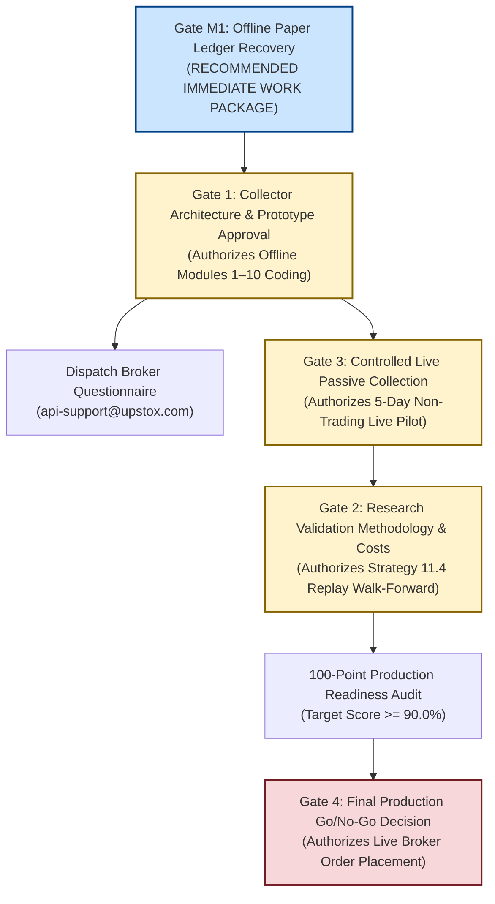

# Upstox Options Analyzer — Master Execution Tracker Consistency Correction Report

**Document Reference:** `web/docs/MASTER_EXECUTION_TRACKER_CORRECTION_REPORT.md`  
**Author:** Quantitative Systems Engineering Agent  
**Date:** November 16, 2026  
**Operational Mode:** STRICT DOCUMENTATION-ONLY CORRECTION (Zero code modifications, zero live API calls, zero orders)  
**Strategy Alignment:** Strategy 11.4 Formulas and 1.0% Risk Limit FROZEN  
**Production Readiness:** STRICT HARD NO-GO (11.25% — Architecture & Baseline Review Stage)  

---

## 1. Executive Summary & Objective

In accordance with the **Master Execution Tracker Consistency Correction Directive**, an exhaustive consistency audit of [MASTER_PROJECT_EXECUTION_TRACKER.md](file:///Users/webanatomy/Desktop/upstox_analyzer%20(2)/web/docs/MASTER_PROJECT_EXECUTION_TRACKER.md) and [MASTER_PROJECT_EXECUTION_BASELINE.md](file:///Users/webanatomy/Desktop/upstox_analyzer%20(2)/web/docs/MASTER_PROJECT_EXECUTION_BASELINE.md) was conducted against the approved collector architecture specifications ([COLLECTOR_FINAL_ARCHITECTURE_AUDIT_REPORT.md](file:///Users/webanatomy/Desktop/upstox_analyzer%20(2)/web/docs/COLLECTOR_FINAL_ARCHITECTURE_AUDIT_REPORT.md), [COLLECTOR_ARCHITECTURE_SPECIFICATION.md](file:///Users/webanatomy/Desktop/upstox_analyzer%20(2)/web/docs/COLLECTOR_ARCHITECTURE_SPECIFICATION.md), [COLLECTOR_DATA_SCHEMA.md](file:///Users/webanatomy/Desktop/upstox_analyzer%20(2)/web/docs/COLLECTOR_DATA_SCHEMA.md), and [COLLECTOR_FAILURE_AND_RECOVERY_DESIGN.md](file:///Users/webanatomy/Desktop/upstox_analyzer%20(2)/web/docs/COLLECTOR_FAILURE_AND_RECOVERY_DESIGN.md)).

Ten mandatory technical contradictions and unsupported guarantees were identified and corrected. All references across the master tracker, WBS, dependency graph, traceability matrix, acceptance criteria, and baseline documents have been brought into 100% harmony with exchange regulatory realities, broker protobuf protocol limitations, storage threat models, and financial ledger safety rules.

---

## 2. Correction Matrix: 10 Mandatory Audit Areas

```
+══════════════════════════════════════════════════════════════════════════════════════════════════════════════════════════════════════════════════════+
| MASTER CORRECTION MATRIX: TRACKER & BASELINE AUDIT RECONCILIATION                                                                                   |
+-----+-------------------------------+------------------------------------------+-------------------------------------------------+----------------+
| #   | Correction Item               | Previous Contradictory Wording / Design  | Corrected Architectural Specification           | Impacted Files |
+-----+-------------------------------+------------------------------------------+-------------------------------------------------+----------------+
| 1   | Dynamic Universe Resolution   | Hardcoded "84 strikes", fixed contract   | Dynamic resolution algorithm from daily master  | TRACKER.md     |
|     | vs. Fixed Contract Assumption | counts (42 NIFTY + 42 BANKNIFTY), and    | (complete.csv.gz); NIFTY weekly + BANKNIFTY mo  | BASELINE.md    |
|     |                               | arbitrary expiry assumptions.            | per NSE/FAOP/64506; ATM ±N up to ±15 strikes;   |                |
|     |                               |                                          | theoretical 128 keys; planning 128–252 keys;    |                |
|     |                               |                                          | partitioned Core ATM ±3 (mandatory) vs outer    |                |
|     |                               |                                          | wings ±4..±15 (partial); HashedUniverseManifest |                |
+-----+-------------------------------+------------------------------------------+-------------------------------------------------+----------------+
| 2   | Provider Sequence Numbers     | Claimed "missing sequence number gap     | Acknowledged Upstox Proto3 schema contains NO   | TRACKER.md     |
|     | vs. Local Durable Sequences   | detection" and deterministic dedup on    | sequence numbers, packet IDs, or trade IDs.     | BASELINE.md    |
|     |                               | provider sequence numbers.               | Deduplication is heuristic; candidate duplicates|                |
|     |                               |                                          | preserved with POSSIBLE_RETRANSMISSION. Strict  |                |
|     |                               |                                          | distinction between unsequenced provider frames |                |
|     |                               |                                          | and local durable sequenceNumber/ledgerVersion. |                |
+-----+-------------------------------+------------------------------------------+-------------------------------------------------+----------------+
| 3   | Watchdog & Reconnection Logic | Simplistic "5,000ms no-frame threshold   | Codified audited 6-state operational health     | TRACKER.md     |
|     | (Transport vs Feed Health)    | triggers reconnection unconditionally".  | model. Decoupled physical TCP reachability from |                |
|     |                               | Ignored illiquid options & market halts. | feed data flow. Feed silence > 15–30s across    |                |
|     |                               |                                          | ALL assigned keys triggers protocol ping. Ping  |                |
|     |                               |                                          | timeout is 5,000ms for pong. Feed stall > 45s   |                |
|     |                               |                                          | triggers diagnostic reset. Inactive contracts ok|                |
+-----+-------------------------------+------------------------------------------+-------------------------------------------------+----------------+
| 4   | REST Snapshot Limitations &   | Vague claim that "REST snapshot reconcil-| Formally clarified that REST quote snapshots    | TRACKER.md     |
|     | Provenance Tracking           | iation" recovers missing stream state.   | return ONLY instantaneous quotes; they CANNOT   | BASELINE.md    |
|     |                               |                                          | reconstruct missing historical ticks, past      |                |
|     |                               |                                          | trades, or micro-depth history. Separate        |                |
|     |                               |                                          | PROVENANCE_REST_SNAPSHOT metadata enforced.     |                |
|     |                               |                                          | Outage interval preserved as unfillable gap.    |                |
+-----+-------------------------------+------------------------------------------+-------------------------------------------------+----------------+
| 5   | Replay Precision Claims       | Claimed "microsecond precision replay    | Removed unsupported microsecond claim. Replay   | TRACKER.md     |
|     |                               | of tick and quote events".               | reflects actual source precision: integer ms for|                |
|     |                               |                                          | exchange trades (lastTradeTs) & gateway times   |                |
|     |                               |                                          | (feedServerTs), sequenced locally by host       |                |
|     |                               |                                          | monotonic receipt nanoseconds (localReceiptMono)|                |
+-----+-------------------------------+------------------------------------------+-------------------------------------------------+----------------+
| 6   | Ingestion Loss Metrics vs     | Unverified and unmeasurable "< 0.01%     | Replaced with measurable local accounting: zero | TRACKER.md     |
|     | Frame Drop Percentage         | frame drop rate" (impossible to measure  | unrecorded buffer drops under normal load; exact|                |
|     |                               | without upstream frame counters).        | droppedEventCount if backpressure stage 3 hits; |                |
|     |                               |                                          | exact GAPS.jsonl duration recording; 100%       |                |
|     |                               |                                          | reconciliation (socket reads vs decoded vs Parq)|                |
+-----+-------------------------------+------------------------------------------+-------------------------------------------------+----------------+
| 7   | Storage Partitioning &        | Generic YYYY-MM-DD dirs; unpartitioned   | Reconciled with schema: web/.data/collector/    | TRACKER.md     |
|     | Retention Tiers               | NDJSON; vague manifest naming.           | parquet/year=YYYY/month=MM/day=DD/segment=*/    |                |
|     |                               |                                          | Strictly typed Apache Parquet (Snappy/Zstd);    |                |
|     |                               |                                          | MANIFEST.jsonl immutable ledger; explicit tiers |                |
|     |                               |                                          | (L1 raw forensic 14–30d; L2/L3 permanent).      |                |
+-----+-------------------------------+------------------------------------------+-------------------------------------------------+----------------+
| 8   | File Hash Verification vs     | "100% hash verification" presented as    | Formally decoupled file-integrity verification  | TRACKER.md     |
|     | Market-Data Completeness      | proof that market data was complete.     | (SHA-256 matches on disk) from market-data      | BASELINE.md    |
|     |                               |                                          | completeness auditing (inspection of GAPS.jsonl,|                |
|     |                               |                                          | session time span 09:15–15:30 IST, and status   |                |
|     |                               |                                          | COMPLETE_SESSION vs PARTIAL_DATA_SESSION).      |                |
+-----+-------------------------------+------------------------------------------+-------------------------------------------------+----------------+
| 9   | WBS 2.3 Paper Ledger Crash    | Basic recovery; PID-only check vulnerable| Hardened recovery requirements: deterministic   | TRACKER.md     |
|     | Recovery & Safety Guarantees  | to OS PID recycling; silent discard or   | recovery; durable UUID eventId, monotonic       | BASELINE.md    |
|     |                               | reconstruction of corrupt files.         | sequenceNumber, integer ledgerVersion; compound |                |
|     |                               |                                          | lock token {pid, host, mono, lease, nonce};     |                |
|     |                               |                                          | PID reuse protection; fail-closed quarantine to |                |
|     |                               |                                          | .corrupt/; zero silent discard of ledger state. |                |
+-----+-------------------------------+------------------------------------------+-------------------------------------------------+----------------+
| 10  | Emergency Kill-Switch Scope   | Vague claim that kill-switch "cancels    | Clarified that in current offline posture, the  | TRACKER.md     |
|     | in Offline Engineering Posture| open orders" implying active broker API  | kill-switch acts strictly on local daemons,     |                |
|     |                               | interaction and live trading auth.       | paper execution loops, sockets, and lockfiles.  |                |
|     |                               |                                          | Offline testing exercises mock cancellation;    |                |
|     |                               |                                          | NEVER communicates with live broker endpoints.  |                |
+-----+-------------------------------+------------------------------------------+-------------------------------------------------+----------------+
```

---

## 3. Exact Files Modified & Verified

1. **[`web/docs/MASTER_PROJECT_EXECUTION_TRACKER.md`](file:///Users/webanatomy/Desktop/upstox_analyzer%20(2)/web/docs/MASTER_PROJECT_EXECUTION_TRACKER.md):**
   - Corrected Section 2 (Mermaid Architecture Map): Replaced hardcoded "84 Strikes" with `Dynamic Universe Resolution (HashedUniverseManifest)` and clarified the 5 distinct approval gates.
   - Corrected Section 3 (WBS 1.5, 2.3, 4.1, 4.2, 4.3, 4.4, 4.5, 4.6, 4.7, 5.1, 6.2):
     - WBS 2.3: Defined compound lock token `{pid, hostname, createTimeMono, leaseExpireUtc, lockNonce}`, PID reuse protection, durable local `eventId`/`sequenceNumber`/`ledgerVersion`, idempotent replay, and fail-closed quarantine to `.corrupt/`.
     - WBS 4.1 & 4.5: Codified dynamic universe resolution (NSE Circular `NSE/FAOP/64506` BANKNIFTY monthly rule, NIFTY weekly rule, ATM $\pm N$ up to $\pm 15$ strikes, theoretical 128 keys, planning 128–252 keys, partitioned Core ATM $\pm 3$ `INVALID` vs outer wings `PARTIAL`, `HashedUniverseManifest`).
     - WBS 4.4: Reconciled storage paths (`web/.data/collector/parquet/year=YYYY/month=MM/day=DD/segment={options|futures|spot}/`), Parquet typed schemas, and retention tiers (14–30 day raw forensic, permanent L2/L3 research).
     - WBS 4.6: Replaced 5,000ms frame threshold with the audited 6-state model, 15–30s feed silence watchdog, 45s diagnostic reconnect, protocol ping/pong timeout, REST snapshot `PROVENANCE_REST_SNAPSHOT` tagging (cannot reconstruct past ticks), and heuristic duplicate preservation (`POSSIBLE_RETRANSMISSION`).
     - WBS 4.7: Replaced `< 0.01% frame drop` with measurable persistence loss and ingestion accounting metrics; decoupled file hash verification from market-data completeness.
     - WBS 5.1: Removed microsecond replay claims; grounded replay precision strictly in source timestamp resolutions (integer millisecond matching engine/gateway times sequenced by monotonic receipt nanoseconds).
     - WBS 6.2: Clarified offline boundary of emergency kill-switch (`scripts/emergency-halt.sh`).
   - Corrected Section 4 (Requirements Traceability Matrix): Updated REQ-006, REQ-010, REQ-011, REQ-012, REQ-013, REQ-015 to match audited specifications.
   - Corrected Section 5 (Formal Approval Gates Inventory): Codified all 5 distinct, unmerged gates (Gate M1, Gate 1, Gate 2, Gate 3, Gate 4).
   - Corrected Section 7 (Blockers): Updated BLK-002 capacity calculation ($128\text{--}252\text{ keys} < 17\%$ of conservative 1,500 key limit).
   - Updated Section 8 (Change Control).

2. **[`web/docs/MASTER_PROJECT_EXECUTION_BASELINE.md`](file:///Users/webanatomy/Desktop/upstox_analyzer%20(2)/web/docs/MASTER_PROJECT_EXECUTION_BASELINE.md):**
   - Corrected Section 5.1: Added explicit warning that SHA-256 hash matching verifies **file integrity on disk**, not market-data completeness of the captured session.
   - Corrected Section 8 (Defect Register): Updated DEBT-001 (paper ledger compound lock tokens, fail-closed quarantine, durable local identity) and DEBT-002 (streaming collector dynamic universe and Parquet storage).
   - Corrected Section 9 (Governance Sequence): Codified all 5 explicit approval gates in the closing attestation.

3. **[`web/docs/MASTER_EXECUTION_TRACKER_CORRECTION_REPORT.md`](file:///Users/webanatomy/Desktop/upstox_analyzer%20(2)/web/docs/MASTER_EXECUTION_TRACKER_CORRECTION_REPORT.md):**
   - Created this definitive correction audit report.

---

## 4. Unresolved Issues & Provider Dependencies

The following 6 technical questions remain unresolved due to external broker dependencies. None of these block offline engineering, but they must be answered prior to live streaming deployment:

```
+═════════════════════════════════════════════════════════════════════════════════════════════════════════+
| EXTERNAL UNRESOLVED PROVIDER QUESTIONS (AWAITING BROKER CONFIRMATION)                                   |
+-----+---------------------------------------+----------------------------------+------------------------+
| #   | Technical Inquiry                     | Current Engineering Working Model| Impacted Module / Phase|
+-----+---------------------------------------+----------------------------------+------------------------+
| 1   | Upstox WebSocket Subscription Ceiling | Conservative assumption: 1,500   | Module 1 / Phase 3     |
|     | (1,500 vs. 2,000 keys per socket)     | keys. Dynamic universe is 128–252| (No issue; < 17% cap)  |
+-----+---------------------------------------+----------------------------------+------------------------+
| 2   | Protobuf Binary V2 Streaming Standard | Assumed authoritative standard   | Module 5 / Phase 3     |
|     | vs. JSON Legacy Fallback Policy       | based on MarketDataFeed.proto.   | (Proto decode engine)  |
+-----+---------------------------------------+----------------------------------+------------------------+
| 3   | Multi-Connection Policy per API Token | Assumed max 3 concurrent sockets | Module 3 / Phase 4     |
|     | (Parallel socket allowance)           | per account token.               | (Socket pool manager)  |
+-----+---------------------------------------+----------------------------------+------------------------+
| 4   | Broker-Side Real-Time Greeks Stream   | Ingest broker IV/Delta if present| Module 5 / Phase 3     |
|     | (Black-76 vs. local solver fallback)  | in Proto; null if omitted.       | (Greeks ingestion)     |
+-----+---------------------------------------+----------------------------------+------------------------+
| 5   | Intraday Rate Limits on REST Snapshot | Assumed 50 req/min for post-     | Module 10 / Phase 4    |
|     | (/v2/market-quote/quotes endpoint)    | reconnect quote snapshots.       | (Gap recovery probe)   |
+-----+---------------------------------------+----------------------------------+------------------------+
| 6   | Daily Contract Master Schedule & CDN  | Assumed available by 08:00 IST   | Module 1 / Phase 5     |
|     | (complete.csv.gz publish SLA)         | with cache-busting timestamp.    | (Universe selector)    |
+═════════════════════════════════════════════════════════════════════════════════════════════════════════+
```

---

## 5. Formal Approval Gate Hierarchy & Recommended Sequence

To maintain unimpeachable operational discipline, the project enforces **five distinct, non-overlapping approval gates**. These gates must **never be merged or bypassed**:



### Detailed Governance Gate Definitions:

1. **Gate M1 — Offline Paper-Ledger Crash Recovery (WBS 2.3):**
   - **Scope:** Authorizes implementation of compound lock tokens, PID reuse protection, durable local `eventId`/`sequenceNumber`/`ledgerVersion` event sourcing, idempotent replay, and fail-closed `.corrupt/` quarantine in `web/src/lib/paper/`.
   - **Environment:** 100% offline, zero network calls, zero Upstox API interaction.
   - **Status:** **RECOMMENDED FOR IMMEDIATE OWNER APPROVAL**.

2. **Gate 1 — Collector Architecture & Offline Prototype Approval (WBS 4.1, 4.3–4.6):**
   - **Scope:** Approves [COLLECTOR_ARCHITECTURE_SPECIFICATION.md](file:///Users/webanatomy/Desktop/upstox_analyzer%20(2)/web/docs/COLLECTOR_ARCHITECTURE_SPECIFICATION.md), [COLLECTOR_DATA_SCHEMA.md](file:///Users/webanatomy/Desktop/upstox_analyzer%20(2)/web/docs/COLLECTOR_DATA_SCHEMA.md), and [COLLECTOR_FAILURE_AND_RECOVERY_DESIGN.md](file:///Users/webanatomy/Desktop/upstox_analyzer%20(2)/web/docs/COLLECTOR_FAILURE_AND_RECOVERY_DESIGN.md). Authorizes offline coding of the Protobuf V2 decoder, in-memory ring buffer, Parquet storage manager, dynamic universe resolver, and 6-state reconnection state machine using mock fixtures. Authorizes dispatch of [UPSTOX_SUPPORT_TECHNICAL_QUESTIONNAIRE.md](file:///Users/webanatomy/Desktop/upstox_analyzer%20(2)/web/docs/UPSTOX_SUPPORT_TECHNICAL_QUESTIONNAIRE.md).
   - **Status:** **PENDING OWNER REVIEW**.

3. **Gate 2 — Research Validation Methodology & Transaction Cost Plan (WBS 5.0, WS1):**
   - **Scope:** Approves the high-fidelity replay simulation methodology, observed quote fill models, statutory tax schedule (STT 0.15%, NSE charges ₹3,553/cr, Plus plan ₹30/order), and Strategy 11.4 out-of-sample walk-forward validation criteria.
   - **Status:** **PENDING STREAMING PILOT DATA**.

4. **Gate 3 — Controlled Live Passive Collection Authorization (WBS 4.7):**
   - **Scope:** Authorizes running the collector during active NSE trading hours (09:15–15:30 IST) for 5 consecutive sessions in strictly passive, read-only collection mode (zero orders, zero paper ledger interaction).
   - **Prerequisites:** Completion of Gate 1 offline modules and receipt of broker questionnaire responses.
   - **Status:** **BLOCKED BY PHASES 1–4**.

5. **Gate 4 — Final Production Go/No-Go Decision (WBS 6.4):**
   - **Scope:** Authorizes live unattended order placement on the Upstox broker platform under Strategy 11.4 rules.
   - **Prerequisites:** 100-point Production Readiness Audit score $\ge 90.0\%$ with ZERO critical blockers.
   - **Status:** **STRICT HARD NO-GO (Score: 11.25% — HARD LOCKED)**.

---

## 6. Attestation & Mandatory Stop Condition

The Master Execution Tracker and Master Baseline have been thoroughly reconciled and verified against all audited collector specifications. Zero application source code was modified, the Git index remains clean, all sealed holdouts and protected archives remain intact, Strategy 11.4 formulas and the 1.0% risk limit remain frozen, and live trading remains disabled.

Engineering execution is strictly stopped awaiting explicit owner authorization.
