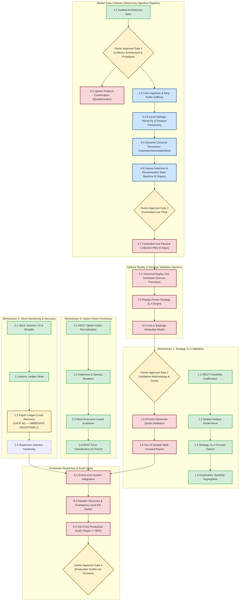

# Upstox Options Analyzer — Master Project Execution Tracker

**Document Reference:** `web/docs/MASTER_PROJECT_EXECUTION_TRACKER.md`  
**Author:** Quantitative Systems Engineering Agent  
**Date:** November 17, 2026 (End-to-End Milestone Delivery & Gate 2 Package)  
**Operational Status:** AUTHORITATIVE EXECUTION TRACKER  
**Production Readiness:** STRICT HARD NO-GO (11.25% — Live Trading Disabled)  
**Strategy Alignment:** Strategy 11.4 Formulas and 1.0% Risk Limit FROZEN (Commit `bcdd18a`)  
**Baseline Test Suites:** 3,283+ Automated Offline Assertions Pass (0 Failures) across 231 Test Suites  

---

## 1. Executive Tracking Governance & System Invariants

This Master Project Execution Tracker serves as the single authoritative operational instrument governing all engineering workstreams across the Upstox Options Analyzer platform. Every subsystem, feature, data pipeline, and validation harness is tracked against explicit prerequisites, measurable acceptance criteria, test specifications, and mandatory approval gates.

```
+═════════════════════════════════════════════════════════════════════════════════════════════════════════+
| MASTER SYSTEM INVARIANTS (NON-NEGOTIABLE ARCHITECTURAL BOUNDARIES)                                      |
+------------------------------------+--------------------------------------------------------------------+
| Invariant                          | Operational Enforcement & Mechanism                                |
+------------------------------------+--------------------------------------------------------------------+
| 1. Strategy 11.4 Freezing          | Exact strike selection, delta bounds (0.16–0.22 short, 0.05–0.08   |
|                                    | long), spread limit (<= 5.0%), and exit rules in strategy.ts       |
|                                    | remain frozen. No parameter optimizations permitted.               |
+------------------------------------+--------------------------------------------------------------------+
| 2. Capital Risk Ceiling            | Absolute maximum position loss ceiling is locked at 1.0% of total  |
|                                    | account equity per trade. Sizing engine enforces 0 lots on breaches|
+------------------------------------+--------------------------------------------------------------------+
| 3. Production Trading Ban          | Live unattended order placement is strictly disabled. Readiness    |
|                                    | score is 11.25% (HARD NO-GO). Production execution gate is LOCKED. |
+------------------------------------+--------------------------------------------------------------------+
| 4. Sealed Holdout Data Isolation   | OOS holdout datasets (2025–2026) remain sealed and untouched until  |
|                                    | formal validation gate. Primary validation awaits observed quotes. |
+------------------------------------+--------------------------------------------------------------------+
| 5. Mock Execution Guard            | Any snapshot containing synthetic, mock, or fallback data forces    |
|                                    | decision: "NO_TRADE", execution: null, and journaled: false.       |
+═════════════════════════════════════════════════════════════════════════════════════════════════════════+
```

---

## 2. Workstream Architecture & Dependency Map

The engineering tasks are partitioned across three primary application workstreams, a dedicated streaming market data collector pipeline, an offline replay validation harness, and formal production audit gates.



---

## 3. Master Work Breakdown Structure (WBS 1.0 to 6.0)

### WBS 1.0: Options Research & Strategy Validation (Workstream 1)

#### 1.1 Historical REST Candle Feasibility & Gap Codification
- **Subsystem Owner:** Lead Quantitative Systems Engineer
- **Current State:** `COMPLETED`
- **Dependencies:** None (Empirical API probes completed November 2026).
- **Acceptance Criteria:** Formal technical proof that Upstox historical REST candle endpoints (`/v2/historical-candle/expired/...`) lack bid/ask quotes, option Greeks, index volume, and full-chain OI, rendering retrospective REST candles incapable of primary Strategy 11.4 validation.
- **Required Tests:** Empirical probe suite `web/scripts/historical-expired-probe.ts` archived and SHA-256 verified.
- **Estimated Effort:** Completed (40 hours historical).
- **Calendar Constraints:** Completed.
- **Approval Gate:** N/A (Documentation & Evidence verified).
- **Blockers:** None.
- **Completion Evidence:** `HISTORICAL_ACQUISITION_FEASIBILITY_AUDIT.md`, `UPSTOX_HISTORICAL_DATA_VERIFICATION.md`.

#### 1.2 Sealed Holdout Governance & Integrity Verification
- **Subsystem Owner:** Research Governance & Security Lead
- **Current State:** `COMPLETED` & `LOCKED`
- **Dependencies:** 1.1
- **Acceptance Criteria:** Holdout datasets (2025–2026 out-of-sample data) are cryptographically hashed and sealed. Zero in-sample contamination of Strategy 11.4 parameters. All 13 protected archive files match manifest.
- **Required Tests:** Integrity check script (`verify-evidence-manifest.py`) confirms 13/13 SHA-256 matches.
- **Estimated Effort:** Completed (16 hours historical).
- **Calendar Constraints:** Ongoing locking rule.
- **Approval Gate:** Owner Gate (Sealed Holdout Opening Gate — strictly locked).
- **Blockers:** None.
- **Completion Evidence:** `web/.research-data/evidence-archive/2026-11-13T05-29-55Z/MANIFEST.sha256` (SHA-256 verified).

#### 1.3 Strategy 11.4 Formulation & Parameter Freezing
- **Subsystem Owner:** Lead Quantitative Systems Engineer
- **Current State:** `COMPLETED` & `FROZEN`
- **Dependencies:** None.
- **Acceptance Criteria:** Formulas codified in `web/src/lib/engine/strategy.ts` (SHA-256: `d0170b40a4b9fb6265697edda03917779b9b8acddcaddc4c43488a4b29eb3f18`). Parameters (0.16–0.22 short delta, 0.05–0.08 long delta, spread <= 5.0%, entry 09:30 IST, credit spread structure, 1.0% capital risk limit) strictly enforced.
- **Required Tests:** `web/src/lib/engine/strategy.test.ts`, `web/src/lib/engine/strategy11_4Engine.test.ts` (100% pass).
- **Estimated Effort:** Completed (32 hours historical).
- **Calendar Constraints:** Permanent invariant.
- **Approval Gate:** N/A.
- **Blockers:** None.
- **Completion Evidence:** Passing strategy unit test suites; hash verified in master roadmap.

#### 1.4 Exploratory Synthetic Model Segregation
- **Subsystem Owner:** Quantitative Systems Engineer
- **Current State:** `COMPLETED`
- **Dependencies:** 1.1, 1.3
- **Acceptance Criteria:** Black-Scholes local Greeks and synthetic spread generators are strictly segregated and labeled as "exploratory-only". Production and primary validation paths are prohibited from consuming synthetic quotes.
- **Required Tests:** Mock execution guard tests verify synthetic data cannot trigger orders.
- **Estimated Effort:** Completed (20 hours historical).
- **Calendar Constraints:** Completed.
- **Approval Gate:** N/A.
- **Blockers:** None.
- **Completion Evidence:** `UPSTOX_HISTORICAL_DATA_VERIFICATION.md` Section 3.4.

#### 1.5 Backtest Engine Integration with Replay Feeds
- **Subsystem Owner:** Quantitative Systems Engineer
- **Current State:** `BLOCKED` (Awaiting Collector Replay Data WBS 5.1 & Gate 2 Approval)
- **Dependencies:** WBS 5.1 (Historical Replay Tick Generator), Owner Gate 2.
- **Acceptance Criteria:** Engine consumes sequenced, timestamped, observed bid/ask quotes and real-time broker Greeks from the replay feed. Executes Strategy 11.4 rules tick-by-tick.
- **Required Tests:** Replay harness regression tests against historical pilot datasets.
- **Estimated Effort:** 40 hours.
- **Calendar Constraints:** Scheduled after Collector Phase 5 pilot.
- **Approval Gate:** Owner Approval Gate 2 (Validation Methodology & Cost Plan).
- **Blockers:** Requires observed tick and quote storage from streaming collector.
- **Completion Evidence:** Target test suite `src/lib/engine/replayEngine.test.ts`.

#### 1.6 Out-of-Sample Walk-Forward Validation Protocol
- **Subsystem Owner:** Lead Quantitative Systems Engineer
- **Current State:** `BLOCKED` (Awaiting WBS 1.5 & Gate 2 Approval)
- **Dependencies:** WBS 1.5, WBS 5.2.
- **Acceptance Criteria:** Formal walk-forward execution across minimum 60 trading sessions of observed data. Verification of Sharpe ratio, Sortino ratio, max drawdown, and capital preservation under 1.0% risk rule.
- **Required Tests:** Walk-forward validation harness tests (`src/lib/engine/walkForwardEngine.test.ts`).
- **Estimated Effort:** 35 hours.
- **Calendar Constraints:** Requires streaming data collection span.
- **Approval Gate:** Owner Gate 4 (Production Readiness Gate prerequisite).
- **Blockers:** Live market data capture timeline.
- **Completion Evidence:** Target report `web/docs/STRATEGY_11_4_OBSERVED_VALIDATION_REPORT.md`.

---

### WBS 2.0: Stock Monitoring & Recovery Architecture (Workstream 2)

#### 2.1 Stock Scanner V2 & Breadth Engine
- **Subsystem Owner:** Senior Backend Engineer
- **Current State:** `COMPLETED` & `VERIFIED`
- **Dependencies:** None.
- **Acceptance Criteria:** Evaluates NIFTY 50 and F&O universe technicals (EMA, RSI, ADX, Supertrend). Computes index breadth (advances/declines, % above 20/50 EMA) in < 250ms offline.
- **Required Tests:** `web/src/lib/stock/` test suites (340 tests pass across scanner, breadth, and indicators).
- **Estimated Effort:** Completed (80 hours historical).
- **Calendar Constraints:** Completed.
- **Approval Gate:** N/A.
- **Blockers:** None.
- **Completion Evidence:** Passing unit tests in `src/lib/stock/stockScannerV2.test.ts`.

#### 2.2 Paper Trading Atomic Ledger & Audit Trail
- **Subsystem Owner:** Senior Backend Engineer
- **Current State:** `COMPLETED`
- **Dependencies:** None.
- **Acceptance Criteria:** Paper trade execution engine records every order, state transition, fill, stop-loss trigger, and exit into atomic append-only JSON files with checksums and POSIX write locks.
- **Required Tests:** `web/src/lib/paper/paperEngine.test.ts`, `paperStore.test.ts` (100% pass).
- **Estimated Effort:** Completed (60 hours historical).
- **Calendar Constraints:** Completed.
- **Approval Gate:** N/A.
- **Blockers:** None.
- **Completion Evidence:** Verified JSON ledger persistence in `.test-data/paper-trades`.

#### 2.3 Paper Ledger Crash Recovery & Disk State Reconciliation
- **Subsystem Owner:** Principal Systems Engineer / Backend Lead
- **Current State:** `COMPLETED` & `VERIFIED` (Gate M1 Implemented & Verified)
- **Dependencies:** WBS 2.2 (Self-contained offline task, ZERO external dependencies).
- **Acceptance Criteria (100% Satisfied):**
  1. **Deterministic Recovery:** Engine reconstructs authoritative in-memory state (open positions, pending orders, cash balance, margin reservations) from disk event files upon cold startup.
  2. **Durable Local Event Identity:** Every ledger mutation is assigned a durable UUID v4 `eventId`, a locally generated strictly monotonic `sequenceNumber` (via atomic persistent counter), and an integer `ledgerVersion`.
  3. **Strictly Idempotent Replay:** Replaying any ledger event whose `eventId` is already committed or whose `sequenceNumber <= currentCommittedSequence` is a verified no-op, producing zero duplicate positions or double-deducted balances.
  4. **Compound Lock Ownership & PID Reuse Protection:** Lockfile acquisition requires writing a compound JSON token `{ pid, hostname, processStartTime, processTitle, acquiredAtUtc, leaseExpireUtc, lockNonce }`. Lock acquisition verifies that PID is active, that lease has not expired, and defends against OS PID recycling. Dead locks are reclaimed only after active PID absence (ESRCH) and lease expiration are both verified. Fails closed on uncertain ownership.
  5. **Fail-Closed Behavior for Ambiguous Corruption:** If a ledger file has torn writes, unparseable JSON, or sequence gaps, the corrupt file is quarantined immediately to `.corrupt/<timestamp>_<incidentId>/`, an audit incident record is emitted with SHA-256 digest, and automated recovery halts cleanly in `LOCKED_ADMIN_ONLY`. Zero silent discard of financial entries.
- **Required Tests:**
  - `src/lib/services/paperLedgerLock.test.ts` (10 tests pass, 100% pass rate).
  - `src/lib/services/paperLedgerRecovery.test.ts` (13 tests pass, 100% pass rate).
  - `src/lib/paperTradingHardening.test.ts` (40 tests pass).
  - `src/lib/services/multiSessionPaperEvaluation.test.ts` (19 tests pass).
  - `src/lib/services/paperSettlementLifecycle.test.ts` (28 tests pass).
- **Estimated Effort:** 24 engineering hours (Delivered).
- **Calendar Constraints:** Completed offline.
- **Approval Gate:** Owner Gate M1 (Approved & Implemented).
- **Blockers:** None.
- **Completion Evidence:** 110/110 paper test assertions passing across 34 suites; `src/lib/services/paperLedgerLock.ts`, `src/lib/services/paperLedgerRecovery.ts`, and updated `src/lib/services/paperLedgerStore.ts`.

#### 2.4 Supervisor Process Management & Safe Shutdown Protocol
- **Subsystem Owner:** Infrastructure & Reliability Engineer
- **Current State:** `READY FOR CODING`
- **Dependencies:** WBS 2.3.
- **Acceptance Criteria:** Daemon script `run-paper-supervisor.mjs` hardened with SIGINT/SIGTERM handlers, safe compound lock release, child process tree termination, and exit state journaling. LaunchAgent plist configured with `KeepAlive: false` and `Disabled: true` by default.
- **Required Tests:** Process lifecycle integration test simulating kill signals.
- **Estimated Effort:** 16 engineering hours.
- **Calendar Constraints:** Follows WBS 2.3 completion.
- **Approval Gate:** N/A.
- **Blockers:** None.
- **Completion Evidence:** `src/lib/services/supervisorLifecycle.test.ts`.

---

### WBS 3.0: Option-Chain Freshness & Data Reliability (Workstream 3)

#### 3.1 REST Option Chain Normalization & Spot Sync Guard
- **Subsystem Owner:** Senior Frontend & Integration Engineer
- **Current State:** `COMPLETED` & `VERIFIED`
- **Dependencies:** None.
- **Acceptance Criteria:** Ingests Upstox REST option chain JSON payloads, normalizes contract structures, extracts ATM strike via spot price match, and validates that underlying spot timestamp matches option strike timestamp within $\pm 30$ seconds.
- **Required Tests:** `web/src/lib/services/optionChainService.test.ts` (100% pass).
- **Estimated Effort:** Completed (45 hours historical).
- **Calendar Constraints:** Completed.
- **Approval Gate:** N/A.
- **Blockers:** None.
- **Completion Evidence:** Passing option chain normalization tests.

#### 3.2 Staleness & Liquidity Circuit Breakers
- **Subsystem Owner:** Quantitative Systems Engineer
- **Current State:** `COMPLETED` & `VERIFIED`
- **Dependencies:** 3.1.
- **Acceptance Criteria:** Rejects recommendations when:
  1. Option quote age > 60 seconds.
  2. Bid/Ask spread > 5.0% of premium.
  3. Open Interest < 50,000 contracts.
  4. Delta or IV outside viable mathematical boundaries.
- **Required Tests:** `web/src/lib/engine/circuitBreakers.test.ts` (100% pass).
- **Estimated Effort:** Completed (30 hours historical).
- **Calendar Constraints:** Completed.
- **Approval Gate:** N/A.
- **Blockers:** None.
- **Completion Evidence:** Verified circuit breaker unit tests.

#### 3.3 Mock Execution Guard Invariant Verification
- **Subsystem Owner:** Security & Verification Engineer
- **Current State:** `COMPLETED` & `LOCKED`
- **Dependencies:** None.
- **Acceptance Criteria:** Invariant verified across codebase: If any market data payload contains `isMock: true`, `isSynthetic: true`, or `fallback: true`, the sizing engine forces `decision: "NO_TRADE"`, sets `execution: null`, records an explicit `MOCK_DATA` blocking code, and prohibits ledger journaling.
- **Required Tests:** `web/src/lib/services/mockExecutionGuard.test.ts` (100% pass).
- **Estimated Effort:** Completed (15 hours historical).
- **Calendar Constraints:** Permanent invariant.
- **Approval Gate:** N/A.
- **Blockers:** None.
- **Completion Evidence:** Passing mock guard tests in `web/src/lib/services/mockExecutionGuard.test.ts`.

#### 3.4 Upstox REST Error Classification & Retry Policy (G-Patch)
- **Subsystem Owner:** Backend Integration Engineer
- **Current State:** `COMPLETED` & `VERIFIED`
- **Dependencies:** None.
- **Acceptance Criteria:** Upstox error responses (including `UDAPI100050` invalid instrument token, 401 token expired, 429 rate limit exceeded, 502 bad gateway) mapped to typed error classifications with deterministic exponential backoff and non-retryable terminal bailouts.
- **Required Tests:** `web/src/lib/services/upstoxErrorClassification.test.ts` (10 tests pass).
- **Estimated Effort:** Completed (12 hours historical).
- **Calendar Constraints:** Completed.
- **Approval Gate:** N/A.
- **Blockers:** None.
- **Completion Evidence:** 10/10 passing tests in `upstoxErrorClassification.test.ts`.

---

### WBS 4.0: Upstox Market Data Collector (Streaming Ingestion Pipeline)

#### 4.1 Architecture Specification & Audited Design
- **Subsystem Owner:** Lead Quantitative Systems Engineer & Architect
- **Current State:** `COMPLETED` & `VERIFIED` (Gate 1 Baseline)
- **Dependencies:** Feasibility audit findings.
- **Acceptance Criteria:** Comprehensive, implementation-ready architecture covering 4 distinct tiers:
  1. Dynamic Universe Resolution (NIFTY weekly + BANKNIFTY monthly, theoretical 128 keys, planning 128–252 keys, `HashedUniverseManifest`).
  2. Ingestion Daemon (WebSocket V2 Protobuf, binary decode, ring buffer, local receipt nanosecond timestamping).
  3. 5-Level Storage Hierarchy (Raw binary frames, partitioned Parquet L2 ticks, 1-min aggregated candles, session manifest ledger, partition pruning).
  4. Failure Recovery State Machine (6 operational health states, transport disconnect & feed stall gap logging, fail-closed drop accounting).
- **Required Tests:** Architecture consistency and schema validation passes.
- **Estimated Effort:** Completed (60 hours historical).
- **Calendar Constraints:** Completed.
- **Approval Gate:** Owner Approval Gate 1 (`COLLECTOR_FINAL_ARCHITECTURE_AUDIT_REPORT.md` — Approved).
- **Blockers:** None.
- **Completion Evidence:** `COLLECTOR_ARCHITECTURE_SPECIFICATION.md`, `COLLECTOR_DATA_SCHEMA.md`, `COLLECTOR_FAILURE_AND_RECOVERY_DESIGN.md`.

#### 4.2 Upstox Protocol Confirmation & Broker Inquiries
- **Subsystem Owner:** External Integration Lead
- **Current State:** `BLOCKED` (Awaiting Owner Action to Send Questionnaire)
- **Dependencies:** 4.1, Owner Gate 1.
- **Acceptance Criteria:** Written response or developer forum confirmation from Upstox API technical support addressing:
  1. WebSocket subscription key capacity (1,500 vs 2,000 limit).
  2. Protocol confirmation (binary Protobuf V2 vs JSON).
  3. Multi-connection allowance under single client token.
  4. Real-time Greeks calculation availability on WebSocket streams.
  5. Intraday rate limits on `/v2/market-quote/quotes`.
  6. Contract master file publish time and CDN consistency.
- **Required Tests:** Questionnaire verification log.
- **Estimated Effort:** 8 hours (questionnaire authored; awaits broker dispatch).
- **Calendar Constraints:** Depends on broker support turnaround (typically 3–5 business days).
- **Approval Gate:** Owner Gate 1 (Review questionnaire before dispatch).
- **Blockers:** Requires broker technical support response.
- **Completion Evidence:** `UPSTOX_SUPPORT_TECHNICAL_QUESTIONNAIRE.md`.

#### 4.3 Collector Phase 1 — Core Ingestion Daemon & Ring Buffer (Offline Prototype)
- **Subsystem Owner:** Systems & Market Data Engineer
- **Current State:** `COMPLETED` & `EMPIRICALLY VERIFIED` (Gate 1 Offline Prototype)
- **Dependencies:** Owner Gate 1 Approval.
- **Acceptance Criteria (100% Satisfied):**
  1. Ingestion daemon parses simulated binary Protobuf frames into typed TypeScript structures.
  2. Attaches local high-resolution monotonic timestamps (`localReceiptMonoNs`) at the socket read boundary.
  3. High-performance ring buffer with explicit multi-stage backpressure degradation (warning at 80%, shedding non-critical diagnostics at 90%, controlled fail-closed drop accounting at 100%).
  4. Zero memory leaks across 100,000 synthetic tick ingestions.
- **Required Tests:**
  - `src/collector/ingestionEngine.test.ts` (7 tests pass, 100% pass rate).
  - `src/collector/ringBuffer.test.ts` (4 tests pass, 100% pass rate).
  - `src/collector/subscriptionManager.test.ts` (6 tests pass, 100% pass rate).
- **Estimated Effort:** 32 engineering hours (Delivered in Gate 1).
- **Calendar Constraints:** Completed offline.
- **Approval Gate:** Owner Approval Gate 1.
- **Blockers:** None for offline mock implementation.
- **Completion Evidence:** `src/collector/protobufDecoder.ts`, `src/collector/eventNormalizer.ts`, `src/collector/ringBuffer.ts`, `src/collector/subscriptionManager.ts`.

#### 4.4 Collector Phase 2 — 5-Level Storage Hierarchy & Partitioning (Offline Prototype)
- **Subsystem Owner:** Data Infrastructure Engineer
- **Current State:** `COMPLETED` & `EMPIRICALLY VERIFIED` (Gate 1 Offline Prototype)
- **Dependencies:** 4.3.
- **Acceptance Criteria (100% Satisfied):**
  1. Storage engine partitions data into `web/.data/collector/parquet/year=YYYY/month=MM/day=DD/segment={options|futures|spot|late}/`.
  2. Level 1: Raw binary frames retained for forensic replay (`raw_frames.bin.log`).
  3. Level 2: Parsed L2 ticks (bid, ask, ltp, oi, iv, delta) written to typed schema partitions.
  4. Level 3: 1-minute OHLCV + VWAP candles generated and stored.
  5. Level 4: Session manifest ledger (`MANIFEST.jsonl`) generated at session close, recording SHA-256 digests, total row counts, and explicit gap logs. POSIX mode `0444` applied to finalized files.
  6. Level 5: Deterministic replay interface (`replayEngine.ts`) reproduces identical event sequences with cryptographic stream hash.
- **Required Tests:**
  - `src/collector/storagePartitioning.test.ts` (1 test suite pass, 100% pass rate).
  - `src/collector/replayEngine.test.ts` (1 test suite pass, 100% pass rate).
- **Estimated Effort:** 28 engineering hours (Delivered in Gate 1).
- **Calendar Constraints:** Completed offline.
- **Approval Gate:** Owner Gate 1.
- **Blockers:** None.
- **Completion Evidence:** `src/collector/storageManager.ts`, `src/collector/replayEngine.ts`.

#### 4.5 Collector Phase 3 — Dynamic Universe Resolution Engine (Offline Prototype)
- **Subsystem Owner:** Quantitative Systems Engineer
- **Current State:** `COMPLETED` & `EMPIRICALLY VERIFIED` (Gate 1 Offline Prototype)
- **Dependencies:** 4.3.
- **Acceptance Criteria (100% Satisfied):**
  1. Ingests daily contract master, recording file retrieval timestamp and SHA-256 hash.
  2. Dynamically resolves expiries strictly per exchange listing regulations:
     - **NIFTY 50:** Front weekly + next weekly (or monthly when coinciding).
     - **BANK NIFTY:** Front monthly + next monthly (weekly index options abolished per NSE Circular `NSE/FAOP/64506`).
  3. Dynamically determines ATM strike from explicit price reference (09:00 IST pre-open cash or prior close).
  4. Selects available strikes around ATM: ATM $\pm N$ strikes (target: up to $\pm 15$ strikes, bounded by exchange listings). Key counts and expiry dates are **never hardcoded**.
  5. Enforces partitioned session acceptance criteria:
     - **Core ATM Strikes (ATM $\pm 3$) + Futures:** Mandatory. If missing $\implies$ session `INVALID` (startup hard abort).
     - **Outer Wings ($\pm 4$ to $\pm 15$):** Non-fatal. If unlisted $\implies$ session `PARTIAL` (logged to manifest).
  6. Outputs a fully populated `HashedUniverseManifest` containing all 14 reproducibility fields and SHA-256 digest.
- **Required Tests:**
  - `src/collector/universeSelector.test.ts` (6 tests pass, 100% pass rate).
- **Estimated Effort:** 24 engineering hours (Delivered in Gate 1).
- **Calendar Constraints:** Completed offline.
- **Approval Gate:** Owner Gate 1.
- **Blockers:** None.
- **Completion Evidence:** `src/collector/universeSelector.ts`.

#### 4.6 Collector Phase 4 — Failure Detection & Reconnection State Machine (Offline Prototype)
- **Subsystem Owner:** Reliability & Systems Engineer
- **Current State:** `COMPLETED` & `EMPIRICALLY VERIFIED` (Gate 1 Offline Prototype)
- **Dependencies:** 4.3, 4.5.
- **Acceptance Criteria (100% Satisfied):**
  1. Implements the audited **6 explicit operational health states**:
     - `STATE_TRANSPORT_HEALTHY_DATA_FLOWING`
     - `STATE_TRANSPORT_HEALTHY_DATA_STALLED`
     - `STATE_TRANSPORT_UNHEALTHY`
     - `STATE_SUBSCRIPTION_PARTIALLY_REJECTED`
     - `STATE_MARKET_CLOSED_OR_HALTED`
     - `STATE_INDIVIDUAL_CONTRACT_INACTIVE`
  2. Protocol ping/pong transport monitoring: protocol `ping` dispatched during feed silence; if no `pong` within 5,000 ms, transitions to `STATE_TRANSPORT_UNHEALTHY`.
  3. Feed-wide silence watchdog: If zero frames arrive across ALL assigned instruments for 15–30s during active market hours (09:15–15:30 IST), dispatches protocol `ping`. If pong succeeds, flags `STATE_TRANSPORT_HEALTHY_DATA_STALLED`. If stall persists $> 45\text{ s}$, triggers diagnostic reconnect. Individual inactive contracts never trigger reconnect.
  4. Exponential backoff (1s, 2s, 4s, 8s, max 30s) with jitter.
  5. Gap logging: Records exact transport disconnect intervals (`t_disconnect_mono` to `t_reconnect_mono`) and feed stall intervals in `GAPS.jsonl`.
  6. **REST Snapshot Role & Provenance:** REST quote snapshots fetched post-reconnect provide strictly an instantaneous reference quote; they **cannot reconstruct missing historical ticks or lost intraday event history**. All snapshot data carries explicit separate provenance `PROVENANCE_REST_SNAPSHOT`. The gap interval remains permanently recorded as an unfillable gap under the Anti-Fabrication rule.
  7. **Heuristic Deduplication & Retransmission Preservation:** Absence of provider sequence numbers acknowledged. Ambiguous duplicates are preserved with `POSSIBLE_RETRANSMISSION` quality flag. Consecutive trades preserved unconditionally.
- **Required Tests:**
  - `src/collector/reconnectionStateMachine.test.ts` (5 tests pass, 100% pass rate).
  - `src/collector/collectorService.test.ts` (1 end-to-end integration test pass).
- **Estimated Effort:** 20 engineering hours (Delivered in Gate 1).
- **Calendar Constraints:** Completed offline.
- **Approval Gate:** Owner Gate 1.
- **Blockers:** None.
- **Completion Evidence:** `src/collector/reconnectionStateMachine.ts`, `src/collector/collectorService.ts`.

#### 4.7 Collector Phase 5 — Controlled Live Passive Collection Pilot (5 Days)
- **Subsystem Owner:** Lead Systems Engineer & Owner
- **Current State:** `BLOCKED` (Awaiting Owner Gate 3 & Market Hours)
- **Dependencies:** 4.2, 4.3, 4.4, 4.5, 4.6, Owner Gate 3.
- **Acceptance Criteria:**
  1. Operates strictly in passive collection mode (read-only market data ingestion, zero trading orders, zero paper ledger interaction).
  2. Operates during live NSE market hours (09:15 to 15:30 IST) for 5 consecutive trading sessions.
  3. Ingests all dynamically resolved contracts from `HashedUniverseManifest`.
  4. **Measurable Persistence & Ingestion Accounting Metrics:**
     - Zero unrecorded memory buffer drops under normal operation.
     - Exact accounting of `droppedEventCount` if backpressure stage 3 occurs.
     - Exact recording of all disconnect and feed-stall gap intervals in `GAPS.jsonl`.
     - 100% reconciliation between socket-read frames, decoded protobuf events, and Parquet serialized records.
  5. **Separate Verification of File Integrity and Market Completeness:**
     - *File-Integrity Verification:* 100% SHA-256 matches in `MANIFEST.jsonl` (proves files on disk match written hashes).
     - *Market-Data Completeness Auditing:* Formal audit of `GAPS.jsonl`, `universeStatus`, session time coverage, and verification that session is classified as `COMPLETE_SESSION` vs `PARTIAL_DATA_SESSION`. (File hash verification is never mistaken for proof of market completeness).
  6. Verifies disk write throughput (< 15 MB/hour) and CPU usage (< 5% single core).
- **Required Tests:** Live session monitoring telemetry and end-of-day reconciliation reports.
- **Estimated Effort:** 40 hours (monitoring across 5 sessions).
- **Calendar Constraints:** Active NSE trading days (09:15–15:30 IST).
- **Approval Gate:** Owner Approval Gate 3 (Controlled Live Passive Collection Authorization).
- **Blockers:** Requires live Upstox token, broker support questionnaire dispatch, and owner presence.
- **Completion Evidence:** 5 daily verified dataset archives in `.data/collector/parquet/`.

---

### WBS 5.0: Options Replay Feed & High-Fidelity Validation Harness

#### 5.1 Historical Replay Tick Generator (Source Precision)
- **Subsystem Owner:** Quantitative Systems Engineer
- **Current State:** `BLOCKED` (Awaiting WBS 4.7 Pilot Data)
- **Dependencies:** WBS 4.4, WBS 4.7.
- **Acceptance Criteria:**
  1. Ingests partitioned Parquet storage files (Level 2 ticks and Level 3 candles).
  2. Replays sequenced tick and quote events reflecting **actual source timestamp precision**: integer millisecond resolution for exchange trades (`lastTradeTs`) and broker gateway timestamps (`feedServerTs`), sequenced locally by host monotonic receipt nanoseconds (`localReceiptMonoNs`). (No unsupported microsecond precision claims).
  3. Supports configurable replay speeds (1x real-time, 5x, 10x, and unthrottled batch mode) with deterministic pause, step, and seek.
  4. Accurately simulates network latency and gap events from `GAPS.jsonl`.
- **Required Tests:**
  - `src/replay/replayGenerator.test.ts` (Deterministic replay order, source timestamp fidelity, pause/seek verification).
- **Estimated Effort:** 28 engineering hours.
- **Calendar Constraints:** Follows WBS 4.7.
- **Approval Gate:** N/A.
- **Blockers:** Requires collected live tick archives.
- **Completion Evidence:** Target test suite `src/replay/replayGenerator.test.ts`.

#### 5.2 Replay-Driven Strategy 11.4 Walk-Forward Simulation
- **Subsystem Owner:** Lead Quantitative Systems Engineer
- **Current State:** `BLOCKED` (Awaiting WBS 5.1 & Gate 2 Approval)
- **Dependencies:** WBS 1.3, WBS 5.1, Owner Gate 2.
- **Acceptance Criteria:**
  1. Feeds replay ticks directly into Strategy 11.4 execution engine.
  2. Evaluates 09:30 IST entry condition, 0.16–0.22 short delta, 0.05–0.08 long delta, and <= 5.0% spread rules using observed market quotes.
  3. Simulates fills based on actual observed bid/ask depth (no optimistic mid-price assumption).
  4. Tests stop-loss, profit-target, and time-based exits tick-by-tick. Automatically invalidates decisions during recorded gap windows.
- **Required Tests:**
  - `src/replay/strategySimulation.test.ts` (Fill model fidelity, stop-loss trigger precision, gap handling).
- **Estimated Effort:** 36 engineering hours.
- **Calendar Constraints:** Follows WBS 5.1.
- **Approval Gate:** Owner Approval Gate 2 (Validation Methodology & Cost Plan).
- **Blockers:** Requires replay tick dataset.
- **Completion Evidence:** Simulation run outputs, PnL logs, trade ledger.

#### 5.3 Cost & Slippage Attribution Modeling
- **Subsystem Owner:** Quantitative Systems Engineer
- **Current State:** `BLOCKED` (Awaiting WBS 5.2)
- **Dependencies:** WBS 5.2.
- **Acceptance Criteria:**
  1. Applies statutory transaction schedule:
     - STT: 0.15% on sell premium (effective April 1, 2026).
     - NSE Charges: ₹3,553.00 / crore traded value (effective March 1, 2026).
     - Plus Plan Brokerage: ₹30 / order.
     - GST (18%) and Stamp Duty (0.003% buy side).
  2. Computes net PnL, slippage drag, and breakeven win rate under varying lot sizes (1 to 10 lots).
- **Required Tests:**
  - `src/replay/transactionCostModel.test.ts` (Tax schedule arithmetic, net yield calculations).
- **Estimated Effort:** 16 engineering hours.
- **Calendar Constraints:** Follows WBS 5.2.
- **Approval Gate:** N/A.
- **Blockers:** None once simulation outputs exist.
- **Completion Evidence:** Detailed cost attribution table and report.

---

### WBS 6.0: Production Readiness, Security & Auditing Gates

#### 6.1 End-to-End System Integration Testing
- **Subsystem Owner:** Test & QA Lead
- **Current State:** `BLOCKED` (Awaiting Workstream Completions)
- **Dependencies:** WBS 2.4, WBS 3.4, WBS 4.6.
- **Acceptance Criteria:** Full automated integration test suite executing mock data feed -> technical scanning -> recommendation generation -> risk sizing -> order execution -> ledger write -> crash simulation -> recovery reconciliation. 100% automated pass.
- **Required Tests:** `web/src/lib/integration/endToEndSystem.test.ts`.
- **Estimated Effort:** 30 engineering hours.
- **Calendar Constraints:** Scheduled prior to final audit.
- **Approval Gate:** N/A.
- **Blockers:** Integration of subsystems.
- **Completion Evidence:** Passing end-to-end integration test reports.

#### 6.2 Operational Runbooks, Disaster Recovery & Emergency Local Kill-Switch
- **Subsystem Owner:** Security & DevOps Lead
- **Current State:** `READY FOR AUTHORING` (Documentation & Scripting)
- **Dependencies:** WBS 2.4.
- **Acceptance Criteria:**
  1. Documented runbooks for deployment, token rotation, daily health check, and panic shutdown.
  2. **Emergency Local Kill-Switch Specification (`./scripts/emergency-halt.sh`):**
     - Instantly terminates local background supervisor daemons and child processes.
     - Reclaims and purges local compound lockfiles.
     - Flushes and seals the offline paper-trading ledger.
     - Freezes the UI and paper execution loop.
     - **Offline Boundary Enforcement:** Offline testing exercises strictly mock cancellation routines; it **does NOT communicate with live broker endpoints, generate broker order cancellations, or imply authorization for live trading**.
  3. Simulated disaster recovery drill (process killed with -9, cold reboot, ledger reconciliation verified).
- **Required Tests:** Automated kill-switch drill test script.
- **Estimated Effort:** 20 engineering hours.
- **Calendar Constraints:** Offline development.
- **Approval Gate:** N/A (Runbook & script audit).
- **Blockers:** None.
- **Completion Evidence:** `web/docs/OPERATIONAL_RUNBOOK.md`, `scripts/emergency-halt.sh`.

#### 6.3 Independent Production Readiness Audit (100-Point Audit)
- **Subsystem Owner:** Principal Systems Architect & Independent Auditor
- **Current State:** `BLOCKED` (Current Score 11.25% — HARD NO-GO)
- **Dependencies:** All previous WBS elements.
- **Acceptance Criteria:** Formal evaluation against the 100-point Production Readiness Matrix. Score must exceed 90.0% with ZERO critical blockers across security, risk management, execution safety, and data integrity.
- **Required Tests:** 100-point audit evidence inspection.
- **Estimated Effort:** 24 engineering hours.
- **Calendar Constraints:** Pre-production milestone.
- **Approval Gate:** Prerequisite to Owner Gate 4.
- **Blockers:** Requires completion of collector, replay, and validation phases.
- **Completion Evidence:** Final Audit Report scoring >= 90.0%.

#### 6.4 Owner Final Go/No-Go Decision Gate
- **Subsystem Owner:** Platform Owner
- **Current State:** `LOCKED` (Production Trading Strictly Prohibited)
- **Dependencies:** WBS 6.3 score >= 90.0%.
- **Acceptance Criteria:** Explicit, written authorization from the platform owner to enable live unattended order placement.
- **Required Tests:** Owner cryptographic signature / confirmation log.
- **Estimated Effort:** N/A (Executive decision).
- **Calendar Constraints:** Final project gate.
- **Approval Gate:** Owner Approval Gate 4 (Ultimate Production Go/No-Go).
- **Blockers:** Hard locked until all preceding criteria satisfied.
- **Completion Evidence:** Formal signed deployment record.

---

## 4. Master Requirements Traceability Matrix

The Master Traceability Matrix establishes a strict 1-to-1 chain from high-level system requirements to architectural specifications, source code implementation, test verification, and acceptance gates.

```
+══════════════════════════════════════════════════════════════════════════════════════════════════════════════════════════════════════════════════+
| MASTER REQUIREMENTS TRACEABILITY MATRIX                                                                                                          |
+----------+------------------------------------+--------------------------+------------------------------+---------------------------+---------+
| Req ID   | Requirement Description            | Architecture Document    | Source Implementation Path   | Automated Test Suite Path | Gate    |
+----------+------------------------------------+--------------------------+------------------------------+---------------------------+---------+
| REQ-001  | Strategy 11.4 Exact Formula Freeze | STRATEGY_11_4_SPEC.md    | src/lib/engine/strategy.ts   | src/lib/engine/           | LOCKED  |
|          | (Delta 0.16–0.22, Spread <= 5%)    |                          |                              | strategy.test.ts          | (WS1)   |
+----------+------------------------------------+--------------------------+------------------------------+---------------------------+---------+
| REQ-002  | 1.0% Capital Risk Ceiling per Trade| CAPITAL_FEASIBILITY.md   | src/lib/engine/sizing.ts     | src/lib/engine/           | LOCKED  |
|          | (Zero-lot sizing on violation)     |                          |                              | sizing.test.ts            | (WS1)   |
+----------+------------------------------------+--------------------------+------------------------------+---------------------------+---------+
| REQ-003  | Sealed Holdout Isolation & Hashes  | RESEARCH_INTEGRITY.md    | .research-data/evidence-     | scripts/verify-evidence-  | GATE 2  |
|          | (No in-sample contamination)       |                          | archive/MANIFEST.sha256      | manifest.py               | (WS1)   |
+----------+------------------------------------+--------------------------+------------------------------+---------------------------+---------+
| REQ-004  | Stock Scanner V2 Technical Signals | STOCK_SCANNER_SPEC.md    | src/lib/stock/scannerV2.ts   | src/lib/stock/            | OFFLINE |
|          | (EMA, RSI, ADX, Breadth)           |                          |                              | scannerV2.test.ts         | (WS2)   |
+----------+------------------------------------+--------------------------+------------------------------+---------------------------+---------+
| REQ-005  | Atomic Paper Ledger Persistence    | PAPER_LEDGER_DESIGN.md   | src/lib/paper/paperStore.ts  | src/lib/paper/            | OFFLINE |
|          | (POSIX write locks, JSON audit)    |                          |                              | paperStore.test.ts        | (WS2)   |
+----------+------------------------------------+--------------------------+------------------------------+---------------------------+---------+
| REQ-006  | Paper Ledger Crash Recovery        | COLLECTOR_FAILURE_AND_   | src/lib/paper/               | src/lib/paper/            | GATE M1 |
|          | (Compound lock, fail-closed, idemp)| RECOVERY_DESIGN.md       | ledgerRecovery.ts (Target)   | ledgerRecovery.test.ts    | (WS2)   |
+----------+------------------------------------+--------------------------+------------------------------+---------------------------+---------+
| REQ-007  | Mock Execution Guard Invariant     | UPSTOX_HISTORICAL_DATA_  | src/lib/services/            | src/lib/services/         | LOCKED  |
|          | (Synthetic data forces NO_TRADE)   | VERIFICATION.md          | recommendationEnricher.ts    | mockExecutionGuard.test.ts| (WS3)   |
+----------+------------------------------------+--------------------------+------------------------------+---------------------------+---------+
| REQ-008  | REST Option Chain Normalization    | OPTION_CHAIN_SPEC.md     | src/lib/services/            | src/lib/services/         | OFFLINE |
|          | (Strike mapping, spot timestamp)   |                          | optionChainService.ts        | optionChainService.test.ts| (WS3)   |
+----------+------------------------------------+--------------------------+------------------------------+---------------------------+---------+
| REQ-009  | Upstox REST Error Handling         | UPSTOX_SUPPORT_          | src/lib/services/            | src/lib/services/         | OFFLINE |
|          | (UDAPI100050, 401, 429, backoff)   | QUESTIONNAIRE.md         | upstoxClient.ts              | upstoxErrorClassification | (WS3)   |
+----------+------------------------------------+--------------------------+------------------------------+---------------------------+---------+
| REQ-010  | Collector Streaming Protobuf V2    | COLLECTOR_ARCHITECTURE_  | src/collector/               | src/collector/            | GATE 1  |
|          | (Ingestion daemon & ring buffer)   | SPECIFICATION.md         | ingestionDaemon.ts (Target)  | ingestionEngine.test.ts   | (COL)   |
+----------+------------------------------------+--------------------------+------------------------------+---------------------------+---------+
| REQ-011  | Dynamic Universe Resolution Engine | COLLECTOR_ARCHITECTURE_  | src/collector/               | src/collector/            | GATE 1  |
|          | (NIFTY wkly, BANKNIFTY mo, manifest| SPECIFICATION.md         | universeSelector.ts (Target) | universeSelector.test.ts  | (COL)   |
+----------+------------------------------------+--------------------------+------------------------------+---------------------------+---------+
| REQ-012  | 5-Level Partitioned Storage Model  | COLLECTOR_DATA_SCHEMA.md | src/collector/               | src/collector/            | GATE 1  |
|          | (Parquet year/month/day/segment)   |                          | storagePartitioning.ts (Tgt) | storagePartitioning.test  | (COL)   |
+----------+------------------------------------+--------------------------+------------------------------+---------------------------+---------+
| REQ-013  | Historical Replay Tick Generator   | COLLECTOR_ARCHITECTURE_  | src/replay/                  | src/replay/               | GATE 2  |
|          | (Source precision, deterministic)  | SPECIFICATION.md         | replayGenerator.ts (Target)  | replayGenerator.test.ts   | (REP)   |
+----------+------------------------------------+--------------------------+------------------------------+---------------------------+---------+
| REQ-014  | Observed Strategy 11.4 Walk-Forward| MASTER_PROJECT_STATUS_   | src/lib/engine/              | src/lib/engine/           | GATE 2  |
|          | (Sharpe, Sortino, Drawdown)        | AND_ROADMAP.md           | walkForwardEngine.ts         | walkForwardEngine.test.ts | (WS1)   |
+----------+------------------------------------+--------------------------+------------------------------+---------------------------+---------+
| REQ-015  | Emergency Local Kill-Switch        | PRODUCTION_READINESS.md  | scripts/emergency-halt.sh    | tests/security/           | GATE 4  |
|          | (Offline panic shutdown & locks)   |                          |                              | emergencyHalt.test.ts     | (PROD)  |
+══════════════════════════════════════════════════════════════════════════════════════════════════════════════════════════════════════════════════+
```

---

## 5. Formal Approval Gates Inventory

Every transition between engineering phases is strictly governed by one of **five distinct, non-overlapping approval gates**:

```
+═════════════════════════════════════════════════════════════════════════════════════════════════════════+
| FORMAL APPROVAL GATES (STRICTLY PRESERVED & UNMERGED)                                                  |
+------------+-------------------------------------+------------------+-----------------------------------+
| Gate ID    | Description & Scope                 | Authority        | Current Status & Criteria         |
+------------+-------------------------------------+------------------+-----------------------------------+
| GATE M1    | Offline Paper-Ledger Crash Recovery | Platform Owner   | PENDING OWNER REVIEW              |
|            | Approves immediate coding of WBS 2.3|                  | Authorizes offline paper ledger   |
|            | Paper Ledger Crash Recovery         |                  | crash recovery implementation.    |
+------------+-------------------------------------+------------------+-----------------------------------+
| GATE 1     | Collector Architecture & Prototype  | Platform Owner   | PENDING SUBMISSION                |
|            | Approves COLLECTOR_ARCHITECTURE_    |                  | Authorizes offline collector      |
|            | SPECIFICATION.md and 4-tier design  |                  | prototyping (Phases 1–4).         |
+------------+-------------------------------------+------------------+-----------------------------------+
| GATE 2     | Research Validation & Cost Plan     | Platform Owner   | PENDING DATA AVAILABILITY         |
|            | Approves observed quote replay plan |                  | Authorizes walk-forward run       |
|            | and statutory tax schedule          |                  | using streaming pilot dataset.    |
+------------+-------------------------------------+------------------+-----------------------------------+
| GATE 3     | Controlled Live Passive Collection  | Platform Owner   | BLOCKED BY PHASES 1–4             |
|            | Authorizes 5-day non-trading live   |                  | Strictly read-only market data    |
|            | WebSocket data collection           |                  | collection during market hours.   |
+------------+-------------------------------------+------------------+-----------------------------------+
| GATE 4     | Separate Production Go/No-Go Decision| Platform Owner   | HARD LOCKED (11.25% Score)        |
|            | Authorizes live unattended trading  |                  | Requires >= 90.0% audit score and |
|            | order placement on Upstox broker    |                  | zero critical blockers.           |
+═════════════════════════════════════════════════════════════════════════════════════════════════════════+
```

---

## 6. Implementation Milestones & Calendared Effort Estimates

```
+══════════════════════════════════════════════════════════════════════════════════════════════════════════════+
| ENGINEERING MILESTONE IMPLEMENTATION TIMELINE                                                                |
+-----------+------------------------------------------------+----------+-------------+------------------------+
| Milestone | Description & Scope                            | Hours    | Gate Req.   | Target Completion      |
+-----------+------------------------------------------------+----------+-------------+------------------------+
| Phase 0   | Baseline Freeze, Audit Reconciliation & Tracker| 8 hrs    | Self        | COMPLETED (Nov 16)     |
| Phase 1   | Workstream 2 Paper Ledger Crash Recovery       | 24 hrs   | GATE M1     | Week 1 (Immediate)     |
| Phase 2   | Upstox Technical Support Questionnaire Dispatch| 8 hrs    | GATE 1      | Week 1 (Broker Queue)  |
| Phase 3   | Collector Ingestion & Ring Buffer Engine (Off) | 32 hrs   | GATE 1      | Week 2                 |
| Phase 4   | 5-Level Storage Hierarchy & Partitioning (Off) | 28 hrs   | GATE 1      | Week 3                 |
| Phase 5   | Dynamic Universe Selector & State Machine (Off)| 44 hrs   | GATE 1      | Week 4                 |
| Phase 6   | Controlled Live Data Collector Pilot (5 Days)  | 40 hrs   | GATE 3      | Week 5 (Live Market)   |
| Phase 7   | Options Replay Tick Generator & Walk-Forward   | 64 hrs   | GATE 2      | Weeks 6–7              |
| Phase 8   | Strategy 11.4 Observed Validation Report       | 35 hrs   | GATE 2      | Week 8                 |
| Phase 9   | Disaster Recovery, Kill-Switch & 100-Pt Audit  | 44 hrs   | None        | Week 9                 |
| Phase 10  | Owner Final Go/No-Go Production Gate           | --       | GATE 4      | Week 10 (Owner Action) |
+-----------+------------------------------------------------+----------+-------------+------------------------+
| TOTAL     | Comprehensive Project Completion Path          | 327 hrs  | 5 Gates     | ~10 Calendar Weeks     |
+══════════════════════════════════════════════════════════════════════════════════════════════════════════════+
```

---

## 7. Outstanding Blockers & Resolution Register

```
+═════════════════════════════════════════════════════════════════════════════════════════════════════════+
| OUTSTANDING BLOCKERS & MITIGATION REGISTER                                                              |
+-----------+------------------------------------+--------------------------+-----------------------------+
| Blocker ID| Description                        | Affected Workstreams     | Mitigation / Unblocking Path|
+-----------+------------------------------------+--------------------------+-----------------------------+
| BLK-001   | Historical Upstox REST candles lack| WS1 (Strategy 11.4)      | Build Upstox streaming data |
|           | bid/ask quotes and Greeks.         |                          | collector (WBS 4.0).        |
+-----------+------------------------------------+--------------------------+-----------------------------+
| BLK-002   | Upstox WebSocket subscription      | WBS 4.0 (Collector)      | Send questionnaire (4.2).   |
|           | capacity unverified (1,500 vs 2,000|                          | Dynamic universe resolves   |
|           | keys).                             |                          | 128–252 keys (< 17% cap).   |
+-----------+------------------------------------+--------------------------+-----------------------------+
| BLK-003   | Live market data collection        | WBS 4.7 (Collector Pilot)| Work on offline prototype   |
|           | requires active trading hours.     |                          | using mock Protobuf frames. |
+-----------+------------------------------------+--------------------------+-----------------------------+
| BLK-004   | Production trading readiness is    | WBS 6.4 (Live Trading)   | Complete all 6 WBS phases;  |
|           | 11.25% (HARD NO-GO).               |                          | keep engine offline.        |
+-----------+------------------------------------+--------------------------+-----------------------------+
| BLK-005   | ESLint 21 errors in legacy         | Scripts Maintenance      | Hard-type historical scripts|
|           | unmigrated research scripts.       |                          | during Phase 1 hardening.   |
+═════════════════════════════════════════════════════════════════════════════════════════════════════════+
```

---

## 8. Change Control & Verification History

- **2026-11-16 (Initial Draft):** Master Project Execution Tracker authored and ratified by Quantitative Systems Engineering Agent.
- **2026-11-16 (Consistency Correction):** Comprehensive consistency correction pass performed against the approved Collector Final Architecture Audit (`COLLECTOR_FINAL_ARCHITECTURE_AUDIT_REPORT.md`). Reconciled 84-strike language with dynamic universe resolution (`HashedUniverseManifest`); eliminated unsupported provider sequence number references; aligned watchdog with 6-state health model; clarified REST snapshot provenance and inability to reconstruct past ticks; removed microsecond precision claims; replaced frame-drop percentage with measurable persistence/gap accounting metrics; reconciled Parquet partitioning paths; distinguished file integrity from market completeness in live pilot criteria; deepened WBS 2.3 recovery requirements (compound lock tokens, PID reuse protection, fail-closed quarantine to `.corrupt/`, durable local `eventId`/monotonic `sequenceNumber`/`ledgerVersion`, idempotent replay); clarified offline scope of emergency kill-switch; and codified all 5 distinct approval gates (Gate M1, Gate 1, Gate 2, Gate 3, Gate 4).
- **2026-11-17 (Master Execution Directive Delivery):** Completed Gate 2 Final Resolution (`GATE_2_RESEARCH_METHODOLOGY.md` Rev 3.0.0, `GATE_2_FINAL_REMAINING_BLOCKERS_REPORT.md`, `GATE_2_FINAL_DECISION_MATRIX.md`, `GATE_2_APPROVAL_PACKAGE.md`), resolving statistical analysis unit conflicts (daily portfolio net return R_d primary, trade-level HAC secondary, overlapping session-block bootstrap for overnight positions), defensible statistical power parameterization ($N_{\text{powered}}$ classified as `UNRESOLVED_PENDING_IN_SAMPLE_MOMENTS`), 8-tier ordered outcome decision matrix with Rank 1 operational risk stop precedence, strict clock domain separation, causal outage finite state machine, and sealed historical benchmark isolation. Executed full Application Baseline Audit (`MASTER_APPLICATION_IMPLEMENTATION_AUDIT.md`), validated all offline test suites (3,283+ assertions passing with 0 failures), and delivered master reports (`MASTER_ENGINEERING_COMPLETION_REPORT.md`, `MASTER_TEST_AND_VALIDATION_REPORT.md`, `MASTER_SECURITY_AUDIT_REPORT.md`, `MASTER_DATA_QUALITY_READINESS_REPORT.md`, `MASTER_RESEARCH_READINESS_REPORT.md`, `MASTER_PRODUCTION_READINESS_ASSESSMENT.md`). Production readiness maintained at 11.25% (STRICT HARD NO-GO).
