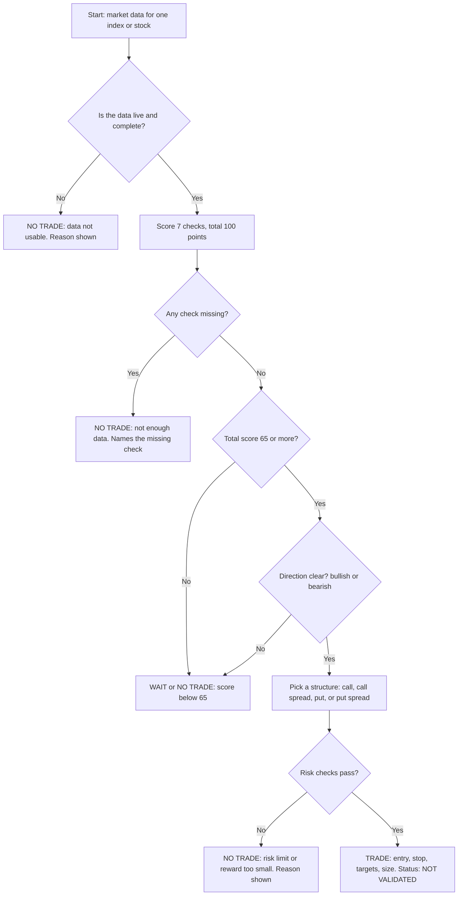
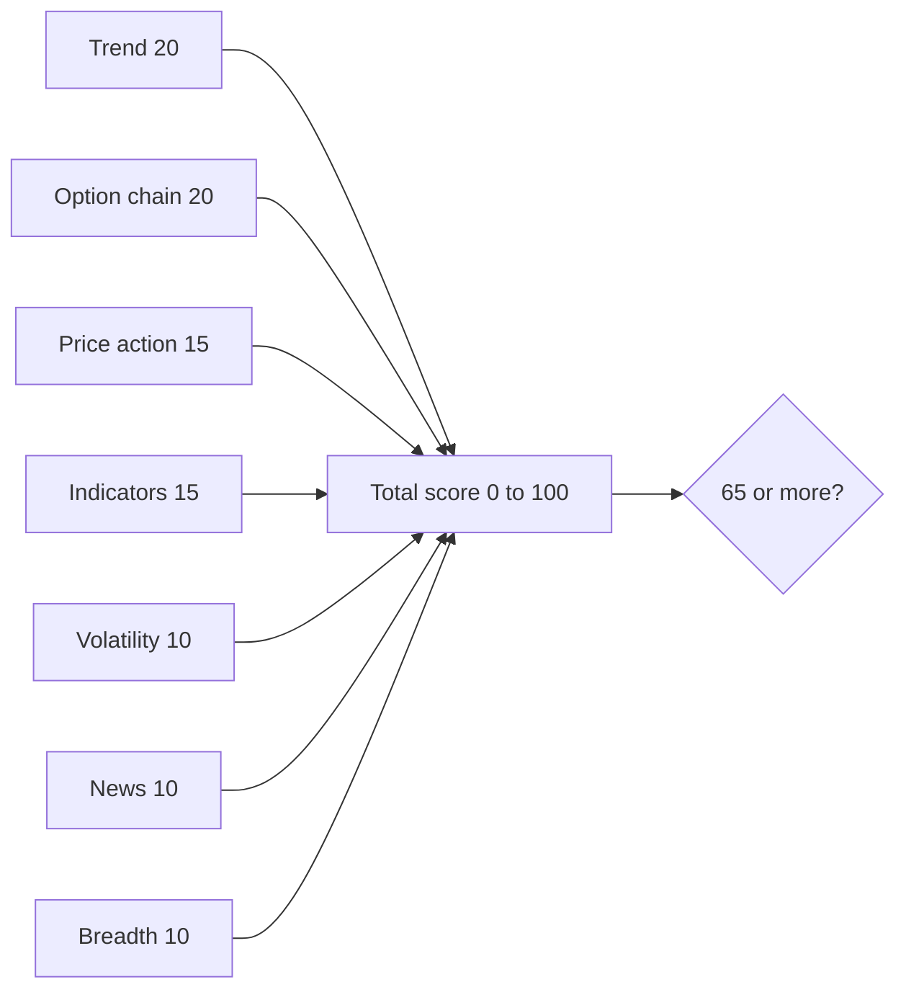
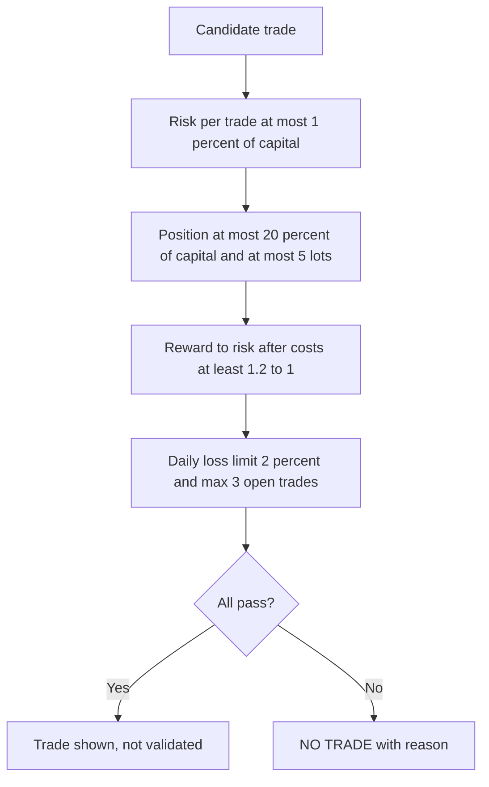
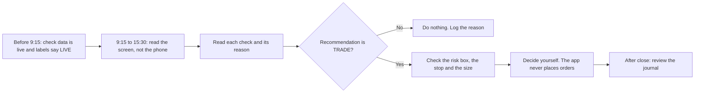

# How the stock and options recommendation works (plain English)

**Status:** the rules below are what the software does today. **None of this is validated.** It has not been tested on data it was not built on, so every output is labelled "not validated".

## 1. The question a trader asks, and how the software answers it
A trader asks: "Is the market moving up or down, is the move confirmed, and is it worth the risk?"
The software answers the same three questions with a checklist.

## 2. The seven checks (total 100 points)

| Check | Points | Plain question |
|---|---|---|
| Market trend | 20 | Are the short and medium moving averages lined up, and is price above them? |
| Option chain / open interest | 20 | Are big option positions building on the side that matches the move? |
| Price action | 15 | Did recent candles make higher highs and higher lows (or the reverse)? |
| Technical indicators | 15 | RSI (momentum) and MACD (trend strength) agree? |
| Volatility / implied volatility | 10 | Is volatility in a range where options are fairly priced? |
| News sentiment | 10 | Is the news flow positive or negative, and is it current? |
| Breadth | 10 | How many index stocks rose versus fell? |

Each check says "bullish", "bearish" or "no view". The side with more points is the direction. Checks that agree with that side add points. Checks that disagree add none.

## 3. Choosing the trade shape
- **Bullish:** Long call (simple) or bull call spread (cheaper, capped profit).
- **Bearish:** Long put (simple) or bear put spread (cheaper, capped profit).

## 4. Risk rules (apply after the score)

## 5. Entry, stop and targets (the formulas in the code)
- **Move** = option delta times the daily average true range (ATR), i.e. the expected index move.
- **Stop** = the larger of (entry minus 0.35 times the move) and (half the entry price).
- **Target 1** = entry plus 0.5 times the move. **Target 2** = entry plus 1.0 times the move.

## 6. Daily process a human would follow

## 7. What is and is not true today
- **True:** the checks, weights, threshold (65) and risk rules above are in the code and tested to behave as described.
- **Not true:** that these rules make money. That has not been proven. The engine is marked NO-GO for that reason.
- **Fixed recently:** a missing 200-day average no longer lets a trade through (the F-R1 defect).
- **Missing data:** if the 200-day average is not available, the trend check is marked missing and no trade is shown.
