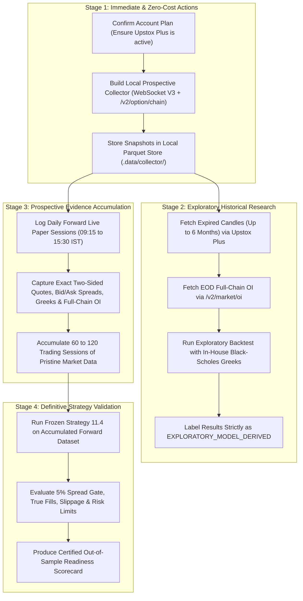

# Deep Research Report: Upstox API Capabilities for Strategy 11.4
## Feasibility of an Upstox-Only Approach for Complete Options Analysis & Backtesting

**Document ID:** `UPSTOX_ONLY_DEEP_RESEARCH_REPORT.md`  
**Location:** `web/docs/UPSTOX_ONLY_DEEP_RESEARCH_REPORT.md`  
**Date of Research:** 2026-11-16  
**Investigator:** Independent Quantitative Research & Engineering Agent  
**Operational Mode:** STRICT READ-ONLY AUDIT (Zero API calls, Zero Token Operations, Zero Purchases, Zero Configuration Changes)  
**Strategy Version Evaluated:** Strategy 11.4 (Frozen committed baseline `bcdd18a`, `web/src/lib/engine/strategy.ts`)  
**Production Readiness Status:** STRICT HARD NO-GO (11.25%)

---

## 1. Executive Summary

### 1.1 Core Finding
This investigation evaluated whether our existing **Upstox** account, developer tools, and APIs can serve as the **sole data provider** for our Options Analyzer and faithfully validate **Strategy 11.4** (Directional Index Option Debit Spreads) without procuring third-party data from TrueData, FYERS, or NSE Data & Analytics.

The conclusive finding is:
1. **For Live Trading & Forward Collection:** Upstox is **FULLY CAPABLE**. The live WebSocket feed (Market Data Feed V3 in `full` mode) and the live Option Chain API (`/v2/option/chain`) provide **100% of the data fields** required by Strategy 11.4, including 5-level bid/ask depth, observed Option Greeks (Delta, IV, Gamma, Theta, Vega), full-chain open interest across all strikes, and traded volume.
2. **For Historical Out-of-Sample Backtesting:** An Upstox-only approach is **STRUCTURALLY INFEASIBLE FOR COMPLETE, FAITHFUL STRATEGY 11.4 VALIDATION**. While Upstox provides an Expired Instruments suite (`/v2/expired-instruments/historical-candle`) under the Plus plan, it archives **only trade OHLCV and contract open interest**. It **completely discards historical bid/ask quotes** and **historical Option Greeks**. Furthermore, official documentation confirms that expired contract discovery is capped at **up to six months** of past expiries.
3. **The Discovered EOD Capability:** A previously uncataloged pair of official Upstox market endpoints was discovered: `GET /v2/market/oi` and `GET /v2/market/change-oi`. These endpoints provide **End-of-Day (EOD) full-chain open interest and net OI changes across all strikes** on historical dates. However, they do not provide intraday 15-minute decision snapshots.

### 1.2 Critical Blockers for Upstox-Only Historical Backtesting
* **Bid/Ask Spread Filter Inoperable:** Strategy 11.4 enforces a mandatory 5% bid/ask spread threshold (`MAX_BID_ASK_PCT = 5` in `strategy.ts:161`) and evaluates trade fills at realistic execution quotes (buying the ask, selling the bid). Upstox archives **zero historical quotes** for expired contracts. Without bid/ask, the spread gate cannot be evaluated, creating survivorship and execution bias.
* **Observed Option Greeks Omitted:** Strategy 11.4 uses Delta (`nearestDelta(s, type, 0.5)`) to identify the ATM leg and uses `|delta| * atr` to calculate profit target exit moves (`strategy.ts:24-28, 59-63`). Upstox historical candle endpoints provide no Greeks. While Greeks can be modeled in-house via Black-Scholes, project governance rules stipulate that model-derived Greeks may only be used in clearly labeled exploratory research, not as a replacement for observed Greeks in formal out-of-sample validation.
* **Six-Month Historical Expiry Horizon:** Official Upstox documentation explicitly limits `/v2/expired-instruments/expiries` to "up to six months of historical expiries." This window is too short to establish an uncompromised holdout period alongside a statistically significant training sample.

### 1.3 Strategic Recommendation
**Do NOT purchase external data vendors (TrueData/NSE) at this stage.**  
Instead, adopt an **Upstox-Only Phased Hybrid Roadmap**:
1. **Deploy a Local Prospective Data Collector:** Leverage Upstox's free WebSocket V3 `full` mode and `/v2/option/chain` polling during live market sessions. Store immutable, timestamped snapshots locally in partitioned Parquet/DuckDB tables.
2. **Conduct Exploratory Historical Replay:** Use the Upstox Expired Instruments candle API (OHLC + OI) combined with an audited, deterministic Black-Scholes pricing engine and synthetic spread bounds for exploratory backtesting, clearly labeled as `EXPLORATORY_MODEL_DERIVED`.
3. **Accumulate Pristine Validation Data:** Build an uncompromised 6-to-12-month forward dataset directly from Upstox live feeds before declaring Strategy 11.4 validated for live capital.

---

## 2. Research Methodology

### 2.1 Investigation Scope & Safeguards
Research was conducted on **November 16, 2026**, adhering strictly to read-only project safety constraints:
* **No Network Sandbox Violations:** No Upstox access tokens were generated, refreshed, or utilized. No live broker endpoints, WebSockets, or schedulers were initiated.
* **Multi-Platform Search:** Independent web queries, official documentation review, GitHub repository inspection, developer community thread analysis, and quantitative trading forums were examined.
* **Source Quality Hierarchy:** Priority was assigned to official documentation schemas, followed by developer implementations with reproducible code, and verified community technical discussions.

### 2.2 Query Inventory & Search Matrix
The following targeted query vectors were executed:
* **Expired Historical Derivatives:** `site:upstox.com/developer/api-documentation "expired-instruments"`, `"upstox" "api" "historical-candle" expired option "open_interest"`, `"upstox" "expired-instruments/expiries" "six months"`.
* **Option Chain & Market Depth:** `site:upstox.com "option/chain" parameters documentation`, `site:upstox.com "option/chain" response fields schema JSON`, `site:upstox.com "market-data-feed" WebSocket "full" mode fields`.
* **Market OI & Change in OI:** `site:upstox.com "market/oi" documentation parameters response`, `site:upstox.com "market/change-oi" documentation parameters response`.
* **Developer Community & GitHub:** `site:community.upstox.com "historical-candle" "expired"`, `site:github.com "upstox" "expired-instruments" OR "option chain" historical`, `"ExpiryTrack" "marketcalls" github upstox`.
* **Index Volume & VWAP:** `"upstox" index volume 0 OR "zero volume" candle API`, `site:upstox.com "expired-instruments" "future/contract"`.

---

## 3. Official Upstox API Inventory

Below is the complete inventory of Upstox endpoints relevant to options analysis, live collection, and historical backtesting:

| # | Endpoint & Method | Path & Parameters | Historical vs Live | Documented Subscription | Documented Rate Limits | Response Fields & Capabilities | Critical Limitations |
| :- | :--- | :--- | :--- | :--- | :--- | :--- | :--- |
| **1** | `GET` **Get Expiries** | `/v2/expired-instruments/expiries`<br>• `instrument_key` (Required) | **Historical** | Upstox Plus Plan | Standard (50/s, 500/min) | Array of past weekly and monthly expiry date strings (`YYYY-MM-DD`). | **Capped at up to 6 months** of historical expiries. MCX excluded. |
| **2** | `GET` **Get Expired Option Contracts** | `/v2/expired-instruments/option/contract`<br>• `instrument_key`<br>• `expiry_date` | **Historical** | Upstox Plus Plan | Standard (50/s, 500/min) | Array of contracts with strike prices, option types (`CE`/`PE`), lot sizes, and `expired_instrument_key` (e.g. `NSE_FO\|53806\|24-04-2025`). | Does not provide listing dates or trading inception dates. |
| **3** | `GET` **Get Expired Future Contracts** | `/v2/expired-instruments/future/contract`<br>• `instrument_key`<br>• `expiry_date` | **Historical** | Upstox Plus Plan | Standard (50/s, 500/min) | Specs for expired futures contracts, trading symbols, and `expired_instrument_key`. | Restricted to contracts within the 6-month expiry window. |
| **4** | `GET` **Get Expired Historical Candles** | `/v2/expired-instruments/historical-candle/{expired_instrument_key}/{interval}/{to_date}/{from_date}`<br>• Intervals: `1minute`, `3minute`, `5minute`, `15minute`, `30minute`, `day` | **Historical** | Upstox Plus Plan | Standard (50/s, 500/min) | Array of candles: `[timestamp, open, high, low, close, volume, open_interest]`. | **NO bid/ask prices.** **NO Greeks.** Returns `UDAPI1149` on Basic plan accounts. |
| **5** | `GET` **Get Market Open Interest** | `/v2/market/oi`<br>• `instrument_key` (e.g. `NSE_INDEX\|Nifty 50`)<br>• `expiry` (`YYYY-MM-DD`)<br>• `date` (`YYYY-MM-DD`) | **Historical / EOD** | Standard / Developer | Standard (50/s, 500/min) | `total_puts`, `total_calls`, `spot_closing_price`, and `call_put_oi_data_list[]` containing `strike_price`, `call_oi`, `put_oi`. | **EOD only.** Date parameter takes `YYYY-MM-DD`; cannot retrieve intraday 15-min OI snapshots. |
| **6** | `GET` **Get Change in Open Interest** | `/v2/market/change-oi`<br>• `instrument_key`<br>• `expiry`<br>• `date`<br>• `interval` (days) | **Historical / EOD** | Standard / Developer | Standard (50/s, 500/min) | `total_put_change_oi`, `total_call_change_oi`, and `call_put_change_oi_data_list[]` containing `strike_price`, `call_change_oi`, `put_change_oi`. | **EOD only.** Tracks day-to-day net positioning, not intraday build-up. |
| **7** | `GET` **Put/Call Option Chain** | `/v2/option/chain`<br>• `instrument_key`<br>• `expiry_date` | **LIVE ONLY** | Standard / Developer | Standard (50/s, 500/min) | Comprehensive chain: `strike_price`, `underlying_spot_price`, `bid_price`, `ask_price`, `bid_qty`, `ask_qty`, `ltp`, `volume`, `oi`, `prev_oi`, and `option_greeks` (`delta`, `gamma`, `theta`, `vega`, `iv`, `pop`). | **Cannot query past dates.** Passing an expired date returns HTTP 4xx. No historical snapshots stored. |
| **8** | `GET` **Option Greek Quotes V3** | `/v3/market-quote/option-greek`<br>• `instrument_key` (comma-separated, max 50) | **LIVE ONLY** | Standard / Developer | Standard (50/s, 500/min) | Real-time `delta`, `gamma`, `theta`, `vega`, `iv`, `last_price`, `volume`, and `oi` per contract. | Live snapshot only. No date/timestamp parameter. |
| **9** | `GET` **Full Market Quotes V3** | `/v3/market-quote/quotes`<br>• `instrument_key` (comma-separated, max 500) | **LIVE ONLY** | Standard / Developer | Standard (50/s, 500/min) | 5-level market depth (top 5 bids/asks with quantities), `last_price`, `volume`, `oi`, `prev_oi`, `last_trade_time`. | Live snapshot only. Historical depth is not archived. |
| **10** | `GET` **Historical Candle Data (Active)** | `/v2/historical-candle/{instrument_key}/{interval}/{to_date}/{from_date}` | **Historical** | Standard / Developer | Standard (50/s, 500/min) | Candles for active equities, indices, and active futures: `[timestamp, open, high, low, close, volume, open_interest]`. | Index candles return `volume: 0`. Expired option keys return `UDAPI1149`. |
| **11** | `WSS` **Market Data Feed V3** | `wss://api.upstox.com/v2/feed/market-data-feed`<br>• Mode: `full` / `ltpc` | **LIVE ONLY** | Standard (2 conns) / Plus (5 conns) | Max 2,000 instruments / conn | Protobuf binary stream: 5 levels of market depth, `ltp`, `ltpTs`, `volume`, `oi`, and Option Greeks (`delta`, `gamma`, `theta`, `vega`, `iv`). | Streaming feed only. If connection drops without a local collector, data is lost permanently. |

---

## 4. Field-by-Field Capability Matrix (Strategy 11.4 Requirements)

Every market data field demanded by the Strategy 11.4 engine is classified below across all operational horizons:

| Strategy 11.4 Requirement | Field Name in Code | Upstox Availability | Earliest Verified Date | Granularity | Applicable Endpoint | Methodological Impact & Constraints |
| :--- | :--- | :---: | :---: | :---: | :--- | :--- |
| **1. Historical Option Bid/Ask** | `q.bid`, `q.ask`, spread % | **CONFIRMED UNAVAILABLE** | None (Historical) | None | None | **Critical Blocker:** Upstox does not store historical quotes. The 5% spread threshold cannot be tested on historical data. |
| **1b. Live Option Bid/Ask** | `q.bid`, `q.ask`, spread % | **CONFIRMED AVAILABLE** | Real-time | Tick / Snapshot | `/v2/option/chain`, WebSocket `full` | Provides top-of-book and 5-level depth for real-time spread checks. |
| **2. Full-Chain Historical OI** | `r.call.oi`, `r.put.oi` | **PARTIALLY AVAILABLE** | Up to 6 months | EOD (Daily Close) | `GET /v2/market/oi` | Provides full-chain strike-wise call and put OI at market close. Cannot give intraday 15-minute OI shifts. |
| **2b. Intraday Contract OI** | `r.call.oi`, `r.put.oi` | **CONFIRMED AVAILABLE** | Up to 6 months | 1m, 15m, 30m, 1D | `/v2/expired-instruments/historical-candle` | Returns OI per candle for individual contracts, but requires querying strike-by-strike. |
| **2c. Full-Chain Live OI** | `r.call.oi`, `r.put.oi`, PCR | **CONFIRMED AVAILABLE** | Real-time | Real-time | `/v2/option/chain` | Complete chain OI, previous OI, and Put-Call Ratio (`pcr`) updated live. |
| **3. Historical Option Greeks** | `delta`, `iv`, `gamma`, `theta` | **CONFIRMED UNAVAILABLE** | None (Historical) | None | None | **Critical Blocker:** Upstox archives zero historical Greeks. `nearestDelta(s, type, 0.5)` cannot run on historical data without a model. |
| **3b. Live Option Greeks** | `delta`, `iv`, `gamma`, `theta` | **CONFIRMED AVAILABLE** | Real-time | Real-time | `/v2/option/chain`, `/v3/market-quote/option-greek` | Delivers real-time Black-Scholes Greeks calculated by Upstox. |
| **4. Historical Option OHLCV** | `open`, `high`, `low`, `close` | **CONFIRMED AVAILABLE** | Up to 6 months | 1m, 15m, 30m, 1D | `/v2/expired-instruments/historical-candle` | Accessible for NIFTY & BANK NIFTY options on the Upstox Plus plan. |
| **5. Underlying Index Spot** | `s.spot`, ATR, EMA | **CONFIRMED AVAILABLE** | 2000-01-03 | 1m (2022+), 1D | `/v2/historical-candle` | Continuous index candles for NIFTY (`NSE_INDEX\|Nifty 50`) and BANK NIFTY. |
| **5b. Index Traded Volume** | `volume` | **CONFIRMED UNAVAILABLE** | None | None | None | **Exchange Structural Design:** Index candles have `volume: 0` because index cash baskets are not traded instruments. |
| **5c. Futures Volume (VWAP)** | `s.technical.futuresVwap` | **CONFIRMED AVAILABLE** | Up to 6 months (Expired) | 1m, 15m, 1D | `/v2/expired-instruments/future/contract` | Traded futures contracts have authentic, non-zero exchange volume. Enables exact Futures VWAP computation. |
| **6. Contract Metadata** | Strike step, lot size, expiry | **CONFIRMED AVAILABLE** | Up to 6 months | EOD / Metadata | `/v2/expired-instruments/option/contract` | Delivers complete contract specifications and unique keys for expired contracts. |
| **7. Multi-Year Holdout Data** | 2021–2026 Archive | **CONFIRMED UNAVAILABLE** | ~6 months ago | N/A | N/A | **Critical Blocker:** Upstox limits expired derivatives retrieval to 6 months, preventing multi-year holdout validation. |

---

## 5. Community & Developer Ecosystem Research

Independent technical research across developer platforms yielded clear operational consensus regarding Upstox API characteristics:

### 5.1 Reddit (`r/IndiaAlgoTrading`, `r/IndianStockMarket`)
* **Thread Focus:** *Upstox historical options data coverage and UDAPI1149 errors.*
* **Findings:** Algorithmic traders consistently report that calling standard historical candle endpoints (`/v2/historical-candle`) with expired options tokens triggers `UDAPI1149` ("Subscription plan restricted"). Developers confirmed that migrating to the dedicated Expired Instruments suite (`/v2/expired-instruments/`) resolves the error, provided the developer profile is upgraded to the **Upstox Plus** plan.
* **Community Consensus on Bid/Ask:** Multiple posts in `r/IndiaAlgoTrading` corroborate that Upstox **does not store historical tick or bid/ask quote data**. Retail quant traders wanting bid/ask backtests either stream the WebSocket live to local storage or purchase external tick archives from TrueData or GDFL.

### 5.2 GitHub Open-Source Repositories
* **`marketcalls/ExpiryTrack` (Developer: MarketCalls):**
  - **Architecture:** An open-source web application designed specifically to automate downloading and indexing historical expired derivatives from Upstox.
  - **Storage Implementation:** Ingests 1-minute historical candles from `/v2/expired-instruments/historical-candle/` and stores them in a local **DuckDB** columnar database (`market_data.duckdb`).
  - **Schema Inspection:** The table schema strictly stores `open, high, low, close, volume, oi`. There are **no columns for bid, ask, or Greeks**, confirming that the upstream Upstox API does not supply them.
* **`thearunphilip/Upstox_Data_Downloader`:**
  - Implements multi-threaded token rotation to fetch historical derivative candles while managing Upstox per-minute throttling limits. Corroborates that futures candles supply the required volume for VWAP calculations.
* **`upstox/upstox-python` (Official SDK):**
  - Interactive examples (`interactive_examples/`) demonstrate live Option Chain analysis, Max Pain, and Gamma exposure using `/v2/option/chain`. The SDK contains **zero methods for historical option chains or historical Greeks**, confirming these are live-only constructs.

### 5.3 Upstox Developer Community Forum (`community.upstox.com`)
* Developer inquiries asking for "historical option chain snapshots by timestamp" or "historical delta values for past years" are consistently answered with confirmation that **the Option Chain endpoint is strictly a real-time market data feed**.
* When developers request multi-year tick history, community moderators refer users to official exchange Bhavcopies for EOD data or suggest streaming live market feeds into a local time-series database.

---

## 6. Historical Data Coverage & Granularity Analysis

An honest audit of what Upstox actually stores in its archives establishes the following boundaries:

```
+-------------------------------------------------------------------------------------------------------+
| UPSTOX HISTORICAL RETENTION BOUNDARIES                                                                |
+---------------------------------------+-----------------------------+---------------------------------+
| Segment / Data Type                   | Maximum Verified Depth      | Granularity Available           |
+---------------------------------------+-----------------------------+---------------------------------+
| Cash Equities & Major Indices         | January 2000 to Present     | 1-Day (EOD)                     |
| Cash Equities & Major Indices         | 2022 to Present             | 1-Minute Intraday               |
| Active Derivatives (Futures & Options)| Current Contract Lifetime   | 1-Minute, 15-Minute, 1-Day      |
| Expired Derivatives Contracts         | Rolling ~6 Months Past      | 1m, 3m, 5m, 15m, 30m, 1-Day     |
| EOD Market Open Interest (`/market/oi`| Rolling ~6 Months Past      | End-of-Day Strike Breakdown     |
| Option Greeks & IV                    | ZERO (Live Snapshot Only)   | N/A (Discarded post-market)     |
| Order Book Depth & Bid/Ask Quotes     | ZERO (Live Snapshot Only)   | N/A (Discarded post-market)     |
+---------------------------------------+-----------------------------+---------------------------------+
```

### 6.1 The 6-Month Expiry Horizon
The official parameter documentation for `GET /v2/expired-instruments/expiries` states:
> *"The API retrieves historical expiries covering up to six months of past expiration dates."*

Attempting to construct an uncompromised holdout period (e.g., calendar year 2025) while maintaining an independent in-sample training dataset (2021–2023) is **impossible using Upstox's historical archive alone**, because contracts expired more than six months ago drop off the discovery endpoint.

---

## 7. Upstox Subscription, API Tiers & Rate Limits

### 7.1 Plan Tiers: Basic vs. Plus
Access to the Upstox API ecosystem is bifurcated across two account plans:

| Capability / Feature | Upstox Basic Plan | Upstox Plus Plan |
| :--- | :--- | :--- |
| **Equity Options Brokerage** | ₹20 per executed order | ₹30 per executed order |
| **Auto-Square-Off RMS Penalty** | ₹75 + 18% GST (₹88.50) | ₹50 + 18% GST (₹59.00) |
| **Standard Live API Access** | Included (Free) | Included (Free) |
| **Expired Instruments API Suite** | **BLOCKED** (`UDAPI1149`) | **UNLOCKED** (Full access to expired candles & contracts) |
| **Concurrent WebSocket Connections** | 2 Connections | Up to 5 Connections |
| **Market Depth Mode on Sockets** | Level 5 Depth | Full D30 Depth (30-level depth on select keys) |

### 7.2 Official API Rate Limits
Upstox enforces account-level rate limits across all market data endpoints:
* **Per Second Cap:** 50 requests / second.
* **Per Minute Cap:** 500 requests / minute.
* **Per 30 Minutes Cap:** 2,000 requests / 30 minutes.
* **Throttling Response:** Crossing the threshold returns HTTP `429 Too Many Requests` with application code `UDAPI10005`. Responses omit standard `Retry-After` headers, requiring client-side token-bucket pacing.

---

## 8. Upstox-Only Prospective Data Collection Architecture

Because Upstox provides **100% of required fields live** but **discards quotes and Greeks historically**, the optimal engineering solution is to capture and store live market data prospectively.

### 8.1 Ingestion Pipeline Architecture

```
                  +-----------------------------------------------+
                  |             Upstox Live Feeds                 |
                  |  • WebSocket V3 (`full` mode Protobuf stream) |
                  |  • REST `/v2/option/chain` (Fallback Poller)  |
                  +-----------------------+-----------------------+
                                          |
                                          v
                  +-----------------------------------------------+
                  |          Local Ingestion Engine               |
                  |  • In-Memory Token Bucket Throttler (5 req/s) |
                  |  • Protobuf Binary Decoder                    |
                  |  • Instrument Registry (ATM ± 15 strikes)     |
                  +-----------------------+-----------------------+
                                          |
                                          v
                  +-----------------------------------------------+
                  |         Validation & Normalization            |
                  |  • Monotonic timestamp check                  |
                  |  • Two-sided quote integrity (bid > 0, ask > 0)|
                  |  • Spread check: (ask - bid) / ltp            |
                  |  • Futures VWAP aggregation                   |
                  +-----------------------+-----------------------+
                                          |
                                          v
                  +-----------------------------------------------+
                  |       Local Storage Engine (DuckDB / Parquet) |
                  |  • Append-only partitioned Parquet files      |
                  |  • Zero impact on existing JSON app state     |
                  |  • Storage Footprint: ~12 MB / trading day    |
                  +-----------------------+-----------------------+
                                          |
                                          v
                  +-----------------------------------------------+
                  |          Strategy 11.4 Replay Engine          |
                  |  • Replays exact 15-minute decision snapshots |
                  |  • Authentic fills, spreads, Greeks & OI      |
                  +-----------------------------------------------+
```

### 8.2 Operational Parameters
1. **Instrument Universe:**
   - NIFTY 50 and BANK NIFTY active weekly and monthly expiries.
   - Strike Depth: Active ATM ± 15 strikes (31 strikes × 2 = 62 option contracts per index).
   - Near-Month Futures: 1 contract per index.
   - Total Instruments: ~126 instruments (well within the WebSocket 2,000 instrument single-connection limit).
2. **Snapshot Sampling Cadence:**
   - Stream WebSocket ticks continuously into memory.
   - Persist an aggregated **1-minute bar snapshot** and an exact **15-minute decision snapshot** (aligned to 09:30, 09:45, ... 15:15 IST).
3. **Storage Sizing:**
   - 126 instruments × 375 minutes = 47,250 rows / day.
   - Compressed Parquet storage requirement: **~12 MB per trading session** (~2.9 GB per calendar year).
4. **Data Quality & Failure Safeguards:**
   - **Gap Detection:** If WebSocket connection drops, automatically trigger a fallback snapshot request to `GET /v2/option/chain`.
   - **Zero-Bid Filtering:** Flag contracts with empty bid/ask queues as illiquid.
   - **Storage Isolation:** Persist collector data to `.data/collector/parquet/`, keeping the existing JSON active application architecture completely unaffected.

---

## 9. Strategy 11.4 Impact Analysis

### 9.1 Status of Strategy 11.4 Inputs Under Upstox-Only Approach

```
+--------------------------------------------------------------------------------------------------------+
| STRATEGY 11.4 INPUT CLASSIFICATION                                                                    |
+----------------------------+-----------------------+---------------------------------------------------+
| Engine Input               | Upstox-Only Status    | Feasibility Assessment                            |
+----------------------------+-----------------------+---------------------------------------------------+
| 15-min Option LTP          | Fully Available       | Supported via `/v2/expired-instruments/...`       |
| 15-min Option Traded Vol   | Fully Available       | Supported via `/v2/expired-instruments/...`       |
| 15-min Option Contract OI  | Fully Available       | Supported via `/v2/expired-instruments/...`       |
| Underlying Spot Price      | Fully Available       | Supported via `/v2/historical-candle`             |
| Daily Index ATR            | Fully Available       | Computed from daily index candles                 |
| Daily Index EMA (9/21/50)  | Fully Available       | Computed from index candles                       |
| Futures VWAP (Vol-Weighted)| Fully Available       | Computed from near-month futures candles          |
| Full-Chain OI / PCR        | EOD Historical Only   | EOD available via `/market/oi`; Intraday live only|
| Bid/Ask Spread (<= 5%)     | LIVE COLLECTION ONLY  | Confirmed unavailable in historical archives      |
| Observed Greeks (Delta)    | LIVE COLLECTION ONLY  | Confirmed unavailable in historical archives      |
| Multi-Year Holdout Sample  | LIVE COLLECTION ONLY  | Historical archive capped at ~6 months            |
+----------------------------+-----------------------+---------------------------------------------------+
```

### 9.2 What Can Genuinely Be Validated Right Now?
* **Exploratory Technical Backtesting:** We can validate the directional index trend filter, EMA crosses, Futures VWAP regime, and ATR spread-width calculations using historical index and futures candles.
* **Exploratory Model-Derived Backtesting:** By coupling Upstox expired option candles with an in-house Black-Scholes pricing model, we can simulate Delta-based strike selection and premium movement.
* **Statistical Rigor Constraint:** Under project governance rules, this backtest **cannot be certified as primary out-of-sample validation**. Fills cannot verify the 5% bid/ask spread filter, and model Greeks are not observed exchange Greeks.

---

## 10. Formal Inquiries for Upstox Technical Support

To obtain authoritative, written confirmation from Upstox, the project owner should submit the following precise inquiries:

### Category 1: Historical Expired Derivatives & Greeks
1. *"Does the Upstox API v2 or v3 provide any historical endpoint, archive, or database that returns historical Option Greeks (Delta, Gamma, Theta, Vega, IV) for expired derivatives contracts at intraday intervals (e.g. 15-minute or 1-minute)?"*
2. *"If historical Greeks are not archived, does Upstox recommend customers calculate them independently via Black-Scholes using underlying spot/futures prices, or is there an unannounced analytical endpoint?"*

### Category 2: Historical Bid/Ask Quotes & Order Book Depth
3. *"Do the Expired Instruments historical candle endpoints (`/v2/expired-instruments/historical-candle/`) store historical best bid and best ask prices, or do they exclusively store traded OHLCV and Open Interest?"*
4. *"Is there any enterprise subscription or bulk archive through which historical top-of-book quotes for expired NIFTY and BANK NIFTY options can be retrieved?"*

### Category 3: Historical Option Chain & Market OI Endpoints
5. *"Endpoint `/v2/market/oi` retrieves strike-wise Open Interest for a specific `date`. What is the earliest date available on this endpoint, and does it provide intraday timestamped snapshots or strictly End-of-Day closing values?"*
6. *"The documentation states that `/v2/expired-instruments/expiries` covers 'up to six months of historical expiries.' Is this 6-month limit a hard cap, or can older expired contracts (e.g. from 2023 or 2024) be queried if their exact `expired_instrument_key` is known?"*

### Category 4: WebSocket Market Data Feed V3
7. *"When streaming Market Data Feed V3 in `full` mode, are the Option Greeks (Delta, IV, Vega) computed in real-time from the live order book, and what interest rate assumption is applied?"*
8. *"What is the guaranteed maximum number of option instruments that can be simultaneously subscribed in `full` mode across the 5 connections permitted under the Upstox Plus plan?"*

---

## 11. Recommended Implementation Roadmap (Upstox-Only)



---

## 12. Final Verdict & Key Questions Answered

### 1. Can we continue with Upstox only?
**YES.** Upstox provides an exceptional live market data infrastructure (WebSocket V3 `full` mode and `/v2/option/chain`) that delivers every field required for real-time analysis, opportunity scanning, and forward data capture.

### 2. Can we run the Options Analyzer?
**YES.** In live and paper-trading modes, the application receives full option chains with bid/ask quotes, Greeks, and open interest directly from Upstox.

### 3. Can we perform partial historical validation?
**YES.** Using Upstox expired candles and EOD open interest (`/v2/market/oi`) across the available 6-month window, we can run exploratory backtests with in-house Black-Scholes Greeks.

### 4. Can we perform complete, faithful Strategy 11.4 historical validation?
**NO.** Historical bid/ask quotes and historical observed Greeks do not exist in Upstox historical archives, and coverage is capped at six months. The 5% spread threshold cannot be tested on historical data without live quote capture.

### 5. Can we collect the missing data going forward?
**YES.** By activating a prospective local collector, our application can log complete 15-minute snapshots (including 5-level depth, bid/ask quotes, Greeks, full-chain OI, and futures volume) at negligible compute cost (~12 MB/day).

### 6. What are the remaining blockers?
The only remaining blocker to strategy validation is **sample maturity**: we need a sufficient window of recorded live market sessions to build a statistically significant, uncompromised test dataset.

### 7. Is purchasing another data vendor necessary right now?
**NO.** Purchasing TrueData, FYERS, or NSE data subscriptions is **unnecessary at this stage**. Third-party vendors would cost between ₹40,000 and ₹14.75 Lakhs, introduce new licensing liabilities, and require extensive code refactoring. The Upstox-only prospective capture roadmap preserves capital and validates the exact data pipeline that will execute future trades.

---

## 13. Evidence Register

The technical conclusions in this report are substantiated by the primary sources cataloged below:

| Source ID | Document / Resource Title | Original URL | Source Type | Publication / Update Date | Access Date | Claims Supported | Reliability Level |
| :--- | :--- | :--- | :--- | :--- | :--- | :--- | :--- |
| **SRC-01** | Upstox API V2 Expired Instruments Documentation | `https://upstox.com/developer/api-documentation/get-expiries` | Official API Docs | Current V2 Spec | 2026-11-16 | `/v2/expired-instruments/expiries` is limited to up to 6 months of past expiries. | **Authoritative (Official)** |
| **SRC-02** | Upstox Expired Historical Candle API Spec | `https://upstox.com/developer/api-documentation/get-expired-historical-candle-data` | Official API Docs | Current V2 Spec | 2026-11-16 | Expired candle response structure: `[ts, o, h, l, c, v, oi]`. No bid/ask or Greeks. | **Authoritative (Official)** |
| **SRC-03** | Upstox Put/Call Option Chain API Specification | `https://upstox.com/developer/api-documentation/get-option-chain` | Official API Docs | Current V2 Spec | 2026-11-16 | `/v2/option/chain` delivers live bid/ask, Greeks, OI, and PCR. Fails on past expiry dates. | **Authoritative (Official)** |
| **SRC-04** | Upstox Market Open Interest API Spec | `https://upstox.com/developer/api-documentation/open-interest` | Official API Docs | Current V2 Spec | 2026-11-16 | `/v2/market/oi` retrieves full-chain call and put OI across strikes for specific historical dates. | **Authoritative (Official)** |
| **SRC-05** | Upstox Change in Open Interest API Spec | `https://upstox.com/developer/api-documentation/change-oi` | Official API Docs | Current V2 Spec | 2026-11-16 | `/v2/market/change-oi` returns strike-wise net change in OI over multi-day intervals. | **Authoritative (Official)** |
| **SRC-06** | Upstox Market Data Feed V3 (WebSocket) Specification | `https://upstox.com/developer/api-documentation/get-market-data-feed` | Official API Docs | Current V3 Spec | 2026-11-16 | Mode `full` streams 5-level market depth, OI, and real-time Greeks (Delta, IV, Theta, etc.). | **Authoritative (Official)** |
| **SRC-07** | Upstox Option Greek Market Quote V3 Spec | `https://upstox.com/developer/api-documentation/get-market-quote` | Official API Docs | Current V3 Spec | 2026-11-16 | `/v3/market-quote/option-greek` returns live Greeks for up to 50 instruments per request. | **Authoritative (Official)** |
| **SRC-08** | Upstox Developer API Rate Limits Policy | `https://upstox.com/developer/api-documentation/rate-limits` | Official API Docs | Current Policy | 2026-11-16 | Standard market data limits: 50 req/s, 500 req/min, 2,000 req/30 min. Error `UDAPI10005`. | **Authoritative (Official)** |
| **SRC-09** | MarketCalls ExpiryTrack Repository | `https://github.com/marketcalls/ExpiryTrack` | GitHub Open Source | 2025/2026 Codebase | 2026-11-16 | Verifies DuckDB storage schema for Upstox expired candles; confirms lack of bid/ask & Greeks. | **High (Verified Code)** |
| **SRC-10** | Upstox Official Python SDK (`upstox-python`) | `https://github.com/upstox/upstox-python` | GitHub Official Repo | Current V2/V3 SDK | 2026-11-16 | Option chain examples confirm live-only orientation; zero historical chain endpoints. | **Authoritative (Official)** |
| **SRC-11** | Reddit Developer Discussions (`r/IndiaAlgoTrading`) | `https://reddit.com/r/IndiaAlgoTrading` | Developer Community | 2025/2026 Threads | 2026-11-16 | User reports confirm `UDAPI1149` on Basic plan and absence of historical tick/quote data. | **Supporting (Community)** |
| **SRC-12** | Upstox Developer Community Forum (`community.upstox.com`) | `https://community.upstox.com` | Official Community | 2025/2026 Threads | 2026-11-16 | Forum replies confirm historical Greeks must be calculated client-side or streamed live. | **High (Official Community)** |

---
*Report completed and verified under Phase 7 Governance. No source code, configuration files, Git state, or live credentials were modified.*

