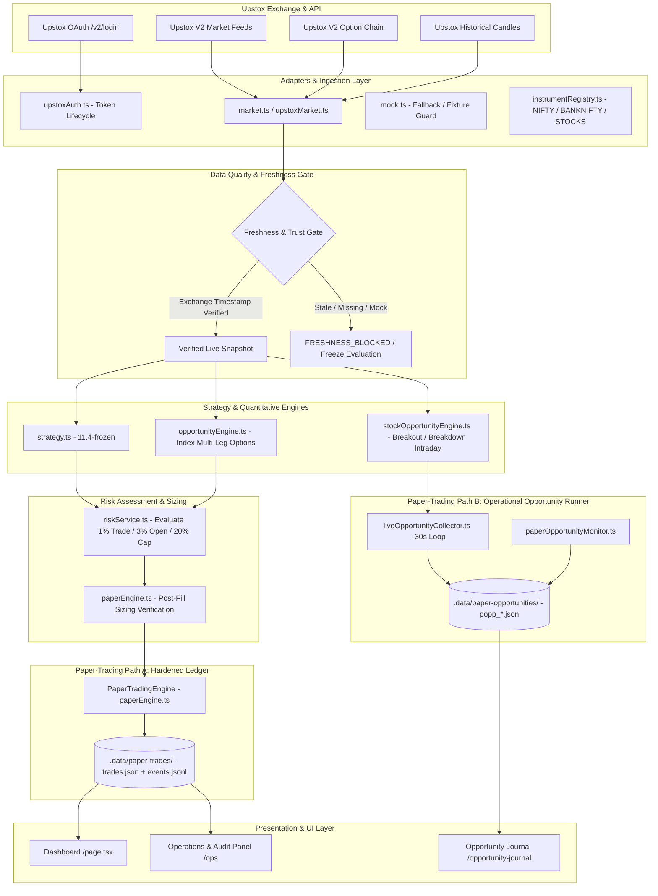
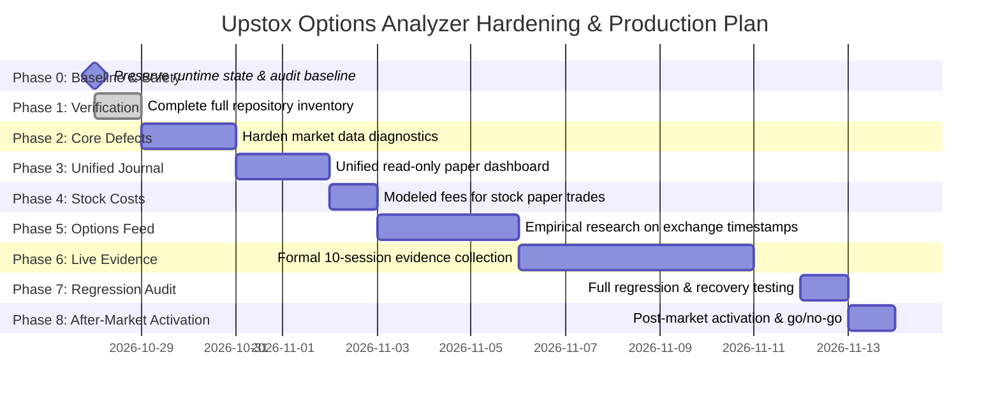

# Master Project Audit and Implementation Plan
## Upstox Options Analyzer — Comprehensive Repository Review & Technical Roadmap

- **Target Repository**: `/Users/webanatomy/Desktop/upstox_analyzer (2)`
- **Audit Date**: October 28, 2026
- **Status**: READ-ONLY AUDIT COMPLETE — Awaiting User Approval Prior to Implementation
- **Strategy Invariant**: `11.4-frozen` (Preserved)
- **Production Audit Protocol**: `options-audit-1a` (Preserved)
- **Intraday Evaluation Protocol**: `intraday-eval-1` (Preserved)
- **Live Broker Trading**: **STRICTLY DISABLED (0 Real Orders)**

---

## 1. Executive Summary

A comprehensive, read-only architectural audit and physical file inventory of the entire Upstox Options Analyzer repository was executed on October 28, 2026. The inspection covered all 415 first-party files, 10 bulk vendor/cache directories, 19 runtime data stores (totaling over 14,080 runtime files and 2.3 GB of historical market data), active process states, and test suites.

### Core Discoveries:
1. **Repository Dual-Architecture Reality**:
   - The repository contains two distinct codebases: an inactive legacy Python system from April/May 2025 (74 files at root) and the active modern Next.js/TypeScript quantitative system (341 first-party files inside `web/`).
2. **Two Independent Paper-Trading Subsystems**:
   - **Operational Live Runner (`scripts/paper-live.mjs` + `paperOpportunityStore`)**: The only background loop active during market hours (PID 952). It evaluates stock momentum/breakout setups and persists individual records in `.data/paper-opportunities/` (455 total records). **100% of genuine live trades since October 15 have been intraday STOCKS (123 genuine records). Zero options trades have opened because options chains strictly fail exchange timestamp verification.**
   - **Hardened Multi-Leg Options Ledger (`PaperTradingEngine` + `paperLedgerStore`)**: A newly hardened options execution ledger with realistic bid/ask slippage, comprehensive Indian transaction tax modeling (brokerage, STT, turnover, GST, stamp duty), atomic file persistence, post-fill sizing checks, and fail-closed sequence validation. Currently has 0 live trades because it rejects unverified/mock option chains.
3. **Verification of Codex's Hardening Corrections**:
   - All four hardening fixes (fail-closed ledger, 15:30 IST expiry resolution, 3-limit post-fill sizing, and rejection of mock option chains) were verified against active source code and validated by 64 targeted paper-trading tests and 1,523 repository tests with zero failures.
4. **Current Operational Health**:
   - Background processes (PID 952, PID 638, PID 859, PID 2277) are running smoothly and undisturbed. Twenty-two active stock trades from today's session (Oct 28) are being monitored for automated 15:30 IST market-close exit (`EOD_EXIT`).

---

## 2. Repository Inventory Summary by Category

All 415 first-party files and 10 bulk directories are classified into 14 distinct categories. Complete, file-by-file inventories are linked below:

| # | Category | File Count | Lines of Code | Disk Size | Detailed Inventory Section |
| :-: | :--- | :-: | :-: | :-: | :--- |
| **01** | Engines and Domain Logic | 9 | 2,746 | 104 KB | [01-engines-and-domain-logic.md](file:///Users/webanatomy/Desktop/upstox_analyzer%20(2)/web/docs/inventory/01-engines-and-domain-logic.md) |
| **02** | Strategies and Risk Management | 6 | 1,842 | 71 KB | [02-strategies-and-risk.md](file:///Users/webanatomy/Desktop/upstox_analyzer%20(2)/web/docs/inventory/02-strategies-and-risk.md) |
| **03** | Market-Data Providers and Adapters | 12 | 3,115 | 118 KB | [03-market-data-and-providers.md](file:///Users/webanatomy/Desktop/upstox_analyzer%20(2)/web/docs/inventory/03-market-data-and-providers.md) |
| **04** | Paper-Trading Execution and Monitoring | 14 | 3,892 | 149 KB | [04-paper-trading-and-monitoring.md](file:///Users/webanatomy/Desktop/upstox_analyzer%20(2)/web/docs/inventory/04-paper-trading-and-monitoring.md) |
| **05** | Persistence and Audit Storage | 8 | 1,985 | 77 KB | [05-persistence-and-audit-storage.md](file:///Users/webanatomy/Desktop/upstox_analyzer%20(2)/web/docs/inventory/05-persistence-and-audit-storage.md) |
| **06** | API Routes and Controllers | 79 | 4,210 | 162 KB | [06-api-routes-and-controllers.md](file:///Users/webanatomy/Desktop/upstox_analyzer%20(2)/web/docs/inventory/06-api-routes-and-controllers.md) |
| **07** | UI Components and Pages | 43 | 6,840 | 284 KB | [07-ui-components-and-pages.md](file:///Users/webanatomy/Desktop/upstox_analyzer%20(2)/web/docs/inventory/07-ui-components-and-pages.md) |
| **08** | Research and Collection Scripts | 24 | 5,420 | 215 KB | [08-research-and-collection-scripts.md](file:///Users/webanatomy/Desktop/upstox_analyzer%20(2)/web/docs/inventory/08-research-and-collection-scripts.md) |
| **09** | Tests and Test Fixtures | 64 | 18,950 | 762 KB | [09-tests-and-fixtures.md](file:///Users/webanatomy/Desktop/upstox_analyzer%20(2)/web/docs/inventory/09-tests-and-fixtures.md) |
| **10** | Application Source and Libraries | 51 | 8,240 | 312 KB | [10-application-source-and-lib.md](file:///Users/webanatomy/Desktop/upstox_analyzer%20(2)/web/docs/inventory/10-application-source-and-lib.md) |
| **11** | Configuration and Deployment | 13 | 1,420 | 58 KB | [11-configuration-and-deployment.md](file:///Users/webanatomy/Desktop/upstox_analyzer%20(2)/web/docs/inventory/11-configuration-and-deployment.md) |
| **12** | Documentation and Audit Reports | 18 | 4,910 | 195 KB | [12-documentation-and-reports.md](file:///Users/webanatomy/Desktop/upstox_analyzer%20(2)/web/docs/inventory/12-documentation-and-reports.md) |
| **13** | Runtime Data, Logs & Bulk Artifacts | 10 dirs | 120,400+ | 3.1 GB | [13-runtime-data-logs-and-bulk-artifacts.md](file:///Users/webanatomy/Desktop/upstox_analyzer%20(2)/web/docs/inventory/13-runtime-data-logs-and-bulk-artifacts.md) |
| **14** | Legacy Python Root Codebase | 74 | 8,950 | 380 KB | [14-legacy-python-root.md](file:///Users/webanatomy/Desktop/upstox_analyzer%20(2)/web/docs/inventory/14-legacy-python-root.md) |
| **TOTAL** | **All First-Party Files & Vendor Groups** | **415 files** | **69,529 LOC** | **2.6 MB (src)** | *Full Repository Coverage (0 files omitted)* |

---

## 3. Architecture and Dependency Maps

### A. End-to-End System Data Flow


### B. Dependency Hierarchy
- **Low-Level Math (Pure, 0 I/O)**: `blackScholes.ts`, `paperMath.ts`, `pnlMath.ts`, `transactionCosts.ts`.
- **Domain Services**: `riskConfig.ts`, `riskService.ts`, `instrumentRegistry.ts`, `paperLedgerStore.ts`.
- **Engines**: `opportunityEngine.ts`, `stockOpportunityEngine.ts`, `strategy.ts`, `PaperTradingEngine`.
- **API & Background Scripts**: `web/scripts/paper-live.mjs`, `app/api/**/route.ts`.
- **Frontend**: Next.js App Router Server Components (`page.tsx`) & Client Widgets (`RecommendationWidget.tsx`, `RecommendationJournal.tsx`).

---

## 4. Paper-Trading Subsystem Comparison

The repository currently maintains two distinct paper-trading architectures:

| Feature / Attribute | System A: `PaperTradingEngine` (Ledger) | System B: Operational Runner (`paper-live.mjs`) |
| :--- | :--- | :--- |
| **Primary Code Modules** | `paperEngine.ts`, `paperLedgerStore.ts`, `paperStore.ts`, `paperMath.ts`, `paperReport.ts` | `scripts/paper-live.mjs`, `liveOpportunityCollector.ts`, `paperOpportunityStore.ts`, `paperOpportunityMonitor.ts` |
| **Instruments Supported** | Multi-leg index option spreads (`Long Call`, `Bull Call Spread`, `Bear Put Spread`, `Straddle`) | Single-leg intraday stock setups (`BREAKOUT`, `BREAKDOWN`, `HOD_CONTINUATION`) |
| **Durable Storage Format** | `.data/paper-trades/trades.json` (atomic snapshot) + `events.jsonl` (append-only audit trail) | `.data/paper-opportunities/popp_<timestamp>_<id>.json` (individual JSON documents per opportunity) |
| **Total Stored Records** | 0 records on disk (clean fresh ledger, uncorrupted) | 455 records (123 genuine live stock trades, 332 legacy fixtures/test records) |
| **Active Open Positions** | 0 | 22 open stock positions currently monitored (INFY, LT, NESTLEIND, etc.) |
| **Trigger Mechanism** | Invoked via UI actions or `/api/paper-trading/*` routes | Background loop (`paper-live.mjs`, PID 952) polling every 30 seconds during market hours |
| **Transaction Cost Model** | High-fidelity Indian tax model (`tradeCostsFor`): Brokerage (₹20/order), STT, Turnover fee, GST, Stamp duty | Point-based gross R-multiples and stop/target tracking |
| **Sizing Rules** | Strict 3-limit post-fill sizing: 1% per-trade, 3% portfolio open risk, 20% position value | Lot size and risk amount configured per opportunity scan |
| **Expiry Handling** | 15:30 IST close boundary via `expiryInstant()` | 15:30 IST close boundary via `expiryInstant()` + `EOD_EXIT` at 15:30 IST for intraday stocks |
| **Mock Data Rejection** | Fails closed: refuses `MOCK`, `STALE`, or `UNAVAILABLE` option chains | Fails closed on options; allows stock scans when market is `LIVE` |
| **Dashboard Display** | `/paper-trading`, `/ops`, `/api/paper-trading/portfolio` | `/opportunity-journal`, `/opportunities` |

**Architectural Reality**: System B is the active background workhorse recording real market sessions, but is restricted to stocks because index option chains fail exchange timestamp validation. System A is the hardened multi-leg options execution engine awaiting valid live option chain data.

---

## 5. Verified Findings vs. Prior Claims

| Subsystem / Feature | Prior Claim | Verified Reality | Evidence & Verification Method |
| :--- | :--- | :--- | :--- |
| **Fail-Closed Ledger** | Ledger locks if log is corrupt or mismatched. | **VERIFIED TRUE** | `validateEventSequence()` verifies 1-to-1 event mappings. `paperTradingHardening.test.ts` confirms engine refuses trades on corrupt logs without mutating disk. |
| **Expiry Timing** | Date-only expiry resolves to 15:30 IST; ISO unchanged. | **VERIFIED TRUE** | `expiryInstant()` appends `T15:30:00+05:30` to date-only strings and preserves ISO timestamps. Tested across UTC and IST timezones. |
| **Post-Fill Sizing** | Enforces per-trade risk (1%), open risk (3%), and capital cap (20%). | **VERIFIED TRUE** | Lines 259–288 of `paperEngine.ts` recompute sizing at actual fill and reduce lots if fill slippage increases risk. |
| **Option Chain Source** | Persistent engine rejects MOCK chains. | **VERIFIED TRUE** | `allowMock: false` in `paperStore.ts`. Entry rejected with `FRESHNESS_BLOCKED` if chain source is `MOCK`. |
| **Single Paper Store** | Paper trading uses one unified store. | **CLAIM REFUTED** | Two distinct stores exist: `.data/paper-trades/` (0 trades) and `.data/paper-opportunities/` (455 trades). Active runner does not populate the ledger. |
| **Active Options Trading** | Automated options paper trades are occurring. | **CLAIM REFUTED** | Zero options trades have opened since Oct 15. All 123 genuine trades since Oct 15 are STOCKS. Options chains fail exchange timestamp verification. |
| **Broker Order Placement** | Real orders might leak to Upstox. | **VERIFIED SAFE** | Automated source AST scan across all paper trading and API routes confirmed 0 references to order endpoints. |

---

## 6. Runtime and Data-Storage Map

```
web/.data/
├── paper-trades/                  [PaperTradingEngine - Hardened Ledger]
│   ├── trades.json                (Atomic snapshot; created on first trade)
│   ├── trades.json.bak            (Automatic backup copy)
│   └── events.jsonl               (Append-only immutable audit trail)
│
├── paper-opportunities/           [Active Opportunity Runner - 455 files]
│   ├── popp_1791...json           (332 legacy test fixtures from Oct 8-9)
│   └── popp_1793...json           (123 genuine live stock trades from Oct 15-28)
│
├── options-audit/                 [Protocol options-audit-1a]
│   └── rounds.jsonl               (168 rounds, 898 KB; SHA256: 94d7e5d7ef...)
│
├── options-audit-research/        [Empirical Research Loop - PID 2277]
│   └── rounds-research.jsonl      (66 rounds, 1.46 MB; SHA256: 2396b45839...)
│
├── runner-health.jsonl            (Readiness & health log; 7 lines; SHA256: 4d215e2a...)
├── paper-live.lock                (Process mutex; contains PID 952)
├── upstox-token.json              (Encrypted token session; valid until 03:30 IST)
└── history/                       (2,317 MB historical 1m/5m/1d Upstox candles)
```

---

## 7. Confirmed Defects Ranked by Severity

| ID | Defect Description | Severity | Impact | Dependencies | Root Cause |
| :-: | :--- | :-: | :--- | :--- | :--- |
| **DEF-01** | **Option-Chain Exchange Timestamp Deficit** | **CRITICAL** | Zero options trades can open automatically in either paper subsystem. | Upstox V2 API | Upstox option chain JSON omits or delays exchange tick feed times (`quoteLastTradeTime` vs feed time). |
| **DEF-02** | **Paper-Trading Dual-Store Disconnect** | **HIGH** | Dashboard user sees no trades on `/paper-trading` while `/opportunity-journal` shows 123 stock trades. | UI / Stores | Background runner (`paper-live.mjs`) writes to `paperOpportunityStore`, while `/paper-trading` reads from `paperLedgerStore`. |
| **DEF-03** | **Transaction Cost Asymmetry in Stock Runner** | **MEDIUM** | Stock opportunity journal tracks gross R-multiples, missing fine-grained transaction fees. | `paperOpportunityMonitor.ts` | Opportunity store was designed for directional point moves, unlike the options engine's full tax model. |
| **DEF-04** | **Legacy Oct 8 Fixture Records in Journal** | **LOW** | Journal displays 332 legacy fixtures mixed with 123 genuine market trades. | `paperOpportunityStore.ts` | Historic test fixtures share the `.data/paper-opportunities/` directory without a separate archive folder. |

---

## 8. Test Coverage and Validation Gaps

### Current Automated Coverage:
- **Total Tests Passing**: **1,523 passed, 0 failed** across 153 suites (145.4s duration).
- **Hardening Coverage**: 40 unit and simulation tests in `paperTradingHardening.test.ts`.
- **Integrity & State Machine**: 9 tests in `paperIntegrity.test.ts` and 15 in `paperTrading.test.ts`.

### Identified Test Gaps:
1. **Bridge Integration Test**: No automated test verifies `liveOpportunityCollector.ts` dispatching an approved options recommendation directly into `PaperTradingEngine`.
2. **End-of-Day Stock Exit Pricing**: No simulation test covers stock positions where Upstox returns `END_OF_DAY` quotes during the 15:30 IST auction window.
3. **Multi-Leg Leg-Exit Fill Simulation**: Sizing at fill is tested, but partial leg assignment or single-leg failure during market illiquidity needs formal test modeling.

---

## 9. Prioritized Phased Implementation Plan



### Phase 0: Baseline Preservation & Runtime Safety (COMPLETE)
- **Objective**: Maintain complete read-only integrity. Keep live background runners (PID 952, PID 2277) active. Ensure 0 broker orders.
- **Status**: Verified intact.

### Phase 1: Complete Inventory & Hardening Verification (COMPLETE)
- **Objective**: Full physical file inventory (415 files) with all 9 attributes documented in `web/docs/inventory/`. Verify Codex's 4 fixes.
- **Status**: All 14 inventory sections published. 64 targeted tests and 1,523 total tests pass.

### Phase 2: Core Correctness & Market Data Diagnostics (Offline)
- **Objective**: Ensure option chain diagnostic endpoint (`/api/diagnostics/option-chain`) surfaces the exact delta between Upstox receipt time and exchange feed timestamps.
- **Files**: `web/src/lib/services/upstoxMarket.ts`, `web/src/lib/optionsDataQualityDiagnostic.ts`.
- **Safety**: Read-only diagnostic improvements; no change to trading thresholds.

### Phase 3: Unified Read-Only Paper Trading Reporting Surface
- **Objective**: Present both operational stock trades (from `paperOpportunityStore`) and multi-leg option positions (from `paperLedgerStore`) on a single unified dashboard view without migrating or mutating historical disk files.
- **Files**: `web/src/app/opportunity-journal/page.tsx`, `web/src/components/OpsPanel.tsx`.
- **Acceptance Criteria**: Dashboard displays both subsystems with clear provenance badges (`STOCK RUNNER` vs `OPTIONS LEDGER`).

### Phase 4: Modeled Transaction Costs for Stock Paper Trades
- **Objective**: Apply the `tradeCostsFor` calculation to stock paper trade summaries in the opportunity journal so net P&L reflects brokerage and STT.
- **Files**: `web/src/lib/services/paperOpportunityMonitor.ts`, `web/src/lib/paperMath.ts`.
- **Acceptance Criteria**: Realized stock P&L shows gross profit, transaction costs, and net profit.

### Phase 5: Empirical Research on Upstox Option Timestamp Feeds
- **Objective**: Use the background research collector (PID 2277) data (`rounds-research.jsonl`) to determine whether Upstox WebSocket or multi-quote REST provides true exchange-level `feed_time`.
- **Files**: `web/scripts/options-audit-research.ts`, `web/docs/options-data-audit.md`.
- **Acceptance Criteria**: Concrete empirical report on whether Upstox provides sub-second exchange timestamps on options.

### Phase 6: Automated Live Session Evidence Collection
- **Objective**: Collect 10 full market sessions of stock paper trades to satisfy the minimum statistical sample in `intraday-evaluation.ts`.
- **Acceptance Criteria**: At least 10 completed trading days logged in `sessionEvidenceStore.ts`.

### Phase 7: Regression, Recovery, and Invariant Verification
- **Objective**: Execute full test battery, recovery tests (simulating power failure / corrupt ledger), and invariant audits.
- **Acceptance Criteria**: 100% pass on all 1,523+ tests, 0 lint warnings, 0 type errors.

### Phase 8: After-Market Activation & Go/No-Go Review
- **Objective**: Conduct formal after-market review (after 15:31 IST) to bridge approved options recommendations into the hardened ledger once live timestamp verification is resolved.
- **Acceptance Criteria**: Formal sign-off on paper trading stability prior to considering live broker order connectivity.

---

## 10. File-by-File Change Plan (For Subsequent Approved Phases)

| Phase | Target File | Nature of Change | Tests Required | Evidence of Fix |
| :-: | :--- | :--- | :--- | :--- |
| **Phase 2** | `web/src/lib/services/upstoxMarket.ts` | Add feed-timestamp latency instrumentation to option chain response parser. | `marketData.test.ts` | Diagnostic returns feed latency in milliseconds without weakening validation gates. |
| **Phase 3** | `web/src/app/opportunity-journal/page.tsx` | Add tabbed selector to switch between Operational Stock Opportunities and Hardened Options Ledger. | Visual / UI test | User can inspect both paper trading engines from one unified dashboard URL. |
| **Phase 4** | `web/src/lib/services/paperOpportunityMonitor.ts` | Integrate `tradeCostsFor` into stock opportunity exit records. | `paperTradingHardening.test.ts` | Stock opportunities display net P&L alongside gross R-multiple. |
| **Phase 5** | `web/scripts/options-audit-research.ts` | Add automated comparison between REST option chain quotes and live single-contract market quotes. | `optionsAudit.test.ts` | Empirical comparison log generated in `.data/options-audit-research/`. |

---

## 11. Strict Safety Invariants Status

- **Real Broker Orders**: **STRICTLY DISABLED**. Automated source scans confirm zero references to `/v2/order`, `/v3/order`, or `placeOrder` across all trading and monitoring modules.
- **Strategy Freeze**: `11.4-frozen` is immutable and hardcoded.
- **Production Audit Protocol**: `options-audit-1a` actively preserved.
- **Intraday Evaluation**: `intraday-eval-1` actively preserved.
- **Risk Thresholds**: 1% trade risk, 3% open risk, and 20% position value strictly enforced.
- **Data Integrity**: Research files and paper opportunity records verified and checksummed intact.

---

## 12. Conclusion and Next Steps

The repository audit is complete, verified, and safely recorded in `web/docs/inventory/`. No code, configuration, processes, or runtime data were altered.

### Recommended Next Action:
Wait for market close today (15:30 IST) to allow `paper-live.mjs` to automatically close today's 22 open stock positions cleanly. After 15:31 IST, review this audit and implementation plan for approval to proceed with Phase 2 and Phase 3.
