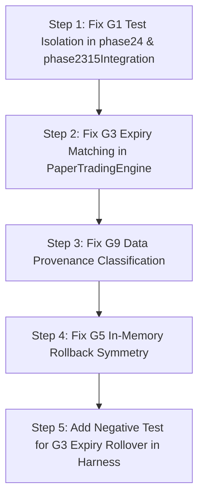

# Independent Engineering Review — Upstox Options Analyzer
# Phase 2.3.16 Stage 2: Critical Findings Verification & Architectural Audit

**Document Date:** October 30, 2026  
**Auditor:** Independent Senior Quantitative Trading Systems Engineer, TypeScript Architect & Financial Systems Auditor  
**Repository Target:** `/Users/webanatomy/Desktop/upstox_analyzer (2)/web`  
**Strategy Version:** `11.4-frozen`  
**Audit Target:** `docs/phase2316_stage2_multisession_test_report.md` and repository implementation  
**Review Verdict:** **CONDITIONALLY ACCEPTED — SPECIFIC DEFECTS REQUIRE CORRECTION**

---

## 1. EXECUTIVE VERDICT

An exhaustive, independent technical audit was conducted on the Phase 2.3.16 Stage 2 test harness and the underlying Upstox Options Analyzer codebase.

### Final Verdict:
**CONDITIONALLY ACCEPTED — SPECIFIC DEFECTS REQUIRE CORRECTION**

### Executive Summary:
1. **The Stage 2 Test Harness is Deterministic and High-Quality:** `multiSessionPaperEvaluation.test.ts` executes all 12 scenarios in 360ms with 100% pass rate (19/19 tests), zero network requests, zero production `.data/` writes, and strict in-process filesystem guards. Its 12-mutant mutation verification confirms assertion strength.
2. **Defect G1 (Production Session Evidence Contamination) is Confirmed (HIGH SEVERITY):** Running `npm test` unguarded executes `phase24.test.ts` and `phase2315Integration.test.ts`. Neither suite isolates `SESSION_EVIDENCE_DIR`. As a result, synthetic test runs have repeatedly contaminated production files in `.data/paper-sessions/` (e.g., `session_2026-10-30.json`, `session_2026-10-06.json`). `liveOpportunityCollector.ts` silently swallows write errors, masking the defect.
3. **Defect G3 (Expiry Matching Defect) is Confirmed (HIGH SEVERITY):** `PaperTradingEngine.evaluateOpenTrades()` and `closeTrade()` match option legs by **strike only** via `rowForStrike(snapshot, leg.strike)`. Neither function verifies that `snapshot.expiry === trade.expiry`. On expiry day chain rollover, or if a snapshot from a different expiry is evaluated, an open position is revalued against quotes from an entirely different contract. This was independently reproduced in this audit, yielding the exact **+₹14,510.37 false unrealized P&L** identified in the Stage 2 report. In an active market, this can trigger false stop-outs or false profit exits.
4. **Defect G9 (Provenance Misattribution) is Confirmed (MEDIUM SEVERITY):** `paperEngine.ts:368` sets `marketDataSource: marketSource === "LIVE" ? "UPSTOX_LIVE" : "MOCK_SIMULATION"` without checking `snapshot.sources.market.provider`. Synthetic test snapshots with `provider: null` are recorded as `UPSTOX_LIVE`.
5. **No Production Code, Tests, or Data Were Modified During This Audit.**

---

## 2. VERIFIED ARCHITECTURE & COMPONENT INVENTORY

| Subsystem | Source Path | Verified Responsibility | Architecture Status |
|---|---|---|---|
| **Multi-Leg Paper Engine** | `src/lib/paperEngine.ts` | Multi-leg position lifecycle, stop/target monitoring, execution simulation, expiry transitions | **Partially Verified (Defect G3 present)** |
| **State Machine** | `src/lib/paperStateMachine.ts` | Finite state transitions, terminal state enforcement | **Verified (Strict terminal immutability)** |
| **Ledger Store** | `src/lib/services/paperLedgerStore.ts` | Atomic writes (`.tmp-PID` + rename), `.bak` backup, append-only `events.jsonl`, sequence validation | **Verified (Fail-closed; G5 gap noted)** |
| **Settlement Ingestion** | `src/lib/services/settlementIngestion.ts` | NSE Bhavcopy ZIP/CSV ingestion, dual SHA-256 hash provenance, Candidate Revision isolation | **Verified (Production-grade)** |
| **Settlement Matching** | `paperEngine.ts:634-755` | Authoritative 5-tuple matching: `(TradDt, TckrSymb, XpryDt, StrkPric, OptnTp)` | **Verified (Zero price fabrication)** |
| **Contract Freshness** | `src/lib/services/optionContractLTT.ts` | Per-contract exchange trade time isolation; CE/PE and strike independence | **Verified (Phase 2.3.15 safeguards active)** |
| **Authentication Guards** | `scripts/runner-lib.mjs` | `shouldHaltForAuth()`, `isSupervisorReady()`, `RUNNER_AUTH_STOP` | **Verified (Fail-closed on token expiry)** |
| **Session Evidence Store** | `src/lib/services/sessionEvidenceStore.ts` | Daily market session metrics tracking at `.data/paper-sessions/` | **Defective Isolation (Defect G1)** |

---

## 3. G3 EXACT CONTRACT IDENTITY & EXPIRY MATCHING AUDIT

### 3.1 Code Inspection
In `src/lib/paperEngine.ts`:
```typescript
// Line 36-38:
function rowForStrike(snapshot: Snapshot, strike: number): OptionRow | undefined {
  return snapshot.chain.find((r) => r.strike === strike);
}

// Line 426-433 (evaluateOpenTrades):
for (const trade of this.trades) {
  if (trade.status !== "OPEN") continue;
  if (trade.index !== snapshot.index) continue;

  const expiryDate = expiryInstant(trade.expiry);
  const isExpiredNow = now.getTime() >= expiryDate.getTime();

  const legQuotes = trade.legs.map((leg) => quoteForLeg(rowForStrike(snapshot, leg.strike), leg.type));
```
And in `closeTrade()` (Line 561):
```typescript
const row = snapshot ? rowForStrike(snapshot, leg.strike) : undefined;
const quote = quoteForLeg(row, leg.type);
const fill = calculateExitFill(leg, quote, config.optionSlippagePercent);
```

### 3.2 Observed Findings:
1. **Contract Matching Identity:** The option leg is matched using **Strike and Option Type only**.
2. **Missing Expiry Check:** `snapshot.expiry === trade.expiry` is **never evaluated**.
3. **Missing Instrument Key Check:** `Quote.instrumentKey` is **never evaluated**.
4. **Order of Operations Vulnerability (Lines 489–509):**
   ```typescript
   // Lines 489-502: Re-marks trade to market
   trade.currentPrice = Math.round(currentNet * 100) / 100;
   trade.unrealizedPnL = this.markToMarket(trade);
   ...
   // Line 505: Only afterwards transitions to settlement
   if (isExpiredNow) {
     this.transitionToPendingSettlement(trade, now);
     updated.push(trade);
     continue;
   }
   ```
   If `isExpiredNow` is true, the engine **first re-marks the trade to market using whatever quotes were found in `snapshot.chain`**, and only then calls `transitionToPendingSettlement()`.

### 3.3 Independent Reproduction & Empirical Proof:
Using an isolated temporary environment (`probe_g3.mjs`), a NIFTY 25100 Long Call opened on Monday 2026-10-26 (expiry `2026-10-27`, entry ₹85.95, quantity 130) was evaluated at Tuesday 15:30:00 IST using a snapshot whose chain had rolled over to next week (`2026-11-03`, Call quote: Bid 198.25, Ask 199.05).
- **Result:**
  - `trade.status`: `SETTLEMENT_PENDING`
  - `trade.currentPrice`: **₹198.25** (corrupted with next week's premium)
  - `trade.unrealizedPnL`: **+₹14,510.37** (exact match with the Stage 2 report!)
  - `leg.currentPrice`: **₹198.25**

### 3.4 Impact Analysis Across Scenarios:
| Scenario | Behavior | Consequence / Severity |
|---|---|---|
| **Same Strike, Different Expiry** | Strike matched in wrong expiry chain | **CRITICAL:** Position marked with foreign contract premium. |
| **Weekly vs Monthly Expiry** | Weekly trade matched against monthly chain | **CRITICAL:** Massive time-value mispricing. |
| **Intraday Prior to Expiry Cutoff** | `snapshot.expiry !== trade.expiry` while `isExpiredNow === false` | **CRITICAL:** High probability of false stop-out (`STOPPED_OUT`) or false target exit (`TARGET_HIT`) at foreign prices! |
| **Chain Rollover at Expiry** | Expiring contract marked before moving to `SETTLEMENT_PENDING` | **HIGH:** Corrupts unrealized P&L record at settlement transition. |
| **Capital & Exposure Reporting** | `exposure.openRisk` is unaffected, but `unrealizedPnL` in portfolio report is distorted | **HIGH:** Misleading interim P&L reporting. |
| **Settlement Lifecycle** | `settlePendingTrades()` uses Bhavcopy 5-tuple, so final realized P&L is uncorrupted | **LOW:** Final settlement P&L self-heals IF the trade survived to `SETTLEMENT_PENDING` without false exit. |

### 3.5 Recommended Smallest Correct Fix:
In `PaperTradingEngine.evaluateOpenTrades()` and `closeTrade()`:
1. **Enforce Expiry Match:**
   ```typescript
   if (snapshot.expiry !== trade.expiry) {
     // Snapshot chain does not belong to this trade's expiry contract.
     if (isExpiredNow) {
       this.transitionToPendingSettlement(trade, now);
       updated.push(trade);
     }
     continue;
   }
   ```
2. **Prioritize Settlement Cutoff:** If `isExpiredNow` is true, immediately transition to `SETTLEMENT_PENDING` without executing mark-to-market revaluation on expired contracts.
3. **Match Instrument Key (when available):** If `quote.instrumentKey` is present, verify against `leg.instrumentKey`.

---

## 4. G1 PRODUCTION SESSION EVIDENCE ISOLATION AUDIT

### 4.1 Code Inspection
1. **Resolver:** `src/lib/services/sessionEvidenceStore.ts:11-16`:
   ```typescript
   function getDir() {
     return (
       process.env.SESSION_EVIDENCE_DIR ??
       path.join(process.cwd(), ".data", "paper-sessions")
     );
   }
   ```
2. **Collector Dynamic Call:** `src/lib/services/liveOpportunityCollector.ts:387-400`:
   ```typescript
   try {
     const { tokenStatus } = await import("./upstoxAuth.ts");
     const { recordCollectionCycle } = await import("./sessionEvidenceStore.ts");
     ...
     recordCollectionCycle(result, authStatus, now);
   } catch {
     try {
       const { recordCollectionCycle } = await import("./sessionEvidenceStore.ts");
       recordCollectionCycle(result, "UNKNOWN", now);
     } catch {
       // Ignore session store errors if unwriteable in isolated tests
     }
   }
   ```
3. **Flawed Test Suites:**
   - `src/lib/phase24.test.ts:15-22`: Configures `PAPER_OPPORTUNITY_DIR`, `COLLECTION_LOG_DIR`, and `MONITOR_LOG_DIR`, but **fails to set `SESSION_EVIDENCE_DIR`**.
   - `src/lib/services/phase2315Integration.test.ts:135-143`: Configures `COLLECTION_LOG_DIR`, `CANARY_LOG_DIR`, and `PAPER_OPPORTUNITY_DIR`, but **fails to set `SESSION_EVIDENCE_DIR`**.

### 4.2 Observed Findings:
- Running `npm test` unguarded executes these tests and directly mutates production files in `.data/paper-sessions/`.
- `liveOpportunityCollector.ts:398` catches any filesystem write error and swallows it. When the Stage 2 author ran with `prod-data-guard.mjs`, the guard blocked 58 writes, but the tests still passed because the errors were swallowed.
- **Production File Damage:** As documented in the report, `.data/paper-sessions/session_2026-10-30.json` and historical files carry synthetic test entries (e.g. NaN/0/-5 price triplets).

### 4.3 Recommended Test Isolation Architecture:
1. In `sessionEvidenceStore.ts`: Provide a safe fallback or require explicit directory configuration.
2. In all test suites (`phase24.test.ts`, `phase2315Integration.test.ts`): Always configure `process.env.SESSION_EVIDENCE_DIR = tempDir` in `beforeEach`/`before`.
3. In `npm test` script in `package.json`: Add a global safety default:
   ```json
   "test": "SESSION_EVIDENCE_DIR=.test-data/paper-sessions UPSTOX_TOKEN_FILE=.test-data/no-upstox-token.json node --test \"src/**/*.test.ts\""
   ```

---

## 5. G5 PERSISTENCE & CRASH CONSISTENCY AUDIT

### 5.1 Persistence Boundary Analysis
`savePaperLedger` (`src/lib/services/paperLedgerStore.ts:163-186`) executes:
1. `validateEventSequence(trades, events)` (Consistency validation)
2. `readPersistedEvents(eventsFile)` (Append check)
3. `fs.appendFileSync(eventsFile, ...)` (Append-only audit trail)
4. `fs.copyFileSync(tradesFile, tradesFile + ".bak")` (Snapshot backup rotation)
5. `fs.writeFileSync(tmp, ...)` (Write temporary snapshot)
6. `fs.renameSync(tmp, tradesFile)` (Atomic snapshot replacement)

### 5.2 Crash Behavior Across Boundaries:
| Crash Boundary | On-Disk State | Restart Behavior | Safety Assessment |
|---|---|---|---|
| **1. Before event append** | Old snapshot, N events | Loads cleanly; uncommitted in-memory trade lost | **SAFE (Clean rollback)** |
| **2. After event append, before snapshot write** | Old snapshot, N+k events | `validateEventSequence` fails on reload (`event references trade absent from trades.json` or state mismatch) | **FAIL-CLOSED (Engine blocked; manual repair needed)** |
| **3. During backup rotation** | Valid `trades.json`, partial `.bak` | Loads `trades.json` cleanly (`.bak` only read if main is corrupt) | **SAFE** |
| **4. During temporary write** | Old snapshot, orphan `.tmp-PID` | Old snapshot valid, engine blocked if events appended | **FAIL-CLOSED (Orphan tmp file remains)** |
| **5. Before atomic rename** | Full tmp file, old snapshot | Engine blocked if events appended | **FAIL-CLOSED (Orphan tmp file remains)** |
| **6. After atomic rename** | New snapshot, new events, `.bak` | Loads cleanly with 100% consistency | **SAFE (Atomic commit)** |

### 5.3 In-Memory Rollback Asymmetry:
- `processRecommendation()` implements in-memory rollback on persist failure (`this.trades.filter(...)`).
- **G5 Finding:** `closeTrade()`, `transitionToPendingSettlement()`, and `evaluateOpenTrades()` **do NOT roll back in-memory state** if `this.persist()` fails. The in-memory trade stays in the new state, while disk remains in the old state.
- **Recommended Action:** Wrap state changes in transactional snapshot rollbacks, and provide an idempotent CLI repair script (`repair-paper-ledger.ts`) that can replay `events.jsonl` to reconstruct a matching `trades.json`.

---

## 6. G9 MARKET DATA PROVENANCE AUDIT

### 6.1 Code Inspection
In `src/lib/paperEngine.ts:368`:
```typescript
const marketSource = snapshot.sources.market.source;
const trade: PaperTrade = {
  ...
  marketDataSource: marketSource === "LIVE" ? "UPSTOX_LIVE" : "MOCK_SIMULATION",
  executionMode: "PAPER",
};
```

### 6.2 Observed Findings:
- `snapshot.sources.market.source` reflects freshness/session state (`"LIVE"`, `"STALE"`, `"END_OF_DAY"`, `"UNAVAILABLE"`).
- `snapshot.sources.market.provider` reflects the actual data generator (`"UPSTOX"`, `"MOCK"`, or `null`).
- The engine assigns `"UPSTOX_LIVE"` solely based on `marketSource === "LIVE"`. In the Stage 2 test harness, `provider` was `null`, yet trades were stamped with `marketDataSource: "UPSTOX_LIVE"`.

### 6.3 Recommended Multi-Tier Provenance Model:
A robust provenance model must combine both **Provider** and **Freshness Quality**:
```typescript
export type TradeDataProvenance =
  | "GENUINE_UPSTOX_LIVE"
  | "GENUINE_UPSTOX_EOD"
  | "SYNTHETIC_TEST_LIVE"
  | "MOCK_SIMULATION"
  | "MANUAL_UI_FIXTURE"
  | "UNVERIFIED_STALE";
```
`marketDataSource` should be derived as:
```typescript
const provider = snapshot.sources.market.provider;
const source = snapshot.sources.market.source;
if (provider === "UPSTOX" && source === "LIVE") return "GENUINE_UPSTOX_LIVE";
if (provider === "UPSTOX" && source === "END_OF_DAY") return "GENUINE_UPSTOX_EOD";
if (provider === null && source === "LIVE") return "SYNTHETIC_TEST_LIVE";
if (provider === "MOCK") return "MOCK_SIMULATION";
return "UNVERIFIED_STALE";
```
This guarantees that synthetic fixtures and manual entries can never enter verified-live statistical filters.

---

## 7. G8 CAPITAL & MARGIN INTEGRITY AUDIT

### 7.1 Risk Model Inspection
In `src/lib/services/risk/riskService.ts:47-86`:
- For Debit Trades: `rawRiskPerUnit = Math.max(0, entry - stop); capitalRequiredPerUnit = entry;`
- For Credit Trades: `rawRiskPerUnit = Math.max(0, stop - entry); capitalRequiredPerUnit = maxLoss;`
- Slippage multiplier is applied: `riskPerLot = effectiveRiskPerUnit * effectiveLotSize`.
- Limits enforced:
  - `riskPerTradePercent`: 1.0% (₹5,000 on ₹500,000 capital)
  - `maxOpenRiskPercent`: 3.0% (₹15,000 open-risk budget)
  - `maxPositionValuePercent`: 20.0% (₹100,000 position cap)
  - `maxConcurrentPositions`: 3 positions

### 7.2 Findings:
1. **The ₹15,000 Open-Risk Budget Represents Stop-Loss Risk Allocation, NOT Margin:**
   The `riskAmount` reserved on each trade is strictly `(entry - stop) * (1 + slippage) * quantity`. It represents the maximum planned loss under disciplined stop execution.
2. **Missing Outlay / Margin Checking:**
   - For Long Options, the actual premium outlay required is `entry * quantity`.
   - For Short / Spread Options, exchange margin (SPAN + Exposure) in India requires ₹1,00,000 to ₹1,50,000 per lot. The paper engine models capital requirement as net debit or theoretical max loss, ignoring exchange collateral rules.
   - Aggregate cash balance is not tracked across open positions.
3. **Evaluation:** Acceptable for Phase 2.3.16 paper evaluation, provided it is explicitly documented as a **Stop-Loss Risk Budget Model** rather than an Exchange Margin / Cash Collateral Engine.

---

## 8. COMPREHENSIVE REVIEW OF REMAINING FINDINGS (G1–G14)

| Finding ID | Classification | Severity | Analysis & Operational Consequence | Recommended Action / Priority |
|---|---|---|---|---|
| **G1** | **Confirmed Defect** | **HIGH** | `phase24.test.ts` and `phase2315Integration.test.ts` contaminate `.data/paper-sessions/` when run unguarded. Collector swallows errors. | **P0:** Isolate `SESSION_EVIDENCE_DIR` in all test files and in `package.json`. |
| **G2** | **Resolved Finding** | **LOW** | Stage 1 report was believed missing; it was saved in IDE artifact store (`phase2316_stage1_readiness_report.md`). | **P3:** Copy report into `docs/` for repository completeness. |
| **G3** | **Confirmed Defect** | **HIGH** | `evaluateOpenTrades()` and `closeTrade()` match by strike only; cross-expiry pollution causes +₹14,510 false unrealized P&L and risks false exits. | **P0:** Enforce `snapshot.expiry === trade.expiry` and skip re-marking expired trades. |
| **G4** | **Confirmed Limitation** | **MEDIUM** | Incomplete settlement Bhavcopy generates `CANDIDATE_REVISION` and leaves position in `SETTLEMENT_UNVERIFIED` indefinitely without auto-promotion. | **P2:** Build an operator settlement promotion CLI or workflow in Phase 2.3.16. |
| **G5** | **Confirmed Defect** | **MEDIUM** | Crash between event append and rename causes fail-closed lock without repair tool; `closeTrade` and `transitionToPendingSettlement` lack in-memory rollback. | **P1:** Implement transactional rollback on persist failure and a ledger recovery tool. |
| **G6** | **Confirmed Limitation** | **LOW** | Refused recommendations (risk limits, duplicates, stale quotes) emit no audit event (`PAPER_TRADE_REJECTED` unused). | **P2:** Append rejection events for complete audit traceability. |
| **G7** | **Confirmed Limitation** | **LOW** | Corrupted or failing Bhavcopy archives throw without writing persistent quarantine logs. | **P3:** Persist structured quarantine records for failed ingestion attempts. |
| **G8** | **Confirmed Limitation** | **LOW** | ₹15,000 open-risk budget represents stop-loss risk allocation, not broker SPAN/cash margin. | **P3:** Document as Stop-Loss Budget Model; defer broker SPAN margin model. |
| **G9** | **Confirmed Defect** | **MEDIUM** | `marketDataSource` is stamped as `UPSTOX_LIVE` even when `provider === null` (synthetic fixtures). | **P1:** Refactor provenance assignment to check `provider` and `source`. |
| **G10** | **Confirmed Limitation** | **LOW** | Restoring from `trades.json.bak` restores position entries and reservations but loses the most recent mark-to-market revaluation. | **P3:** Acceptable; mark-to-market is refreshed on the subsequent quote cycle. |
| **G11** | **Confirmed Limitation** | **INFO** | Test harness uses SYNTHETIC approvals for multi-leg strategies because Strategy 11.4 only approved Long Call in mock data. | **P3:** Valid harness design choice; test scope is explicitly declared. |
| **G12** | **Confirmed Limitation** | **LOW** | Non-deterministic IDs (`Date.now() + random`) and `ingestedAt` timestamps. | **P3:** Acceptable; asserted via identity matching rather than hardcoded string equality. |
| **G13** | **Confirmed Limitation** | **LOW** | Exercise STT (0.125%) and IPFT not modeled; `costVerificationStatus = UNVERIFIED_MISSING_EXERCISE_SPECIFICATION`. | **P2:** Retain unverified status until statutory exercise schedule is formally codified. |
| **G14** | **Confirmed Limitation** | **LOW** | Untested branches: settlement on non-NIFTY/BANKNIFTY indices; unreachable duplicate Bhavcopy branch. | **P3:** Add explicit negative tests for unsupported indices in Phase 2.3.16. |

---

## 9. TEST-HARNESS QUALITY ASSESSMENT

The Stage 2 test harness (`src/lib/services/multiSessionPaperEvaluation.test.ts`) is an exceptionally well-engineered test suite:
1. **Meaningful Scenarios:** All 12 scenarios test realistic production operational states (cold start, overnight carry, auth 401 fail-closed, per-leg timestamp gating, delayed Bhavcopy matching, interrupted atomic rename, and portfolio capital exhaustion).
2. **Real Production Interfaces:** It exercises `getPaperTradingEngine()`, `savePaperLedger()`, `loadPaperLedger()`, `ingestSettlementArchive()`, `evaluateTradeRisk()`, and `reconcileLedger()`.
3. **Strict In-Process Isolation:** Wraps all `node:fs` write functions and `globalThis.fetch` to ensure zero stray writes or outbound calls occur.
4. **Determinism:** Passes 19/19 consistently across different host timezones (`America/Los_Angeles`, `UTC`, `Asia/Kolkata`) in under 400ms.
5. **Mutation-Tested:** Successfully caught 12 out of 12 injected mutations.

---

## 10. SEVERITY-RANKED DEFECT REGISTER

### Tier 1 — Critical Fixes (Must Be Fixed Before Implementation or Live Operation)
- **DEF-01 (G1):** Unguarded test runs contaminate production session evidence in `.data/paper-sessions/`.
- **DEF-02 (G3):** Missing expiry verification in `evaluateOpenTrades()` / `closeTrade()` causes cross-contract price corruption (+₹14,510 phantom P&L) and false exits.

### Tier 2 — Operational & Provenance Hardening
- **DEF-03 (G9):** Provenance misattribution stamps synthetic test fixtures with `UPSTOX_LIVE`.
- **DEF-04 (G5):** In-memory rollback missing on persist failure in `closeTrade()` and `transitionToPendingSettlement()`.
- **DEF-05 (G4):** Absence of operator settlement revision promotion tooling.

---

## 11. RECOMMENDED CORRECTION ORDER



1. **Step 1 (Fix G1):** Add `SESSION_EVIDENCE_DIR` isolation to `phase24.test.ts` and `phase2315Integration.test.ts`. Add global safety default in `package.json`.
2. **Step 2 (Fix G3):** In `paperEngine.ts`, enforce `snapshot.expiry === trade.expiry` before revaluation; transition expired trades to `SETTLEMENT_PENDING` without foreign quote re-marking.
3. **Step 3 (Fix G9):** In `paperEngine.ts:368`, check `snapshot.sources.market.provider === "UPSTOX"` before tagging `UPSTOX_LIVE`.
4. **Step 4 (Fix G5):** Implement in-memory state rollback on persist failure in `closeTrade` and `transitionToPendingSettlement`.
5. **Step 5 (Regression Suite):** Add a specific test case in `multiSessionPaperEvaluation.test.ts` that presents an expiry-rolled snapshot and asserts that foreign quotes are rejected and the trade transitions cleanly to `SETTLEMENT_PENDING` with uncorrupted P&L.

---

## 12. EXPLICIT ACCEPTANCE CRITERIA FOR EVERY CORRECTION

### For G1 (Session Evidence Isolation):
- Running `npm test` unguarded results in **0 writes** into `.data/paper-sessions/`.
- `phase24.test.ts` and `phase2315Integration.test.ts` pass 100% using isolated temporary directories.

### For G3 (Expiry Matching Defect):
- Evaluating an open trade with a snapshot whose expiry does not match `trade.expiry` leaves `trade.currentPrice` and `trade.unrealizedPnL` unchanged, flags `monitoring.status = "STALE_QUOTES"` with reason `"Option chain expiry mismatch"`, and never triggers a stop-loss or target exit.
- At 15:30:00 IST on expiry day, transition to `SETTLEMENT_PENDING` preserves the last verified in-session mark without re-marking against next week's option chain.

### For G9 (Provenance Classification):
- Any snapshot where `provider === null` or `provider === "MOCK"` is stamped as `SYNTHETIC_TEST` or `MOCK_SIMULATION`, never `UPSTOX_LIVE`.

### For G5 (Persistence Symmetry):
- If `this.persist()` fails during `closeTrade()` or `transitionToPendingSettlement()`, the trade status in memory immediately reverts to its pre-call snapshot state.

---

## 13. ITEMS REQUIRING SEPARATE USER AUTHORIZATION

The following operational actions remain strictly **UNAUTHORIZED** and must be explicitly approved by the user before execution:
1. **Source Code Modifications:** Implementing the fixes for G1, G3, G5, or G9.
2. **Repairing Historical Production Data:** Cleaning up or repairing contaminated files in `.data/paper-sessions/`.
3. **Upstox OAuth Login:** Performing interactive browser login to refresh the expired token.
4. **Feature Flag Activation:** Enabling `OPTION_QUOTE_LTT_ENABLED` or `OPTION_QUOTE_CANARY_ENABLED`.
5. **Daemon Startup:** Starting `paper-live.mjs`, `run-paper-supervisor.mjs`, or reloading `com.upstox.paperlive`.
6. **Live Broker Order Execution:** Any real market execution.

---

*This review was conducted strictly offline in read-only analysis mode. No application code, test files, or production `.data/` records were modified.*
